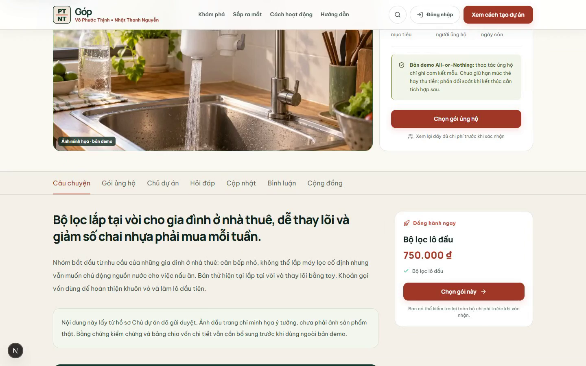
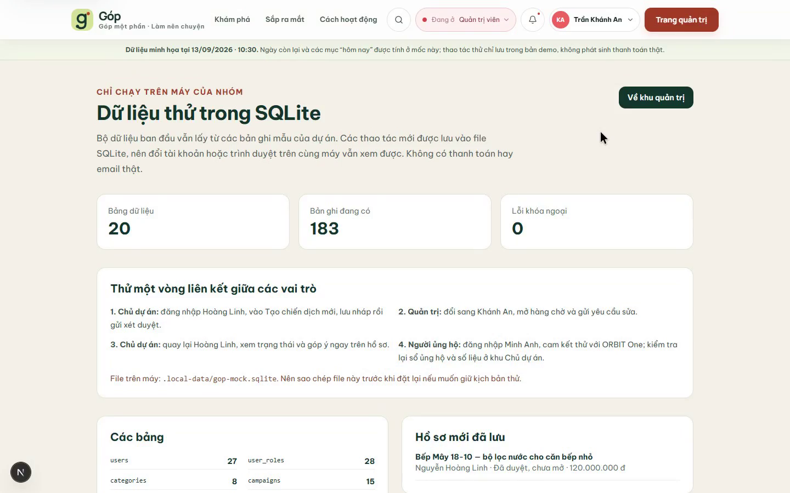

# Video demo chiến dịch trên SQLite local

## Bản có lời dẫn ngày 01/11/2026

[Xem video demo Góp có tiếng Việt](./gop-demo-co-loi-dan-2026-11-01.mp4) · khoảng **9 phút 22 giây** · 1440 × 900 · có phụ đề tiếng Việt nhúng. Quay từ Chrome chạy web local và DB riêng `gop-video-20261101.sqlite`: Bếp Mây đi từ lưu nháp, duyệt, mở gọi vốn tới cam kết 950.000 đ của Minh Anh, câu hỏi, lời mời/cập nhật của Gia Huy, rồi đối chiếu mã chiến dịch và khóa ngoại trong SQLite. Video còn điểm qua các khu AI ở mức dữ liệu mẫu, nhánh không nhận quà, giao quà mẫu, người dùng và phí.

[Nhật ký từng cảnh và việc cần sửa](./NHAT_KY_QUAY_2026-11-01.md) · [Mốc thời gian](./MOC_VIDEO_2026-11-01.md) · [Lời dẫn](./LOI_DAN_2026-11-01.md) · [Phụ đề rời](./gop-demo-co-loi-dan-2026-11-01.srt) · [Đối chiếu record](./DB_KIEM_TRA_2026-11-01.json) · [SQLite snapshot mang sang máy khác](./gop-video-snapshot-2026-11-01.sqlite). Hai video không tiếng bên dưới là các lần quay cũ, nên dùng bản mới khi giới thiệu hiện trạng.

## Bản quay mới ngày 21/10: theo dõi cùng chiến dịch qua bốn vai trò

[Xem video MP4 mới](./demo-nhat-ky-roles-2026-10-21.mp4) · 3 phút 17 giây · không có tiếng. Đây là màn hình web local đang chạy, không phải ảnh dựng. WebM gốc của tab thao tác được giữ riêng trên máy ở `output/playwright/demo-nhat-ky-roles-2026-10-21-source.webm` (thư mục bỏ qua Git, không đưa lên Vercel); bản MP4 chỉ rút ngắn 25 khoảng màn hình đứng yên bằng `scripts/compact-role-demo-video.py`.

Video đi qua: Quản trị viên xem quan hệ SQLite và mở hộp thoại đặt lại (chỉ hủy, **không xóa**); xem lịch sử hồ sơ tạo mới; đổi sang Chủ dự án đọc nhật ký ORBIT; Cộng tác viên hoàn tất một việc được giao và thấy mục việc nhóm của mình; Người ủng hộ Minh Anh chọn gói số 150.000 đ, xác nhận **cam kết mẫu không thu tiền**, rồi mở nhật ký chỉ thấy cam kết của mình. Màn tạo hồ sơ và vòng sửa v1/v2 dài hơn nằm ở [video trước](./video-demo-chien-dich-sqlite-local.mp4); bản quay mới tập trung vào tiến độ, phân quyền và chi tiết UI.

Sau khi xem lại video, luồng gói số đã được rút từ bốn bước xuống ba bước; bản MP4 này vẫn thể hiện giao diện tại thời điểm quay. Gói vật lý giữ bốn bước vì cần chọn giao hàng và nhập địa chỉ.

Ba ảnh từ web đang chạy: [Admin](./nhat-ky-admin-thuc-te.png), [Cộng tác viên](./nhat-ky-cong-tac-vien-thuc-te.png), [Người ủng hộ](./nhat-ky-nguoi-ung-ho-thuc-te.png). [Nhận xét sau khi xem video](./danh-gia-video-2026-10-21.md) ghi cả lỗi đã sửa và phần còn thiếu; không dùng các ảnh này làm bằng chứng cổng thanh toán hay AI thật.

---

[Mở video MP4](./video-demo-chien-dich-sqlite-local.mp4) · 4 phút 28 giây · 1440 × 900 · không có tiếng.

Video được quay từ giao diện đang chạy ở `localhost:3000`. Các khoảng đứng yên khi chờ công cụ đã được cắt ngắn; thao tác trên web, trạng thái và số tiền không được dựng lại bằng ảnh giả. Khi thuyết trình, có thể tạm dừng ở mỗi thẻ chương để giải thích.

| Mốc gần đúng | Nội dung |
| --- | --- |
| 00:00 | Giới thiệu bản local và lưu ý không có thanh toán thật. |
| 00:04 | Chủ dự án Hoàng Linh tạo hồ sơ Bếp Mây, lưu nháp, khai báo gói quà/phần bổ sung rồi gửi v1. |
| 01:10 | Quản trị viên Khánh An mở hàng chờ, đọc nội dung và yêu cầu làm rõ phần rủi ro. |
| 02:01 | Hoàng Linh nhận đúng góp ý, sửa kế hoạch kiểm tra lõi lọc và giao hai đợt, gửi v2; Khánh An duyệt. |
| 02:55 | Cộng tác viên Gia Huy đăng bản tin trên ORBIT One. |
| 03:13 | Minh Anh xem bản tin công khai, chọn gói Early Bird và ghi cam kết mẫu. |
| 04:00 | Đối chiếu trang SQLite: 20 bảng, 183 bản ghi, 0 lỗi khóa ngoại lúc quay. |
| 04:24 | Giới hạn của bản demo. |

## Hai chiến dịch trong video

**Bếp Mây 18-10** là hồ sơ mới do Hoàng Linh tạo. Mục tiêu 120.000.000 đ trong 30 ngày, một gói quà 750.000 đ, phần bổ sung 120.000 đ và phí giao 30.000 đ. Quản trị yêu cầu sửa v1, sau đó duyệt v2. Trạng thái cuối là `PRE_LAUNCH`: **đã duyệt hồ sơ nhưng chưa có trang công khai để nhận cam kết**.

**ORBIT One** là chiến dịch LIVE có sẵn trong bộ dữ liệu mẫu. Gia Huy đăng cập nhật tại khu Cộng tác viên; Minh Anh thấy tin trên trang dự án rồi chọn gói 3.890.000 đ + phụ kiện 320.000 đ + góp thêm 100.000 đ + giao hàng 35.000 đ = **4.345.000 đ**. Mã cam kết trong lần quay là `authz_1131d68a`. Đây chỉ là `AUTHORIZED` mô phỏng, chưa giữ hay thu tiền.

Hai nhánh này dùng cùng server SQLite local, nhưng **không phải** câu chuyện “tạo Bếp Mây xong là người ủng hộ có thể đặt quà Bếp Mây”. Tính năng công bố hồ sơ mới vẫn cần làm tiếp. Nếu thầy hỏi, nên nói thẳng điều này.

## Chạy lại trên máy

1. Tại thư mục dự án chạy `pnpm install` nếu chưa cài gói, rồi `pnpm dev`.
2. Mở `http://localhost:3000/auth`, dùng nút đăng nhập nhanh cho từng vai trò. Trang `http://localhost:3000/local-data` dành cho Quản trị viên xem dữ liệu liên kết.
3. Dữ liệu hiện hành nằm trong `.local-data/gop-mock.sqlite`. Đừng bấm **Đặt lại dữ liệu đã thử** nếu còn muốn giữ kịch bản trong video. Trước lần quay lại từ đầu, sao lưu file SQLite bằng công cụ SQLite backup hoặc khi đã dừng server.

Ảnh chụp thật ở cuối video:

## Những chỗ chưa nên nói quá

- SQLite này phục vụ thử trên máy của nhóm; bản Vercel không ghi vào file SQLite này. Cách mô phỏng hiện tại có các bảng quan hệ và `platform_state`/`user_preview_state` dạng snapshot, chưa phải backend production.
- Trong lần quay, bảng `campaign_reviews` cuối cùng giữ quyết định `APPROVED` ở bản gửi v2. Việc lưu lịch sử v1/v2 bất biến để audit đầy đủ vẫn cần hoàn thiện, dù giao diện đã cho thấy vòng yêu cầu sửa → gửi lại → duyệt.
- Cập nhật cộng tác viên, số liệu biểu đồ, dự báo và một số nội dung khác vẫn dựa trên lớp dữ liệu demo. Không nên mô tả chúng như kết quả xử lý từ toàn bộ cơ sở dữ liệu quan hệ.
- Video không ghi cửa sổ terminal khởi động server; bước chạy `pnpm dev` được ghi ở trên. Không có email, ảnh kiểm thử thật, cổng thanh toán hay giao hàng thật.

Xem thêm [cách thử SQLite và truy vấn kiểm tra](../local-mock-database.md).
