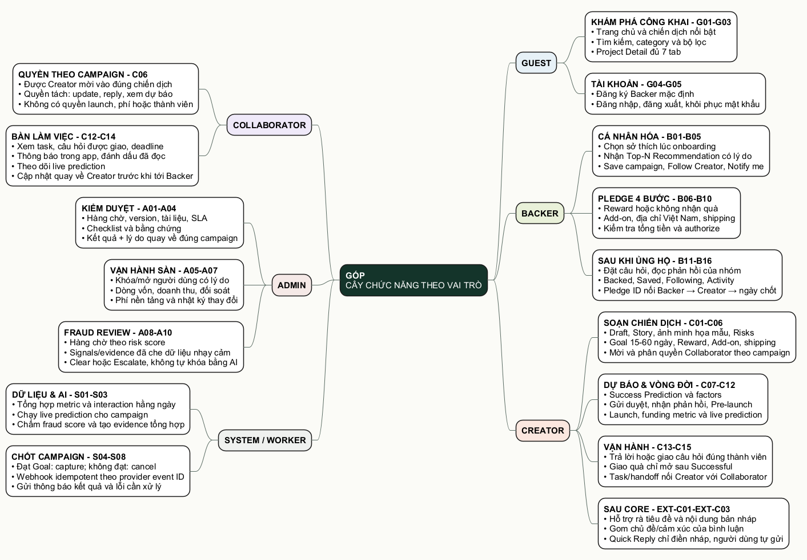

# 01. Cây chức năng theo vai trò



- [Mở file Draw.io để chỉnh](./diagrams/01-cay-chuc-nang-theo-role.drawio)
- [Mở ảnh SVG](./diagrams/01-cay-chuc-nang-theo-role.svg)
- [Mở mã nguồn PlantUML](./diagrams/01-cay-chuc-nang-theo-role.puml)

## Cách nhóm chia chức năng

```text
Góp Crowdfunding Platform
├── Guest
│   ├── Khám phá công khai: UC-G01 → UC-G03
│   └── Tài khoản: UC-G04 → UC-G05
├── Backer
│   ├── Cá nhân hóa: UC-B01 → UC-B05
│   ├── Pledge bốn bước: UC-B06 → UC-B10
│   └── Sau khi ủng hộ: UC-B11 → UC-B16
├── Creator
│   ├── Soạn chiến dịch: UC-C01 → UC-C06
│   ├── Dự báo và vòng đời: UC-C07 → UC-C12
│   ├── Vận hành: UC-C13 → UC-C15
│   └── Sau phần lõi: EXT-C01 → EXT-C03
├── Collaborator
│   ├── Quyền theo từng campaign: một phần UC-C06
│   └── Dự báo, Update, reply: UC-C12 → UC-C14
├── Admin
│   ├── Kiểm duyệt: UC-A01 → UC-A04
│   ├── Vận hành sàn: UC-A05 → UC-A07
│   └── Fraud review: UC-A08 → UC-A10
└── System / Worker
    ├── Daily metric, prediction và fraud scoring: UC-S01 → UC-S03
    └── Chốt All-or-Nothing: UC-S04 → UC-S08
```

Collaborator không phải global role để tự tạo chiến dịch. Người này được Creator mời vào một campaign cụ thể và chỉ thấy đúng nhóm quyền được cấp. Đây là điểm nhóm giữ xuyên suốt Use Case, schema và UI.

## Quy ước ưu tiên

- `G/B/C/A/S`: 54 Use Case trong phạm vi chính, phải trình bày và truy vết được.
- `EXT`: phần nhóm chủ động bổ sung sau khi luồng chính ổn. Nếu thiếu thời gian có thể giảm phần này trước.
- Collaborator dùng chung C06, C12–C14 nhưng quyền luôn đi kèm `campaign_id`; không cộng thêm Use Case chỉ để tăng số lượng.
- Một chức năng chỉ được tính là “có demo” khi mở được đúng route, đọc đúng record và thao tác không vượt quyền.

## Bảng truy vết chức năng sang bản demo

| Nhánh | Mã Use Case | Điểm vào giao diện | Tình trạng ở bản demo |
|---|---|---|---|
| Danh sách, tìm kiếm, chi tiết 7 tab | G01–G03 | `/`, `/discover`, `/projects/[slug]` | Có dữ liệu mock và nhiều trạng thái campaign. |
| Đăng ký, đăng nhập, khôi phục | G04–G05 | `/auth`, `/auth/forgot-password` | Có session preview và bốn tài khoản đăng nhập nhanh. Chưa có dịch vụ email thật. |
| Chọn sở thích, Recommendation | B01–B02 | `/onboarding`, trang chủ sau đăng nhập | Có Top-N, reason và dữ liệu cold-start ở phiên demo. Chưa chạy model thật. |
| Save, Follow, Notify | B03–B05 | Project Detail, `/dashboard` | Thao tác được và giữ trong phiên đăng nhập. |
| Pledge bốn bước | B06–B10 | `/pledge/[slug]` | Có Reward, Add-on, địa chỉ Việt Nam, tổng tiền tính lại và kết quả `AUTHORIZED`. Không dùng tiền thật. |
| Bình luận, hỏi đáp, tin nhắn | B11–B12, B15 | Project Detail, `/dashboard?tab=messages` | Backer hỏi từ lúc Sắp mở; lời đáp của nhóm hiện tại tab Bình luận. Có lưu SQLite/cookie demo, chưa lưu PostgreSQL. |
| Backed, fulfillment, khu vực cá nhân | B13–B16 | `/dashboard` | Có cả `AUTHORIZED`, `CAPTURED`, `CANCELED`; mốc tiếp theo không bị lẫn. |
| Wizard chiến dịch | C01–C06 | `/creator/campaigns/new` | Wizard năm bước, dữ liệu mẫu có thể nạp, có quản lý Reward/Add-on/Shipping/Team. |
| Prediction và vòng đời | C07–C12 | `/creator/ai`, màn quản lý campaign | Có model card, factors, timeline và live metrics. Job AI/backend thật chưa có. |
| Update, reply, phân công câu hỏi, fulfillment | C13–C15 | `/creator/.../manage` | Creator giao câu chưa đáp cho thành viên cùng chiến dịch đã nhận lời mời và có `canReply`; ORBIT Live khóa giao quà, ORBIT Drip Successful có đơn mẫu. |
| Bàn làm việc Collaborator | C06, C12–C14 | `/collaborator`, `/account?tab=notifications`, `/collaborator/forecast`, `/collaborator/.../manage` | Task/handoff theo ORBIT; hồ sơ mới hiện câu hỏi giao đúng người, thông báo trong app có trạng thái đọc và nút đến phần trả lời. |
| Duyệt campaign | A01–A04 | `/admin` → Duyệt chiến dịch | Có version, tài liệu, SLA, checklist và quyết định kèm lý do. |
| User, dòng vốn, phí | A05–A07 | `/admin` → Tổng quan / Người dùng / Phí & nhật ký | Có số liệu, form và audit response mock. |
| Fraud queue | A08–A10 | `/admin` → Cảnh báo gian lận | Có risk score, signals, note, Clear/Escalate; AI không tự khóa. |
| Worker và All-or-Nothing | S01–S08 | Database Schema + trạng thái trên Backer/Creator/Admin | Mới mô phỏng kết quả và contract. Scheduler, Stripe webhook và notification worker chưa chạy thật. |

## Mối nối nhanh sang dữ liệu

| Vai trò | Khóa quan hệ phải giữ | Dữ liệu đi xuyên màn hình |
|---|---|---|
| Guest | `campaign_id`, `category_id`, `creator_user_id` | Danh sách và Project Detail phải cùng trạng thái, Goal và số tiền đã góp. |
| Backer | `user_id`, `pledge_id`, `reward_id`, `payment_authorization_id` | Một cam kết giữ nguyên tổng tiền và trạng thái từ kết quả pledge tới dashboard. |
| Creator | `campaign_id`, `prediction_id`, `task_id`, `comment_id`, `fulfillment_id` | Tiến độ, dự báo, câu hỏi được giao, việc nhóm và giao quà đều thuộc đúng campaign. |
| Collaborator | `campaign_id + user_id`, `task_id`, `comment_id`, `handoff_id` | Quyền và câu hỏi được giao phải khớp với Creator; hết quyền trả lời thì không hiện việc chờ. |
| Admin | `review_id`, `alert_id`, `actor_user_id`, `campaign_id` | Hàng chờ luôn truy được về chiến dịch, người tạo và quyết định của Admin. |
| System/Worker | `provider_event_id`, `campaign_id`, `snapshot_at` | Chốt campaign và xử lý payment không được chạy lặp; số liệu phải cùng mốc snapshot. |

## Luồng bàn giao được hiện ngay trên bốn workspace

| Không gian | Chuỗi người dùng nhìn thấy | Mục đích |
|---|---|---|
| Backer | Minh Anh → giữ hạn mức → ORBIT ghi nhận → hệ thống chốt | Biết tiền đang ở đâu và khi nào mới bị thu. |
| Creator | Hồ sơ đã duyệt → cộng đồng cam kết → nhóm xử lý → ngày chốt | Biết dữ liệu vào xưởng từ đâu và việc nào phát sinh tiếp. |
| Collaborator | Creator giao → Gia Huy làm → Creator nhận lại → Backer thấy phần công khai | Không nhầm Collaborator là một Creator thứ hai. |
| Admin | Creator gửi → AI/worker xếp ưu tiên → Admin quyết định → trả trạng thái + audit | Làm rõ AI không tự duyệt hoặc tự khóa. |

Các chuỗi này chỉ là cách trình bày quan hệ đã có trong schema. Chúng không tạo thêm Use Case mới và không làm thay đổi quyền của từng role.

Bảng đầy đủ Role → UC → dữ liệu → UI → kiểm tra nằm ở `06-ma-tran-truy-vet-thuc-thi.md`.

## Phần mở rộng đang để riêng

| Mã mở rộng | Chức năng | Lý do không nhập vào lõi |
|---|---|---|
| EXT-C01 | Hỗ trợ cải thiện tiêu đề/mô tả | Không thuộc ba module AI bắt buộc; chỉ đưa gợi ý, không tự thay nội dung. |
| EXT-C02 | Phân tích chủ đề và cảm xúc bình luận | Hỗ trợ vận hành cộng đồng sau khi chức năng lõi ổn định. |
| EXT-C03 | Gợi ý câu trả lời nhanh | Chỉ điền bản nháp; Creator/Collaborator vẫn phải đọc và bấm gửi. |

Ba phần trên dùng prompt có version, input snapshot và `requiresHumanReview`. Chi tiết nằm ở `08-chuan-prompt-va-human-review.md`. Nếu thời gian bị thiếu, nhóm ưu tiên hoàn chỉnh 54 UC trước rồi mới nâng chất lượng ba phần `EXT`.
