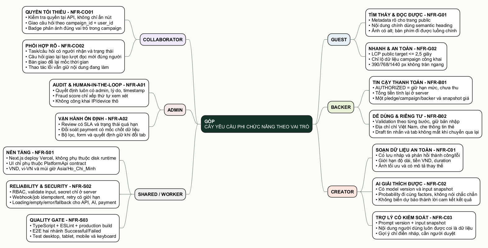

# 02. Cây yêu cầu phi chức năng theo vai trò

- [Mở file Draw.io để chỉnh](./diagrams/02-cay-phi-chuc-nang-theo-role.drawio)
- [Mở ảnh SVG](./diagrams/02-cay-phi-chuc-nang-theo-role.svg)
- [Mở mã nguồn PlantUML](./diagrams/02-cay-phi-chuc-nang-theo-role.puml)

Phi chức năng không phải một danh sách chung chung kiểu “nhanh, đẹp, an toàn”. Nhóm gắn từng tiêu chí vào người chịu ảnh hưởng và ghi cách kiểm tra được. Cột trạng thái có mốc gốc 14/09/2026 và cập nhật riêng cho luồng câu hỏi ngày 30/10; không phải cam kết đã có backend production.

Quy ước trạng thái: **Đã kiểm tra** là có lệnh hoặc thao tác tái hiện được; **Có mô phỏng** là UI/contract đúng nhưng chưa có dịch vụ thật; **Chưa đo/nối thật** là phần còn lại, không gộp vào kết quả đã xong.

## Ma trận tiêu chí

| Mã | Vai trò | Tiêu chí chấp nhận | Hiện trạng |
|---|---|---|---|
| NFR-G01 | Guest | Heading có thứ tự, ảnh nội dung có `alt`, luồng khám phá/đăng nhập dùng được bằng bàn phím. | Một phần – semantic và alt đã có, cần chạy audit bàn phím toàn tuyến. |
| NFR-G02 | Guest | Không tràn ngang ở 390/768/1440 px; LCP trang public mục tiêu không quá 2,5 giây trên cấu hình test đã ghi nhận. | Có smoke test 390 và 1440; còn tablet 768 và LCP có hồ sơ. |
| NFR-B01 | Backer | `AUTHORIZED` luôn ghi “chưa thu”; tổng tiền được tính lại ngoài UI; một Backer chỉ có một pledge đang hiệu lực trên một campaign. | Một phần – copy và mock route đã đúng; unique constraint có trong thiết kế, chưa có DB chạy thật. |
| NFR-B02 | Backer | Form báo lỗi tại trường, giữ bước đang nhập, chỉ nhận địa chỉ Việt Nam và không hiển thị dữ liệu thẻ thô. | Đã có trên luồng mock; vẫn cần test refresh/mạng lỗi. |
| NFR-C01 | Creator | Có lưu nháp, giới hạn Goal/Duration, phản hồi lỗi rõ; media được tối ưu và có mô tả thay thế. | Một phần – validation và draft mock đã có; upload/storage thật chưa làm. |
| NFR-C02 | Creator | Mỗi dự báo có model version, thời điểm chạy, input snapshot và factors; không dùng câu khẳng định chắc chắn. | Có trên mock và schema; chưa có pipeline FastAPI thật. |
| NFR-C03 | Creator/Collaborator | Trợ lý ngôn ngữ có prompt version, coi nội dung người dùng là dữ liệu và không tự thay/đăng kết quả. | Có contract + UI minh bạch ở mock; chưa nối LLM thật. |
| NFR-CO01 | Collaborator | Quyền gắn `campaign_id + user_id`; API phải từ chối thao tác ngoài quyền dù người dùng tự gọi request. Câu hỏi chỉ giao cho người đã nhận lời mời và có `canReply`. | Đã kiểm trên mock API cho cả ca sai role, sai campaign, sai người và câu đã trả lời. SQLite dùng FK ghép; chưa có backend đa người dùng. |
| NFR-CO02 | Collaborator | Task có người nhận, deadline, trạng thái; handoff giữ người gửi, người nhận và thời gian. Câu hỏi được giao phải hiện đúng người, có trạng thái đọc và rời hàng chờ sau khi nhóm đáp. | Task/handoff vẫn theo dữ liệu mẫu; câu hỏi và thông báo trong app đã thử trên SQLite riêng/cookie demo và browser mobile. Chưa có email/push/realtime. |
| NFR-A01 | Admin | Mọi quyết định có actor, lý do, timestamp; fraud score chỉ xếp hàng chờ; UI không lộ IP/device thô. | Có trên UI mock và schema audit; chưa có log bất biến ở backend. |
| NFR-A02 | Admin | Review có SLA, nhìn ra quá hạn; đối soát có mốc chốt; filter/form không mất khi đổi tab. | Query tab đã sửa; review/fraud giữ sau reload. Còn E2E form và filter đầy đủ. |
| NFR-S01 | Shared | Next.js chạy được trên Vercel; chế độ cookie demo không ghi file runtime; UI phụ thuộc `PlatformApi`; tiền VND, locale `vi-VN`, múi giờ Việt Nam. | Production build 47 route đã qua 30/10; SQLite chỉ dùng local, deploy Vercel thật chưa xác nhận. |
| NFR-S02 | Shared | RBAC ở server, validate input, secret chỉ ở server; webhook/job idempotent và retry có giới hạn; có loading/empty/error/fallback. | Một phần – error state và schema event unique đã có; backend/worker thật chưa làm. |
| NFR-S03 | Nhóm phát triển | `tsc`, ESLint, production build; E2E hai nhánh Successful/Failed; test desktop/tablet/mobile/keyboard. | Type/lint/build, test luồng câu hỏi SQLite/cookie và UI control audit qua 30/10; còn full E2E, tablet và keyboard audit. |

## Các quy tắc không được phá

1. AI chỉ hỗ trợ quyết định. Creator quyết định sửa nội dung; Admin quyết định Clear/Escalate; không có thao tác tự khóa do model.
2. Nội dung do người dùng nhập không được phép thay đổi chỉ dẫn hệ thống của trợ lý; mọi gợi ý ngôn ngữ đều có `prompt_version` và cần người duyệt.
3. Tiền được lưu bằng số nguyên VND. UI format dấu chấm/ngăn cách chỉ là phần hiển thị.
4. Khi campaign còn `LIVE`, Backer nhìn thấy `ĐANG GIỮ HẠN MỨC · CHƯA THU`, Creator nhìn thấy danh sách giữ chỗ, chưa có đơn giao.
5. Khi campaign `FAILED`, authorization chuyển `CANCELED`, fulfillment không được sinh ra.
6. Khi campaign `SUCCESSFUL`, payment mới được `CAPTURED`, sau đó mới mở survey/address/fulfillment.
7. Nút bị ẩn không thay thế kiểm tra quyền tại API.
8. Một chỉ số chỉ được gọi là “đã kiểm tra” khi có route, kích thước màn hình, thời điểm và kết quả đi kèm.

## Checklist kiểm tra trước buổi demo

- Đăng nhập lần lượt bốn tài khoản nhanh và kiểm tra đúng trang đích.
- Đi từ Guest → Project Detail → Pledge → kết quả `AUTHORIZED`.
- Đối chiếu cam kết ORBIT của Minh Anh ở Backer và Creator.
- Đối chiếu task của Gia Huy ở Creator và Collaborator.
- Mở nhánh campaign thành công và thất bại để chứng minh All-or-Nothing.
- Gọi route Collaborator bằng role sai và xác nhận API trả `403`; lặp lại khi chuyển sang backend thật.
- Kiểm tra focus, menu mobile, form lỗi, empty state và thông báo `aria-live`.
- Chạy TypeScript, ESLint, production build và ghi lại vào `PROGRESS.md`.
