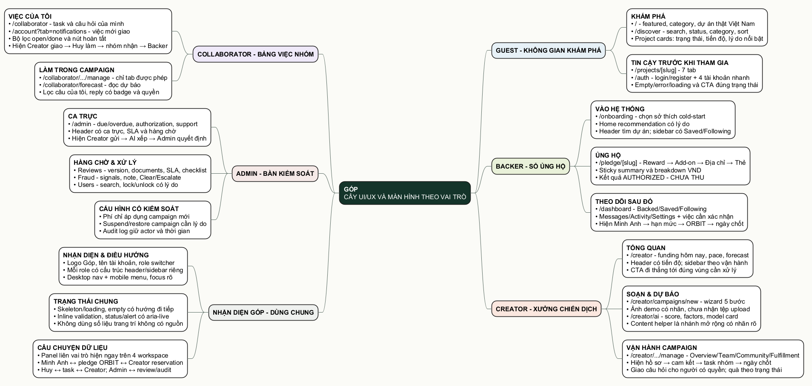

# 03. Cây UI/UX và màn hình theo vai trò



- [Mở file Draw.io để chỉnh](./diagrams/03-cay-ui-ux-theo-role.drawio)
- [Mở ảnh SVG](./diagrams/03-cay-ui-ux-theo-role.svg)
- [Mở mã nguồn PlantUML](./diagrams/03-cay-ui-ux-theo-role.puml)

## Ý đồ khác nhau của từng workspace

Giao diện có thể dùng chung logo, font, button và hệ spacing, nhưng không nên chỉ đổi màu rồi gọi là “khác role”. Nhóm chia theo công việc thật của từng người:

| Role | Cảm giác chính | Người dùng cần nhìn thấy đầu tiên | Cách tổ chức |
|---|---|---|---|
| Guest | Không gian khám phá ý tưởng Việt | Dự án đáng chú ý, trạng thái thật, lý do nên xem | Ảnh lớn, thẻ nội dung, category và lời mời tham gia vừa đủ. |
| Backer | Sổ cam kết cá nhân | Việc cần xác nhận, tiền đã/chưa thu, mốc tiếp theo | Dòng thời gian và trạng thái cam kết dễ đọc hơn biểu đồ. |
| Creator | Xưởng chiến dịch | Tiến độ hôm nay, tốc độ cần đạt, dự báo và việc gấp | Dashboard theo campaign, CTA đi thẳng tới đúng khu vực xử lý. |
| Collaborator | Bảng việc nhóm | Việc của mình, quyền đang có, nội dung cần bàn giao | Task queue gọn, ít số liệu tài chính, không có nút của Owner. |
| Admin | Bàn kiểm soát dựa trên bằng chứng | Hồ sơ gần SLA, cảnh báo rủi ro, dòng vốn cần đối soát | Queue đậm thông tin, luôn kèm actor/lý do/thời gian. |

## Mối nối liên vai trò phải nhìn thấy được

Mỗi dashboard chính có một khối nhỏ giải thích dữ liệu vừa đến từ đâu và sẽ đi đâu tiếp theo. Nội dung giống nhau ở quan hệ, nhưng cách kể theo đúng việc của từng người:

- Backer thấy dạng dòng tiền cá nhân: đã cam kết, ngân hàng giữ hạn mức, Creator chỉ thấy chỗ đã giữ, hệ thống chốt vào ngày kết thúc.
- Creator thấy dạng dây chuyền vận hành: hồ sơ được duyệt, cộng đồng đặt câu hỏi hoặc cam kết, nhóm nhận việc và mốc All-or-Nothing.
- Collaborator thấy dạng bàn giao task và câu hỏi: ai giao, mình đang làm gì, trạng thái quay về Creator và nội dung nào mới tới Backer.
- Admin thấy dạng quyết định có kiểm soát: hồ sơ/tín hiệu đi vào hàng chờ, AI xếp ưu tiên, Admin ghi lý do rồi trả kết quả về campaign.

Khối này dùng ID và số liệu từ read model đang có. Nó không cho role này mở màn hình riêng tư của role khác.

## Header và sidebar không dùng chung một khuôn

| Workspace | Header riêng | Sidebar riêng | Dữ liệu làm căn cứ |
|---|---|---|---|
| Backer | Tìm dự án, nhận diện Minh Anh, lối vào ủng hộ | Dự án đã góp, đã lưu, đang theo dõi, tin nhắn | Pledge, saved campaign, followed creator và message của cùng Backer. |
| Creator | Tên chiến dịch đang chọn, tiến độ và trạng thái | Tổng quan, câu hỏi cộng đồng, tạo chiến dịch và vận hành | Campaign snapshot, prediction, task, câu hỏi được giao, team và reservation. |
| Collaborator | Tên campaign, nhóm đang tham gia và số việc mở | Việc hôm nay, câu hỏi được giao, thông báo trong app | Campaign membership, permission, task, handoff và câu hỏi của đúng người. |
| Admin | Ca trực, SLA, cảnh báo và mốc snapshot | Tổng quan, review, fraud, user, phí và nhật ký | Review queue, fraud evidence, user relation và platform setting. |

Trên mobile, sidebar chuyển thành dải điều hướng ngang trong đúng workspace; nội dung chính không bị đẩy ra ngoài 390 px. Việc đổi role vẫn đi qua session và quyền tài khoản, không phải nút đổi màu để xem thử.

## Cây điều hướng chi tiết

```text
Guest
├── /                         Trang chủ và dự án đang được quan tâm
├── /discover                 Tìm kiếm, category, status, sort
├── /projects/[slug]          7 tab: Story / Rewards / Creator / FAQ / Updates / Comments / Community
├── /auth                     Đăng nhập, đăng ký, 4 tài khoản nhanh
└── /auth/forgot-password     Yêu cầu khôi phục

Backer
├── /onboarding               Chọn sở thích ban đầu
├── /                         Recommendation có reason
├── /pledge/[slug]            Reward → Add-on → Địa chỉ → Thẻ thử nghiệm
├── /dashboard
│   ├── Dự án đã ủng hộ       Authorized / Captured / Canceled
│   ├── Đã lưu
│   ├── Đang theo dõi
│   ├── Tin nhắn
│   ├── Hoạt động
│   └── Cài đặt
└── /account                  Hồ sơ và sở thích

Creator
├── /creator                  Snapshot gọi vốn, pace, forecast, task, team
├── /creator/campaigns/new    Wizard 5 bước, chọn ảnh minh họa mẫu hoặc để trống
├── /creator/ai               Success Prediction + model card
└── /creator/campaigns/[slug]/manage
    ├── Tổng quan
    ├── Nội dung & nhóm
    ├── Cập nhật, bình luận & phân công câu hỏi
    └── Giao quà

Collaborator
├── /collaborator             Task queue, handoff và số câu hỏi của tôi
├── /collaborator/forecast    Live prediction chỉ đọc
├── /account?tab=notifications Câu hỏi mới giao, đã đọc, đã có phản hồi
└── /collaborator/campaigns/[slug]/manage
    └── Việc được giao, lọc câu của tôi và hành động được cấp quyền

Admin
└── /admin
    ├── Tổng quan ca trực
    ├── Duyệt chiến dịch
    ├── Cảnh báo gian lận
    ├── Người dùng
    └── Phí & nhật ký
```

## Trạng thái nhỏ nhất phải có trên màn hình

| Khu vực | Loading | Empty | Lỗi | Thành công / trạng thái đặc biệt |
|---|---|---|---|---|
| Discover | Skeleton thẻ | Không có kết quả + xóa bộ lọc | Không tải được + thử lại | Có tổng kết bộ lọc đang áp dụng. |
| Project Detail | Khung nội dung | Tab chưa có Update/FAQ | Campaign không tồn tại | CTA đổi theo `LIVE`, `PRE_LAUNCH`, `SUCCESSFUL`, `FAILED`. |
| Pledge | Giữ bước hiện tại | Không có Reward vẫn cho ủng hộ không nhận quà | Lỗi field hoặc authorize | `AUTHORIZED · CHƯA THU` và mã tham chiếu. |
| Backer dashboard | Skeleton từng vùng | Empty state có đường đi tiếp | Không tải được dữ liệu cá nhân | Mỗi pledge có trạng thái tiền, quà và mốc tiếp theo. |
| Creator wizard | Khôi phục draft | Draft mới chưa có ảnh thì dùng nền theo lĩnh vực | Validation theo bước; ảnh chọn ngoài thư viện mẫu bị API từ chối | Save draft, chọn/bỏ ảnh minh họa, submit review và checklist. Upload thật chưa có. |
| Creator operations | Snapshot timestamp | Không có task/câu hỏi/order | Không tải được campaign hoặc người được giao hết quyền | Giao câu chưa đáp cho thành viên hợp lệ; Live khóa fulfillment, Successful mở quản lý đơn. |
| Trợ lý nội dung | Skeleton checklist | Chưa có nội dung đủ để phân tích | Lỗi dịch vụ vẫn giữ bản nháp | Hiện prompt version, input snapshot và yêu cầu người duyệt. |
| Collaborator queue | Skeleton task | “Hôm nay chưa có việc được giao” | Permission denied hoặc API lỗi | Task, câu hỏi được giao đúng người; đã đáp thì rời hàng chờ. |
| Thông báo Collaborator | Đang tải câu hỏi | Không có câu hỏi được giao | Lỗi tải/đánh dấu đọc có nút thử lại | Chuông đếm câu chưa đọc và chưa đáp; một mục theo phân công hiện hành. |
| Admin review | Loading hàng chờ | Hết hồ sơ cần duyệt | Quyết định thất bại, giữ note | SLA, version, checklist, quyết định + audit ID. |
| Fraud review | Loading signals | Không có cảnh báo mới | Không xử lý được | Clear/Escalate cần note và actor. |

## Câu chuyện dữ liệu dùng để demo xuyên role

- Phạm Minh Anh (Backer) giữ chỗ ORBIT với mã `PLG-240827-102`, tổng `4.245.000 đ`, gói Early Bird và ca đánh sữa.
- Nguyễn Hoàng Linh (Creator) nhìn thấy đúng dòng giữ chỗ đó trong khu vực vận hành ORBIT.
- Lê Gia Huy (Collaborator) có hai việc đang mở. Cùng task ID phải xuất hiện trong dashboard Creator và queue Collaborator.
- Trần Khánh An (Admin) trực ca ngày 13/09/2026, ưu tiên một hồ sơ quá SLA và cảnh báo Nova Mini CNC risk score 92.
- ORBIT đang `LIVE`, Bếp nhỏ không rác đã `SUCCESSFUL`, Mộc đã `FAILED`; ba dự án này chứng minh ba nhánh tiền và giao quà khác nhau.

## Mối nối giữa ba cây

Ví dụ với Gia Huy: cây chức năng xác định C06/C12–C14; cây phi chức năng buộc quyền theo `campaign_id + user_id`; cây UI/UX chỉ mở task, forecast và phần câu hỏi được giao khi có `canReply`. Luồng task ORBIT đọc cùng `usr_gia_huy`, `cmp_orbit` và `task-thermal-update`; câu hỏi của hồ sơ mới đọc cùng `campaign_id + comment_id + assignee_user_id`. Nếu một màn hình xuất hiện nút quản lý thành viên hoặc launch campaign thì sai cả ba lớp, dù giao diện có đẹp.

## Giới hạn dùng chung giữa các role

Chỉ dùng chung các thành phần thật sự chung: logo Góp, auth/session, public campaign card, status badge, format tiền/ngày, loading/error primitive. Dashboard và cách ưu tiên nội dung của từng role vẫn là component riêng. Cách này giúp code không bị lặp vô lý nhưng người dùng cũng không có cảm giác bốn trang chỉ là một template đổi màu.
