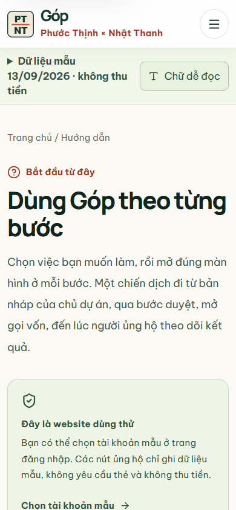
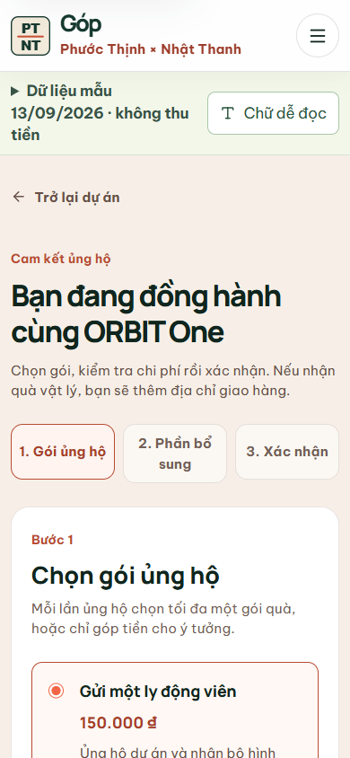

# Đợt chỉnh giao diện dễ đọc và dữ liệu giao quà — 27/10/2026

Đây là ghi chép cho phần web demo của nhóm. Mình thử trên bản chạy local với dữ liệu mẫu; các số tiền trong màn cam kết không phải giao dịch thật. Bộ fixture có mốc **13/09/2026 10:30**, vì vậy không dùng nó để nói một chiến dịch còn bao nhiêu ngày tính từ ngày đang xem.

## Phần nhìn thấy khi kiểm tra

| Chỗ kiểm tra | Vấn đề | Cách xử lý trong đợt này |
| --- | --- | --- |
| Màn hình điện thoại 390 px | Chữ nhỏ và nhiều lời giải thích ở đầu làm bước chọn gói bị đẩy xuống | Gộp dải dữ liệu mẫu, thêm chế độ chữ lớn; rút gọn phần mở đầu và thanh bước cam kết. |
| Người mới vào web | Có nhiều khu theo vai trò nhưng thiếu một chỗ chỉ đường chung | Thêm `/huong-dan` với thao tác theo Khách, Người ủng hộ, Chủ dự án, Cộng tác viên và Quản trị viên. Mỗi bước dẫn tới màn tương ứng. |
| Địa chỉ giao quà | Danh sách chỉ có vài tỉnh/thành dù giao hàng mô phỏng trên toàn quốc | Cho nhập tỉnh/thành, đưa gợi ý mẫu, kiểm tra không để trống. Chưa đối soát với danh mục hành chính chính thức. |
| SQLite local | Form hỏi số điện thoại và số nhà/đường, nhưng bản chiếu SQLite trước đây không lưu hai giá trị này | Thêm cột địa chỉ còn thiếu và ghi đầy đủ cho cam kết **LOCAL mới**. Bản DB cũ được bổ sung cột khi mở mà không đặt lại dữ liệu. |
| Bản chạy Vercel/cookie | Liên kết tới `/local-data` không có ích vì bản này không chạy SQLite | Hướng dẫn Quản trị viên dẫn tới `/system-design` khi không bật SQLite. Cookie demo không giữ số điện thoại và dòng địa chỉ. |

## Cách tự thử luồng ngắn

1. Mở `/huong-dan`, chọn vai trò muốn thử. Nút **Chữ dễ đọc** nằm cạnh nhắc dữ liệu mẫu và giữ lựa chọn khi chuyển trang.
2. Đăng nhập nhanh Người ủng hộ, mở một dự án đã công khai rồi bấm ủng hộ. Chọn gói vật lý để tới phần địa chỉ; nhập một tỉnh/thành ngoài các gợi ý, chẳng hạn Nghệ An. Gợi ý chỉ giúp gõ nhanh, không giới hạn nơi giao mô phỏng.
3. Xác nhận **cam kết mẫu** rồi dùng Quản trị viên vào `/local-data` hoặc mở file SQLite test. Dòng `pledges.shipping_address_id` nối tới `addresses`, trong đó có tên, số điện thoại, dòng địa chỉ và tỉnh/thành đã nhập.
4. Đổi sang Chủ dự án và xem khoản cam kết ở cùng chiến dịch. Luồng tạo/gửi duyệt/mở dự án mới đã có bài test `test:new-campaign-flow`; đợt này không thay đổi quy trình duyệt.

## Kết quả đã chạy

- TypeScript (`pnpm exec tsc --noEmit`), ESLint (`pnpm lint`) và production build (`pnpm build`) đạt trong lượt chỉnh; build có 46 route, gồm `/huong-dan`.
- `pnpm test:new-campaign-flow` đạt trên server SQLite dùng file riêng `gop-ui-audit-20261027.sqlite`, gồm kiểm bằng SQL rằng cam kết vừa tạo nối tới địa chỉ đủ tên, điện thoại, dòng địa chỉ và tỉnh/thành. Bài tương tự đạt ở chế độ cookie, không kỳ vọng cookie lưu phần địa chỉ nhạy cảm.
- Trên DB sạch riêng `gop-nav-20261027.sqlite`, `test:role-navigation` đạt 26/26 và `test:role-permissions` đạt 32/32. `test:schema-relations` đạt 14/14; `test:ui-controls` và `test:docs-sync` đạt.
- Bản production ở 1280 px: trang hướng dẫn không tràn ngang, liên kết Admin là `/local-data` khi bật SQLite. Khi chạy `GOP_LOCAL_DB=0`, nội dung bước đó chuyển sang **Xem sơ đồ dữ liệu**, không còn nút **Xem dữ liệu SQLite**.
- Tạo bản sao riêng `gop-migration-check-20261027.sqlite` từ DB cũ rồi mở bằng source mới: bảng `addresses` tăng từ 5 lên 10 cột, địa chỉ seed được điền lại, `PRAGMA foreign_key_check` trả 0 lỗi. Đây là kiểm trên **bản sao**, không phải lần chạy migration trên DB chính.
- Mở Chromium ở 390 px: `/huong-dan`, trang cam kết và khu Người ủng hộ không tràn ngang. Nút **Chữ dễ đọc** bật và giữ trạng thái khi đổi trang. Ở phần địa chỉ, nhập Nghệ An được nhận; nếu bỏ trống những ô bắt buộc thì hiện lỗi xác thực thay vì gửi cam kết.
- Hai ảnh dưới đây là ảnh chụp từ bản web local trên Chromium, không phải ảnh vẽ lại:

## Giới hạn cần giữ khi trình bày

- Dữ liệu fixture là ảnh chụp thời điểm 13/09/2026; giao diện nêu mốc đó để tránh hiểu là số liệu đang cập nhật theo ngày hiện tại.
- Các cam kết ghi **trước** khi thêm cột không thể tự lấy lại số điện thoại/dòng địa chỉ vì phiên bản cũ chưa lưu chúng. Không điền giả vào dữ liệu người dùng cũ.
- Chế độ cookie trên Vercel chỉ phù hợp xem thử trong một trình duyệt; SQLite local chỉ phù hợp demo cùng một server. Chưa có PostgreSQL runtime, thanh toán thật, upload minh chứng hoặc AI thật.
- Chế độ chữ lớn giúp đọc dễ hơn trên các màn đã thử. Chưa có kiểm thử sử dụng với trẻ em/người lớn tuổi ngoài đời, nên không gọi đây là đánh giá khả dụng với các nhóm tuổi ấy.
- File `.local-data/gop-mock.sqlite` của nhóm được giữ nguyên trong đợt test. Khi chạy source mới với file đó, app sẽ thêm cột thiếu; nên chụp lại file trước buổi demo nếu muốn giữ một mốc có thể phục hồi.
