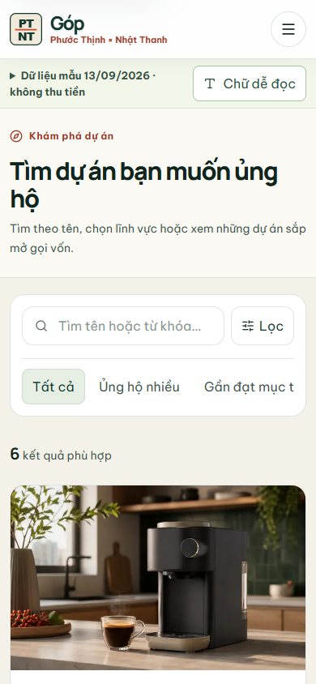
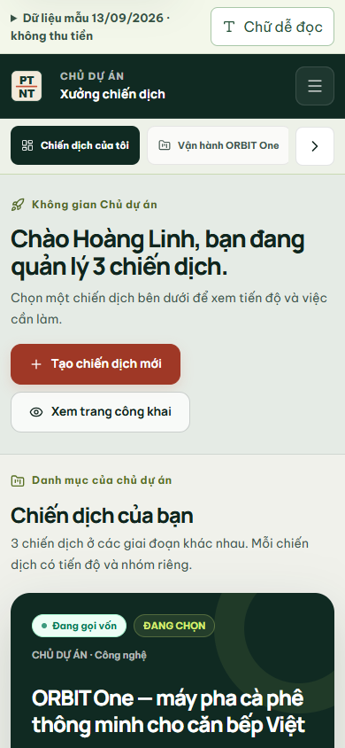
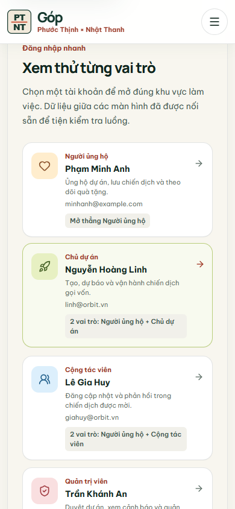

# Lượt chỉnh UI/UX theo luồng sử dụng — 28/10/2026

Đợt này nhóm dùng bộ skill trong `agent-skills/` để xem luồng trên điện thoại, đối chiếu nhãn lọc với dữ liệu đang có và bấm thử các thao tác trên web chạy local. Dữ liệu chiến dịch mẫu vẫn chốt tại **13/09/2026 10:30**; các khoản tiền trên màn hình là cam kết mô phỏng.

## Những chỗ đã chỉnh

| Luồng | Quan sát trên bản trước | Thay đổi |
| --- | --- | --- |
| Khách tìm dự án | Ở màn 390 px, phần giới thiệu và các ô lọc đẩy dự án đầu tiên xuống khá sâu. | Rút gọn phần mở đầu; giữ ô tìm kiếm và bộ lọc nhanh ngay trên mặt màn hình. Danh mục và cách sắp xếp mở bằng nút **Lọc** trên điện thoại, còn trên máy rộng thì hiện luôn. |
| Khách dùng bộ lọc | “Thịnh hành” dùng điểm dự báo, “Mới ra mắt” dùng số ngày còn lại, “Phù hợp nhất” thực tế chỉ giữ thứ tự dữ liệu. | Đổi thành **Ủng hộ nhiều** theo số người ủng hộ của chiến dịch đang gọi vốn; **Mới mở** theo ngày mở trong 21 ngày gần mốc dữ liệu; nhãn sắp xếp là **Thứ tự mặc định**. Có giải thích ngắn khi chọn hai lọc này. |
| Người xem thử vai trò | Trên điện thoại, bốn thẻ tài khoản mẫu nằm sau form đăng nhập nên khó thấy. | Thêm lối tắt **Muốn xem thử? Chọn tài khoản mẫu**, dẫn tới đúng tiêu đề danh sách. Form đăng nhập bằng email vẫn ở cùng trang. |
| Chủ dự án xem danh mục | Màn đầu lặp nút tạo chiến dịch và đặt các ô thống kê trước thẻ chiến dịch. | Đưa thẻ chiến dịch lên trước thống kê trên điện thoại; giữ thứ tự thống kê trước trên máy rộng. Bỏ nút tạo bị lặp, rút ngắn lời mở đầu. Số cam kết ở chiến dịch thành công được ghi là **cam kết mẫu**, không gọi là tiền đã đối soát. |
| Ảnh thẻ đầu trong Khám phá | Next dev cảnh báo ảnh đầu trang đang tải lazy dù là ảnh lớn đầu tiên. | Cho thẻ đầu tải ảnh sớm bằng `loading="eager"` qua `CampaignVisual`; những thẻ còn lại vẫn tải lazy. Chưa đo lại LCP trên Vercel. |

Ba ảnh này được chụp từ **bản production local bằng Chromium ở 390 × 844 px**, không phải ảnh dựng lại:

## Kiểm tra đã làm

- Trên Chromium 390 px, lọc **Mới mở** còn 2 dự án mẫu; chọn thêm **Công nghệ** còn ORBIT One. Lọc **Ủng hộ nhiều** hiện ORBIT One với một kết quả. Tìm từ khóa không tồn tại hiện trạng thái rỗng, nút **Đặt lại bộ lọc** trả về danh sách. Không thấy tràn ngang ở trang Khám phá.
- Bấm lối tắt ở `/auth` đưa tiêu đề tài khoản mẫu tới vị trí gần đầu màn hình, rồi chọn Người ủng hộ/Chủ dự án/Cộng tác viên/Quản trị viên để vào đúng khu. Mỗi khu có màu và điều hướng riêng; đây là kiểm các điểm vào, chưa phải thao tác hết mọi nút bên trong.
- `pnpm exec tsc --noEmit`, `pnpm lint`, `pnpm build` đạt. Build tạo 46 route. `pnpm test:ui-controls` đạt; `pnpm test:role-navigation` đạt **26/26** trên dev và trên bản production local.
- Lần khởi động production đầu tiên thiếu `GOP_SESSION_SECRET` nên API đăng nhập trả 500. Sau khi đặt biến theo `.env.example` và README, đăng nhập nhanh chạy lại bình thường; đây là lỗi cấu hình phiên thử, không phải dữ liệu của tài khoản. Server production dùng SQLite riêng `gop-ui-prod-proof-20261028.sqlite`; file chính `.local-data/gop-mock.sqlite` không được đặt lại.

## Giới hạn còn giữ

- Bộ lọc “Ủng hộ nhiều” chọn nhóm một phần ba chiến dịch **đang gọi vốn** có nhiều người ủng hộ nhất trong danh sách tải về. Đây không phải số liệu truy cập hay xu hướng thời gian thực.
- “Mới mở” dùng ngày mở của record đang hiển thị và mốc dữ liệu mẫu hoặc ngày mở mới nhất nếu có chiến dịch local mới. Không coi ảnh chụp 13/09 là trạng thái trực tiếp của ngày đang xem.
- Lượt này không đổi schema, API, quyền của vai trò hoặc giao dịch. Đăng nhập và danh mục đã kiểm ở các bước trên; chưa kết luận mọi chức năng của toàn website đã hoàn chỉnh.
