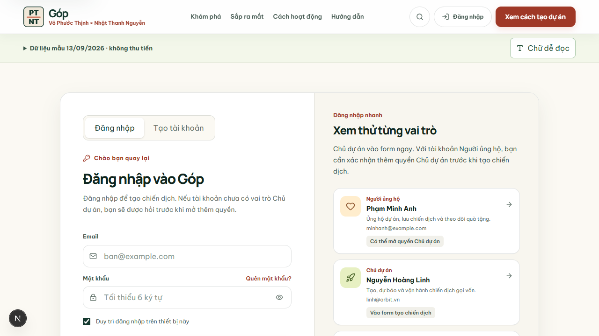
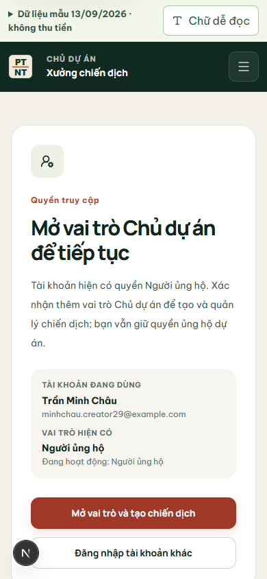
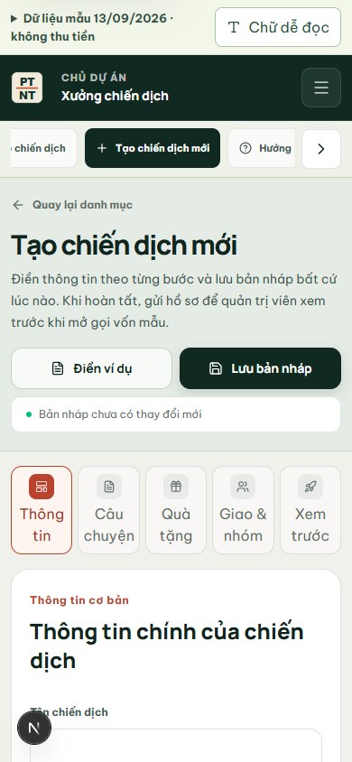

# Từ đăng ký đến hồ sơ chiến dịch — 29/10/2026

Mình kiểm luồng bắt đầu tại nút **Tạo chiến dịch** trên web local, trên màn hình điện thoại 390 × 844 px. Dữ liệu thử nằm trong file SQLite riêng `gop-creator-signup-20261029.sqlite`; không đặt lại file demo chính của nhóm.

## Chỗ bị đứt và cách sửa

| Bước | Quan sát trước khi sửa | Sau khi sửa |
| --- | --- | --- |
| Khách mở `/creator/campaigns/new` | Nút đăng ký dẫn đến form nhưng không nói rõ còn bước mở quyền. | Màn chặn giải thích: đăng ký/đăng nhập, xác nhận vai trò Chủ dự án, rồi vào form. Đường quay lại giữ cả path và query. |
| Đăng ký từ ý định tạo chiến dịch | Tài khoản mới bị đưa sang chọn lĩnh vực Người ủng hộ. Sau khi mở vai trò, trang chuyển về `/creator` nên mất form đang định mở. | Đăng ký đưa về đúng `/creator/campaigns/new`; người dùng tự bấm xác nhận thêm vai trò và tiếp tục trên cùng đường dẫn. Đăng ký thông thường vẫn đến `/onboarding`. |
| Đăng nhập nhanh | Chọn tài khoản Người ủng hộ từ link tạo chiến dịch lại về dashboard. | Người ủng hộ đến màn mở quyền; tài khoản đã có quyền Chủ dự án vào thẳng form. Thẻ tài khoản mẫu có lời nhắc đúng với luồng này. |
| Form trên điện thoại | Thanh năm bước chỉ có biểu tượng; nút “Xem ví dụ” thực ra điền đè form. | Tên bước hiện trên màn hẹp và có nhãn đọc màn hình. Nút đổi thành **Điền ví dụ**, hai nút hành động nằm cùng hàng; phần mở đầu nói việc cần làm thay cho cách lưu SQLite/cookie. |

## Ảnh chụp từ web

Ảnh lấy từ Chromium đang mở bản dev local; ký hiệu tròn **N** ở mép màn hình là thanh công cụ của Next.js dev.

## Đã kiểm

- Trên Chromium: đăng ký tài khoản mới từ `/auth?mode=register&next=%2Fcreator%2Fcampaigns%2Fnew` → xác nhận vai trò → vào form. Điền ví dụ **Bếp Mây**, lưu nháp, tải lại thấy đúng nội dung, quay về `/creator` thấy thẻ nháp và link tiếp tục.
- Truy vấn SQLite thử: nháp `cmp_preview_26265c48ffd5` có chủ sở hữu **Trần Minh Châu** và tài khoản này có hai role `BACKER,CREATOR`. Đây là bản ghi tạo trong lượt thử, không phải dữ liệu seed của nhóm.
- Đăng nhập nhanh tài khoản Người ủng hộ đến màn xin quyền; tài khoản Chủ dự án vào form. Đăng ký không có ý định tạo chiến dịch vẫn đến `/onboarding?next=%2Fdashboard`.
- 390 px: `scrollWidth = 390`, không tràn ngang ở form tạo. `pnpm test:ui-controls` đạt 138 nút, 156 link, 80 field, 14 select, 11 form; điều hướng 26/26, quyền 32/32, schema 14/14. TypeScript, ESLint và build 46 route đạt.
- Sau khi build, server production local cổng 3100 còn giữ asset ID cũ nên Chromium báo ba file CSS/JS trả 500. Đã khởi động lại server này trên cùng SQLite thử, tải lại trang đăng ký: đúng chế độ **Tạo tài khoản**, console không còn error/warning. Phiên đăng nhập cũ của bản preview cần đăng nhập lại vì khóa phiên của lần khởi động mới khác.
- Trên server production local cổng 3102 với `GOP_LOCAL_DB=0`: đăng ký mới → mở vai trò → điền Bếp Mây → lưu nháp → tải lại vẫn thấy tên chiến dịch. Console Chromium không có error/warning. Đây là phép thử chế độ cookie dùng cho bản deploy, chưa phải kiểm trên Vercel thật.

## Phạm vi demo

Luồng vừa sửa chạy với phiên mock. SQLite local giữ tài khoản và nháp để thử trên cùng máy; bản triển khai Vercel vẫn dùng cookie demo, chưa có tài khoản và database production dùng chung nhiều thiết bị. Quản trị viên vẫn phải duyệt hồ sơ trước khi mở gọi vốn mẫu; đây không phải quy trình thanh toán thật.
