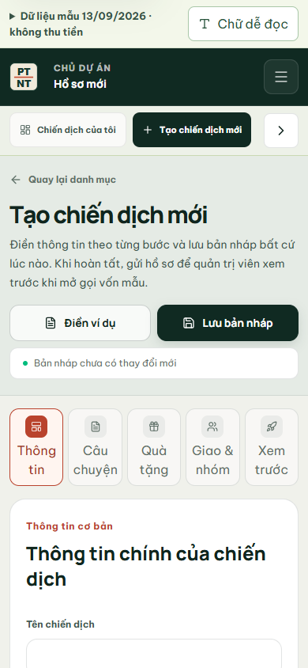
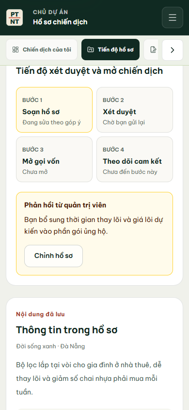
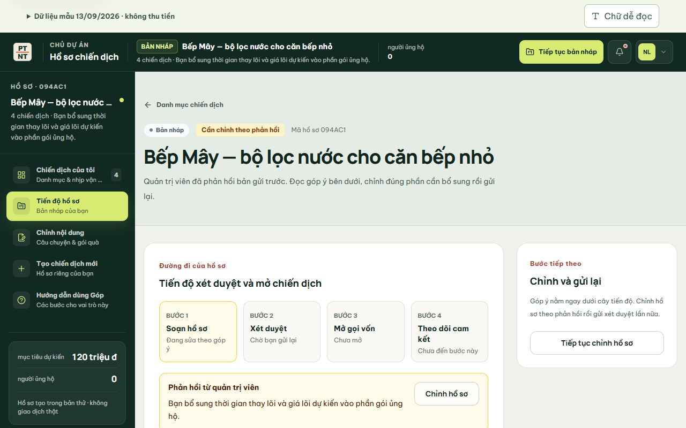

# Từ hồ sơ mới đến phản hồi xét duyệt — 29/10/2026

Mình đi lại một luồng đủ hai phía trên web: Chủ dự án tạo Bếp Mây, gửi duyệt; Quản trị viên đọc bản gửi v1 và yêu cầu bổ sung; Chủ dự án mở lại đúng hồ sơ để sửa. Luồng này bám vai trò Creator/Admin trong bản tổng hợp đề tài và hai buổi trao đổi với thầy. Web responsive là yêu cầu của đề tài; phần dưới đã xem trên màn 390 px.

## Những chỗ dễ hiểu nhầm đã sửa

| Màn | Quan sát khi bấm trên web | Cách xử lý |
| --- | --- | --- |
| Tạo chiến dịch mới | Header/sidebar vẫn gọi ORBIT One và hiện 637 triệu đồng dù người dùng đang soạn hồ sơ khác. | Màn chưa lưu hiện **Hồ sơ mới**, năm bước và lối về danh sách. Khi lưu Bếp Mây, header/sidebar đổi sang đúng mã hồ sơ, tên, mục tiêu và trạng thái. |
| Menu Chủ dự án | Ở form ORBIT Mini, hai mục “Chỉnh sửa” và “Tạo chiến dịch mới” cùng sáng. | So cả `campaign`/`draft` trên URL; màn đang soạn hoặc chỉnh chỉ có một mục được chọn trong mỗi menu. Trên điện thoại menu cuộn đủ để thấy mục đang chọn mà không cắt nhãn phía trước. |
| Checklist gửi duyệt | Dòng “Có video hoặc hình ảnh” hiện dấu đạt từ một checkbox, trong khi form chưa nhận tệp. | Ghi đúng là **đã khai báo video**, đánh dấu tùy chọn; ngay cạnh checkbox nói rõ bản dùng thử chưa tải tệp lên. |
| Sau khi gửi hồ sơ mới | Nút “Xem dự báo” đi sang ORBIT One, không liên quan Bếp Mây. | Nút chính mở **tiến độ xét duyệt của chính mã hồ sơ vừa gửi**; nút phụ về danh sách chiến dịch. |
| Tiến độ | Trạng thái đang chờ duyệt bị gom vào nhãn “chưa hoàn tất”. Sau khi Admin yêu cầu sửa, bước xét duyệt lại ghi “Chưa gửi”. | Bốn bước phân biệt đã gửi, đang chờ, chờ mở và đang theo dõi. Nếu có góp ý, hiển thị “Đang sửa theo góp ý” → “Chờ bạn gửi lại”. |
| Phản hồi | Góp ý nằm dưới gói ủng hộ, phải cuộn qua số liệu mới thấy. | Đặt phản hồi ngay dưới cây tiến độ, có nút **Chỉnh hồ sơ** đến đúng bản nháp. Phần bên phải chỉ bước tiếp theo theo trạng thái hiện tại. |
| Bàn Admin | Chữ trên hàng duyệt dễ khiến người xem nghĩ mọi thao tác đã có nhật ký bền vững. | Nói rõ đây là quyết định trong bản dùng thử; Admin phải đọc hồ sơ và ghi lý do khi yêu cầu sửa/từ chối. Nút mở hồ sơ có trạng thái mở/đóng cho công cụ hỗ trợ. |

Sau khi lưu và gửi, form gọi làm mới dữ liệu của layout. Trước đó mình phải reload mới thấy header Bếp Mây; sau sửa, chuyển sang trang tiến độ là đúng Bếp Mây ngay.

## Ảnh chụp từ web đang chạy

Ảnh là Chromium tại `localhost:3102`, chế độ cookie demo, không phải ảnh dựng bằng công cụ vẽ. Tên Bếp Mây và phản hồi trong ảnh là dữ liệu đã nhập trong lần thử này.

## Đã kiểm trên bản chạy

- Trên Chromium: Creator Linh điền ví dụ Bếp Mây → gửi duyệt → nút **Xem tiến độ xét duyệt** mở đúng `cmp_preview_ee9369094ac1`. Admin Khánh An thấy đúng tên, chủ dự án, bản gửi v1 và nội dung hồ sơ; yêu cầu sửa với lý do cụ thể. Creator đăng nhập lại thấy góp ý, bấm **Chỉnh hồ sơ** về đúng `?draft=cmp_preview_ee9369094ac1`.
- Màn 390 px: `scrollWidth = clientWidth = 390`; menu Chủ dự án có một mục đang chọn trên mỗi thanh. Console không có warning/error trong luồng hợp lệ đã xem.
- `pnpm exec tsc --noEmit`, ESLint các file sửa và `pnpm build` qua; build sinh 46 route. Trên server cookie riêng: `test:new-campaign-flow` qua, `test:role-navigation` 26/26, `test:role-permissions` 32/32, `test:ui-controls` qua 138 nút, 157 link, 80 field, 14 select và 11 form.
- Chạy thêm `test:new-campaign-flow` trên SQLite riêng `gop-review-ui-20261029.sqlite`: luồng Creator → Admin → Creator → Collaborator → Backer và khóa ngoại qua. File `.local-data/gop-mock.sqlite` của nhóm không được đặt lại hay dùng cho phép thử này.
- Bản xem trước local cổng 3100 đã được khởi động lại sau build; `/api/v1/health`, `/auth` và một asset Next.js đều trả HTTP 200. Phiên đăng nhập cũ cần đăng nhập lại vì khóa phiên của process mới khác.

## Giới hạn cần ghi đúng khi trình bày

Các bước duyệt và phản hồi có dữ liệu mock cùng mã hồ sơ, nhưng bản triển khai Vercel hiện giữ trạng thái trong cookie của từng trình duyệt. SQLite chỉ dùng để test trên một máy; chưa có PostgreSQL nhiều người dùng, upload ảnh/video hồ sơ, email, thanh toán hay nhật ký kiểm toán bất biến. Ảnh trong tài liệu này chứng minh giao diện và luồng local đã bấm được, không chứng minh các dịch vụ đó đã chạy thật.
