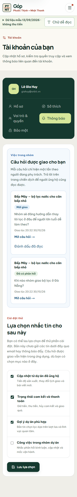
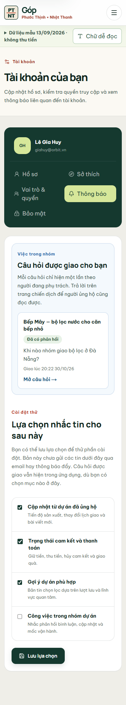

# Thông báo câu hỏi được giao — kiểm trên web local 30/10/2026

Mục này ghi lại một nhánh nhỏ của luồng hỏi đáp. Backer hỏi ở chiến dịch Bếp Mây; Chủ dự án giao cho Gia Huy; Gia Huy xem việc, đánh dấu đã đọc và mở đúng câu hỏi để trả lời. Hai ảnh dưới đây chụp trực tiếp từ web chạy `pnpm start --port 3100` với SQLite **test** `gop-ui-prod-proof-20261028`, ở màn hình mobile 360 px. Nội dung câu hỏi và tên người dùng đều là dữ liệu mẫu.

## Đi theo từng vai trò

1. **Minh Anh (Người ủng hộ):** mở trang Bếp Mây khi hồ sơ đã được duyệt, vào phần Bình luận và chọn đặt câu hỏi. Ví dụ đã thử: “Nhóm sẽ đăng hướng dẫn thay lõi lọc ở đâu để người lớn tuổi dễ làm theo?”. Câu hỏi có `campaign_id` và `comment_id` riêng.
2. **Hoàng Linh (Chủ dự án):** mở màn quản lý đúng chiến dịch, tìm **Câu hỏi và bình luận**, bấm **Phân công câu hỏi** rồi chọn Gia Huy. Gia Huy phải đã nhận lời mời và có quyền trả lời trong Bếp Mây. Giao cùng người lần nữa không sinh mục trùng.
3. **Gia Huy (Cộng tác viên):** vào **Việc của tôi** → **Thông báo việc**, hoặc bấm chuông/menu ở đầu trang. Mục mới có nhãn **Mới giao**, tên chiến dịch, nguyên văn câu hỏi và giờ giao. Bấm **Đánh dấu đã đọc** để tắt chấm thông báo; bấm **Mở câu hỏi** để đến phần trả lời của chiến dịch.
4. **Người ủng hộ đọc lại:** khi nhóm đã trả lời, lời đáp xuất hiện ở Bình luận công khai. Trong hộp của Gia Huy, mục ấy đổi thành **Đã có phản hồi** và không còn tính là việc chưa đọc.

Ảnh trên là lúc Gia Huy vừa được giao câu hỏi mới. Ảnh dưới là một câu Bếp Mây khác đã được nhóm đáp; nó vẫn ở hộp để người phụ trách xem lại, nhưng không làm tăng số thông báo mới.

## Dữ liệu nằm ở đâu

`question_assignments` dùng khóa `(campaign_id, comment_id)` nên mỗi câu hỏi chỉ có một người phụ trách hiện hành. `assignee_user_id` trỏ tới thành viên cùng chiến dịch, `assigned_at` là lượt giao mới và `read_at` là lúc người đó đánh dấu đã đọc. Hộp thông báo đọc từ chính bản ghi phân công, không sao chép thêm một hàng `notifications`. Trạng thái **Đã có phản hồi** được tính từ bình luận con do Creator/Collaborator đăng, không lưu cờ thứ hai.

Nếu Chủ dự án bỏ phân công, mục đó rời hộp. Giao lại thì tạo `assigned_at` mới và `read_at` rỗng; request đánh dấu lượt cũ bị từ chối. API `GET/PATCH /api/v1/notifications` chỉ cho Collaborator đọc/sửa phần việc của mình. Các vai trò khác nhận `403` khi gọi route này.

## Đã kiểm và phần còn thiếu

- `pnpm test:new-campaign-flow` qua cả SQLite test và cookie demo, gồm giao trùng, bỏ giao, giao lại, đánh dấu lượt cũ, trạng thái đã đọc và phản hồi. SQLite trả 0 lỗi khóa ngoại.
- File SQLite test cũ trước đó chưa có `read_at`; khi đăng nhập bằng source mới, cột được thêm và `PRAGMA foreign_key_check` vẫn 0. File `.local-data/gop-mock.sqlite` của nhóm không bị đặt lại.
- Trên trình duyệt, menu mobile báo **1 câu hỏi mới**; bấm đánh dấu rồi tải lại thấy **Đã đọc**, menu hết chấm. Màn 390 px không tràn ngang; ảnh hướng dẫn được chụp ở mobile 360 px.
- Bản này cập nhật số thông báo khi chuyển trang hoặc quay lại tab. Chưa có email, push hay realtime. Cookie demo trên Vercel chỉ giữ dữ liệu trong cùng trình duyệt; để nhiều máy cùng thấy việc mới phải nối repository PostgreSQL sau này.
