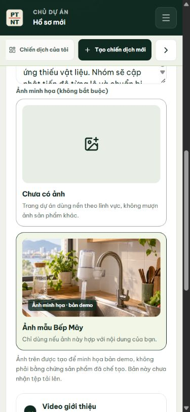
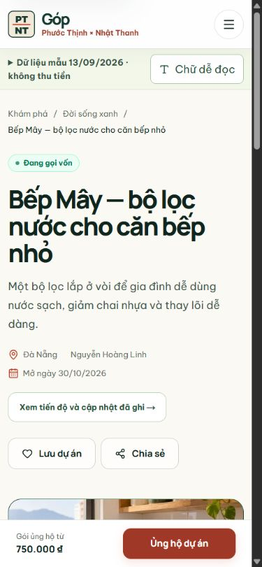
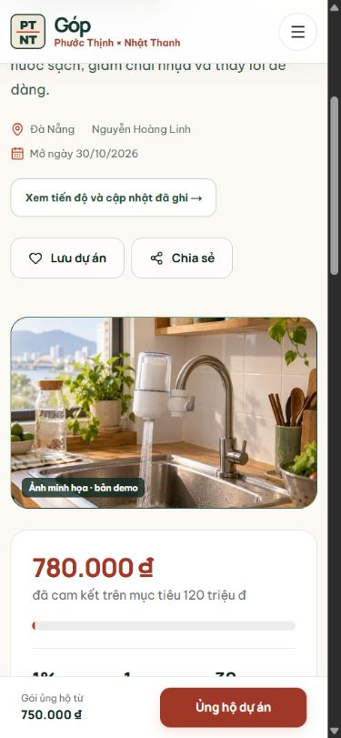
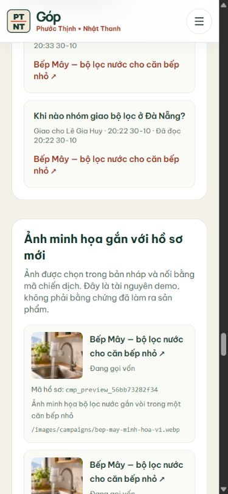

# Ảnh minh họa cho hồ sơ mới — kiểm trên web local 31/10/2026

Mục này ghi một thay đổi nhỏ nhưng dễ gây hiểu nhầm nếu làm ẩu: hồ sơ mới có ảnh đầu trang, song ảnh chỉ là **minh họa ý tưởng**. Nó không chứng minh nhóm Bếp Mây đã chế tạo bộ lọc. Bản demo dùng một ảnh được tạo riêng cho ví dụ Bếp Mây; nguồn và prompt nằm ở `docs/brand/bep-may-anh-minh-hoa-2026-10-30.md`.

## Đi từ form đến dữ liệu

1. Đăng nhập nhanh **Nguyễn Hoàng Linh** tại `/auth`, mở **Tạo chiến dịch mới**. Bấm **Điền thử ví dụ Bếp Mây** rồi sang bước **Câu chuyện**.
2. Trong **Ảnh minh họa**, chọn **Chưa có ảnh** hoặc **Ảnh mẫu Bếp Mây**. Ảnh mẫu có nhãn **Ảnh minh họa · bản demo**. Form nói rõ chưa nhận tệp tải lên; không nên chọn ảnh này cho một dự án khác loại.
3. Bấm **Lưu bản nháp**. Địa chỉ có `draft=cmp_preview_*`; tải lại, sang bước Câu chuyện và kiểm ảnh vẫn được chọn. Lượt thử trên SQLite riêng tạo `cmp_preview_ce72887fecf3` ở trạng thái `DRAFT`.
4. Khi hồ sơ được gửi, Admin duyệt và Creator mở gọi vốn mẫu, trang công khai dùng đúng ảnh của hồ sơ. Ảnh nằm ngay phần đầu, có nhãn demo; phần Câu chuyện nói rõ bằng chứng sản phẩm và kế hoạch vốn chi tiết còn thiếu. Ảnh chụp công khai bên dưới là hồ sơ Bếp Mây **đã mở trước đó**, mã `cmp_preview_16e1274fc98c`; nó không phải bản nháp ở bước 3.
5. Admin mở `/local-data`, tìm mục **Ảnh minh họa gắn với hồ sơ mới**. Mỗi dòng hiện ảnh, trạng thái, mã hồ sơ và link sang tiến độ của chính mã đó. Dòng này đọc từ `campaign_media`, nối với `campaigns` bằng `campaign_id`. Không có ảnh thì không tạo dòng media cho hồ sơ đó.

## Quan hệ và phép kiểm đã làm

`coverAssetId = bep-may-v1` là mã tài nguyên trong bản nháp. API chỉ chấp nhận mã trong thư viện mẫu hoặc chuỗi rỗng, không nhận URL tùy ý. Khi chiếu bản nháp xuống SQLite, `campaign_media.campaign_id` phải tồn tại trong `campaigns`; URL, alt và thứ tự ảnh được lưu cùng dòng. Bản công khai đọc lại đúng mã đã chọn, không đoán ảnh từ tiêu đề dự án.

Trên bản production local cổng 3100, database thử `gop-ui-prod-proof-20261028.sqlite`, mình đã chọn/bỏ/chọn lại ảnh trong form, lưu nháp, tải lại và thấy ảnh vẫn được chọn. Truy vấn `campaign_media` cho `cmp_preview_ce72887fecf3` trả URL `/images/campaigns/bep-may-minh-hoa-v1.webp`, alt của ảnh và trạng thái hồ sơ `DRAFT`; `PRAGMA foreign_key_check` trả danh sách rỗng. Trang công khai Bếp Mây cũ tải ảnh thật, có nhãn minh họa; màn 390 px không tràn ngang. Trên `/local-data`, bấm tên hồ sơ ở dòng media của `cmp_preview_ce72887fecf3` đã mở đúng trang tiến độ của bản nháp này, vẫn là trạng thái **Bản nháp**.

Ảnh được tạo bằng `imagegen`, không phải ảnh chụp từ thiết bị thật. Chưa có upload, kho lưu trữ file, duyệt quyền xem ảnh riêng hay chứng cứ sản phẩm do Chủ dự án nộp. Bản Vercel vẫn dùng trạng thái cookie demo; bảng SQLite chỉ chạy local.
