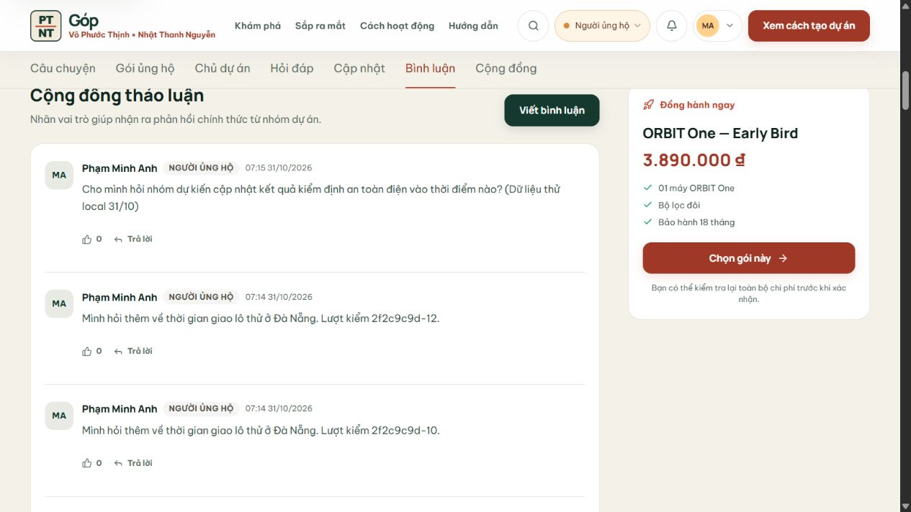
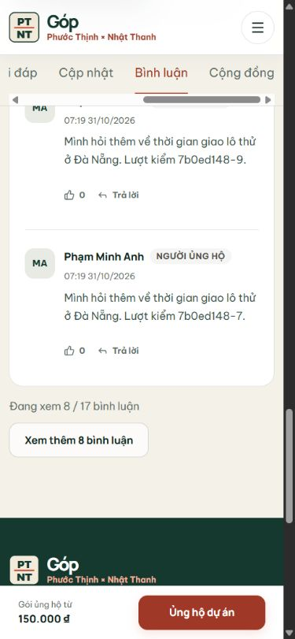

# Kiểm tra hai lượt ghi cùng lúc trên SQLite local

**Ngày kiểm:** 31/10/2026. Đây là phần kiểm bản demo trên máy, chưa phải kiểm thử tải cho bản triển khai Vercel.

## Vì sao phải sửa

Ứng dụng đang giữ dữ liệu phát sinh trong `platform_state` rồi chiếu ra các bảng có khóa ngoại. Trước khi sửa, hai server cùng đọc một bản cũ có thể đều trả 200 khi đăng câu hỏi, nhưng lượt lưu sau thay thế snapshot của lượt trước. Bài thử dùng hai cổng 3110/3111 cùng file `.local-data/gop-concurrency-proof-20261031.sqlite` đã bắt được một `recordId` được API báo lưu nhưng biến mất khi đọc lại trang chiến dịch. Đây là lỗi dữ liệu, không phải chỉ là chậm cập nhật giao diện.

## Cách sửa trong bản local

- Thêm cột `platform_state.revision`, tự bổ sung cho file SQLite cũ khi mở bằng source mới.
- Mỗi lần đọc snapshot giữ số phiên bản đi cùng state. Lúc ghi, transaction `BEGIN IMMEDIATE` so với revision đang nằm trong file. Nếu khác thì trả `409 LOCAL_DB_STALE` và không thay snapshot/bảng chiếu; nếu đúng mới ghi và tăng revision.
- Nút **Đặt lại dữ liệu đã thử** cũng tăng revision, nên một thao tác giữ bản cũ không thể ghi dữ liệu đã xóa quay trở lại.
- API báo bằng tiếng Việt rằng thao tác chưa được lưu và có thể gửi lại. `clientRequest` đánh dấu riêng mã này là có thể thử lại. Form bình luận giữ nội dung khi lỗi; chưa xác nhận hết mọi form khác trong dự án có cùng hành vi.

## Những gì đã chạy

| Bước | Kết quả quan sát |
| --- | --- |
| Bản cũ, hai server cùng file DB test | Test dừng ở câu hỏi có 200 nhưng không còn trong API đọc chiến dịch. |
| Bản mới, 12 câu gửi song song qua hai server | 7 lượt lưu ngay; 5 lượt trả 409; gửi lại tuần tự thì đủ 12 câu, mỗi ID/nội dung xuất hiện đúng một lần; `PRAGMA foreign_key_check` không có dòng lỗi. |
| Đặt lại DB test sau bài thử | Revision từ 54 lên 55, snapshot không còn bình luận phát sinh, FK 0. Chỉ đặt lại file test nêu trên. |
| Trình duyệt local cổng 3110 | Đăng nhập nhanh Minh Anh, đăng một bình luận vào ORBIT One, tải lại tab Bình luận và thấy đúng nội dung/tác giả/vai trò. Ảnh dưới chụp từ web trước khi đặt lại DB test. |
| Hồi quy liên vai trò | `test:comment-flow` và `test:new-campaign-flow` qua trên cùng DB test trước khi đặt lại. TypeScript, lint, build 48 trang, schema 15/15 và rà control 146 nút/161 link qua. |
| Danh sách bình luận khi có nhiều dữ liệu | Trang hiển thị 8/17 bình luận ban đầu; bấm **Xem thêm 8 bình luận** thành 16/17, sau đó còn một lượt. Màn 390 px không tràn ngang. Nút có viền rõ hơn, có lời nhắc khi danh sách trống. Bản build cuối qua 48 trang và rà control 147 nút/161 link. Đây là chia phần hiển thị ở client, chưa phân trang API. |





## Tự chạy lại

Mở hai terminal ở thư mục web, cùng đặt `GOP_LOCAL_DB=1`, `GOP_LOCAL_DB_NAME=gop-concurrency-proof-20261031` và một `GOP_SESSION_SECRET` local đủ 32 ký tự. Chạy `pnpm start --port 3110` và `pnpm start --port 3111`. Ở terminal thứ ba, đặt:

```powershell
$env:GOP_PREVIEW_URL='http://localhost:3110'
$env:GOP_PREVIEW_URL_2='http://localhost:3111'
$env:GOP_EXPECT_LOCAL_DB_NAME='gop-concurrency-proof-20261031'
pnpm test:local-concurrency
```

Script từ chối tên file `gop-mock` để không ghi câu hỏi thử vào dữ liệu nhóm đang dùng. Nếu chỉ chạy một server, bỏ `GOP_PREVIEW_URL_2`; ca một server cũng kiểm được 12 lượt gần nhau, nhưng không thay cho ca hai server.

## Giới hạn và việc tiếp

`platform_state` vẫn là snapshot demo; xung đột ở một phần dữ liệu có thể làm một thao tác khác nhận 409. Bản sửa chặn mất dữ liệu âm thầm, chưa tự gộp hai bản sửa, chưa có idempotency cho request, chưa bảo vệ đồng thời riêng `user_preview_state`, và không biến file SQLite trên máy thành database dùng chung cho Vercel. Khi chuyển sang PostgreSQL, nhóm cần viết repository/transaction theo từng nghiệp vụ, kiểm quyền và kiểm thử lại hai phiên trên backend đó. Bài này chỉ chứng minh hành vi của bản local tại file test đã nêu.
