# Thiết kế Cơ sở dữ liệu — FundViet v3

> **Hệ thống:** Nền tảng gọi vốn cộng đồng tích hợp AI (**FundViet v3** — mô hình *All-or-Nothing*).  
> **Phạm vi dữ liệu:** **40 bảng nghiệp vụ** (chia thành **8 miền** theo `TABLE_GROUPS`) + **1 bảng hạ tầng (`meta`)**, **3 View** và **25 Trigger**.  
> **Nguồn chân lý mã nguồn:**
> - Bản chạy local (SQLite / `node:sqlite`): [`apps/web/src/server/db/schema.ts`](../../apps/web/src/server/db/schema.ts)
> - Bản triển khai PostgreSQL 18: [`database/postgres/schema.sql`](../../database/postgres/schema.sql) · [`seed-reference.sql`](../../database/postgres/seed-reference.sql) · [`schema.prisma`](../../database/postgres/schema.prisma)
> - Danh mục vai trò & quyền: [`apps/web/src/server/db/catalog.ts`](../../apps/web/src/server/db/catalog.ts)

---

## Mục lục

1. [Kiến trúc & nguyên tắc thiết kế CSDL](#1-kiến-trúc--nguyên-tắc-thiết-kế-csdl)
2. [Sơ đồ ERD tổng quan & 8 sơ đồ ERD theo miền](#2-sơ-đồ-erd-tổng-quan--8-sơ-đồ-erd-theo-miền)
3. [Từ điển dữ liệu đầy đủ (40 bảng + `meta`)](#3-từ-điển-dữ-liệu-đầy-đủ)
4. [Phân loại quan hệ thực thể (1–1, 1–N, N–N, Tự tham chiếu)](#4-phân-loại-quan-hệ-thực-thể)
5. [Mô hình phân quyền RBAC 2 tầng & Ma trận quyền](#5-mô-hình-phân-quyền-rbac-2-tầng--ma-trận-quyền)
6. [Sơ đồ máy trạng thái (`stateDiagram-v2`)](#6-sơ-đồ-máy-trạng-thái)
7. [Ánh xạ quy tắc nghiệp vụ (Business Rules)](#7-ánh-xạ-quy-tắc-nghiệp-vụ)
8. [Phân tích chuẩn hoá (3NF / BCNF) & Phi chuẩn hoá có kiểm soát](#8-phân-tích-chuẩn-hoá-3nf--bcnf--phi-chuẩn-hoá-có-kiểm-soát)
9. [Chiến lược chỉ mục (Indexing Strategy)](#9-chiến-lược-chỉ-mục)
10. [Ma trận truy vết FR01–FR34 → Bảng & Thành phần](#10-ma-trận-truy-vết-fr01fr34--bảng--thành-phần)
11. [Đối chiếu SQLite (Demo Local) và PostgreSQL 18 (Triển khai)](#11-đối-chiếu-sqlite-và-postgresql-18)

---

## 1. Kiến trúc & nguyên tắc thiết kế CSDL

Cơ sở dữ liệu của **FundViet v3** được thiết kế theo định hướng **Database-Enforced Integrity** (tầng CSDL tự bảo vệ tính đúng đắn của dữ liệu ngay cả khi nhiều tuyến thao tác cùng ghi hoặc thao tác trực tiếp bằng SQL):

1. **100% thực thể và trạng thái nghiệp vụ là bảng quan hệ:** Mọi quan hệ thành viên, phần quà, giao dịch, bình luận, đánh giá AI, nhật ký đều được chuẩn hoá thành bảng riêng. Chỉ các payload kết quả phân tích giải thích của AI (`ai_predictions.factors_json`, `suggestions_json`) dùng `JSONB` (PostgreSQL) / chuỗi JSON (SQLite) vì không tham gia ràng buộc khoá ngoại hay trạng thái chuyển tiếp.
2. **Tiền tệ là số nguyên VND (`INTEGER` / `BIGINT`):** Không dùng kiểu số thực (`FLOAT`/`REAL`) cho tiền để triệt tiêu sai số làm tròn (NFR06 / BR18). Đơn vị thống nhất là Việt Nam Đồng (`>= 10.000đ` cho pledge, `1.000.000đ – 2.000.000.000đ` cho mục tiêu dự án).
3. **Thời gian chuẩn UTC, thống kê theo ngày giờ Việt Nam:** Mọi mốc thời gian giao dịch lưu `TIMESTAMPTZ` (PostgreSQL) hoặc ISO-8601 UTC (SQLite); bảng `project_daily_stats.stat_date` lưu `DATE` theo múi giờ Việt Nam (`UTC+7`) để biểu đồ theo ngày khớp với người dùng Việt.
4. **Thanh toán mô phỏng an toàn (MockPay — NFR07):** Không lưu số thẻ thô (PAN) hay mã CVV. Bảng `payment_methods` chỉ lưu `brand`, `last4` (4 số cuối) và `provider_token` duy nhất. Dòng tiền *All-or-Nothing* được ghi nhận qua sổ cái bất biến `payment_transactions` có `idempotency_key` (`<pledge_id>:<KIND>`).
5. **Phân quyền RBAC 2 tầng hướng dữ liệu:** Quyền không bị hard-code rải rác; ma trận `roles ↔ permissions` lưu trong `role_permissions`, kết hợp 2 View (`v_user_system_permissions`, `v_project_permissions`) cho cả tầng ứng dụng (`rbac.ts`) và tầng Trigger cùng đọc một nguồn chân lý.
6. **Khoá ngoại ghép & chỉ mục duy nhất từng phần:** Dùng khoá ngoại ghép (`UNIQUE (id, project_id)`, `UNIQUE (id, user_id)`) để ngăn liên kết chéo dự án hoặc mượn thẻ/địa chỉ của người dùng khác ngay tại tầng quan hệ, kết hợp partial unique index (`WHERE ...`) để thực thi duy nhất có điều kiện (1 địa chỉ mặc định, 1 thẻ mặc định, 1 Creator mỗi dự án, 1 pledge hiệu lực mỗi Backer/dự án).

---

## 2. Sơ đồ ERD tổng quan & 8 sơ đồ ERD theo miền

### 2.1. Sơ đồ tổng quan 8 miền nghiệp vụ

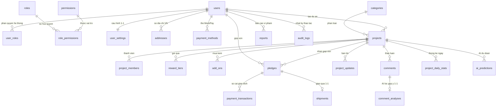

---

### 2.2. Miền 1 — Danh tính & phân quyền (9 bảng)

Gồm: `users`, `user_settings`, `roles`, `permissions`, `role_permissions`, `user_roles`, `sessions`, `addresses`, `payment_methods`.

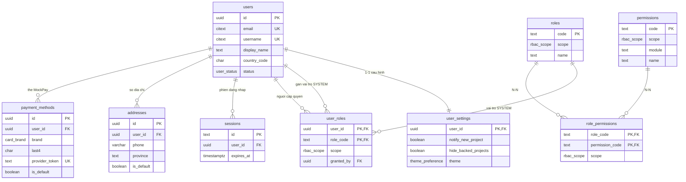

---

### 2.3. Miền 2 — Danh mục (1 bảng)

Gồm: `categories` (hỗ trợ cây phân cấp tự tham chiếu qua `parent_id`).

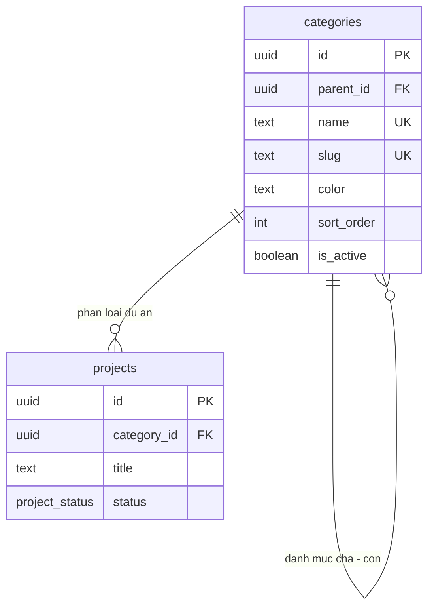

---

### 2.4. Miền 3 — Dự án (6 bảng)

Gồm: `projects`, `project_sections`, `project_members`, `project_invitations`, `project_reviews`, `project_status_history`.

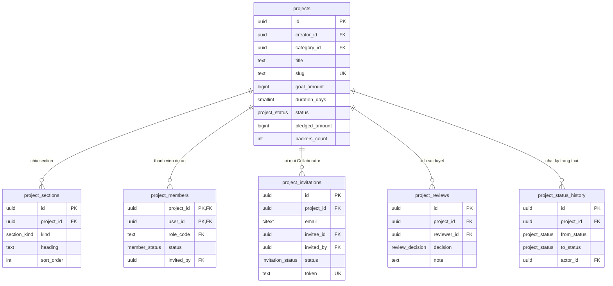

---

### 2.5. Miền 4 — Phần quà (4 bảng)

Gồm: `reward_tiers`, `reward_items`, `add_ons`, `reward_tier_add_ons`.

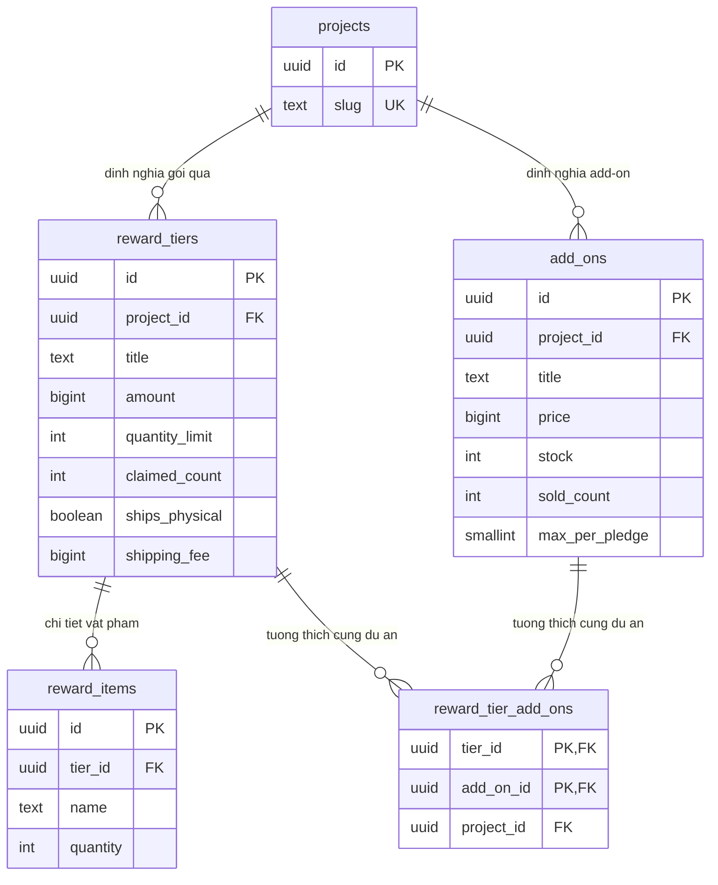

---

### 2.6. Miền 5 — Góp vốn & thanh toán (4 bảng)

Gồm: `pledges`, `pledge_add_ons`, `payment_transactions`, `shipments`.

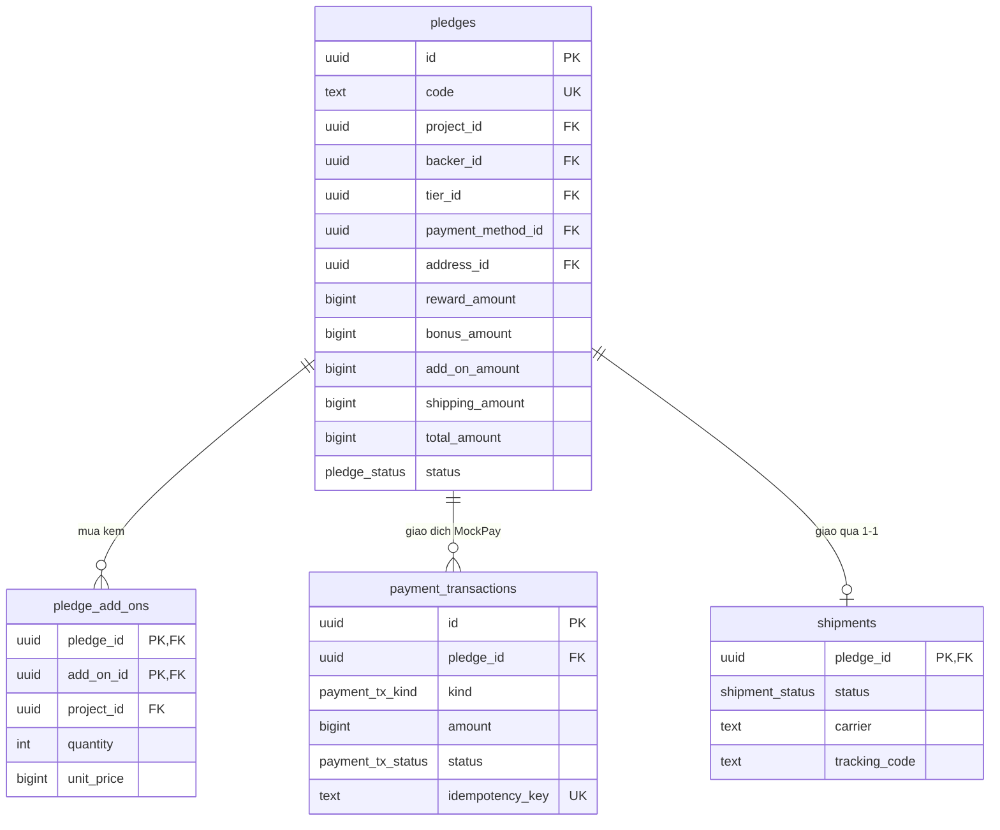

---

### 2.7. Miền 6 — Nội dung & tương tác (11 bảng)

Gồm: `project_updates`, `faqs`, `comments`, `comment_likes`, `comment_analyses`, `saved_projects`, `follows`, `conversations`, `conversation_participants`, `messages`, `notifications`.

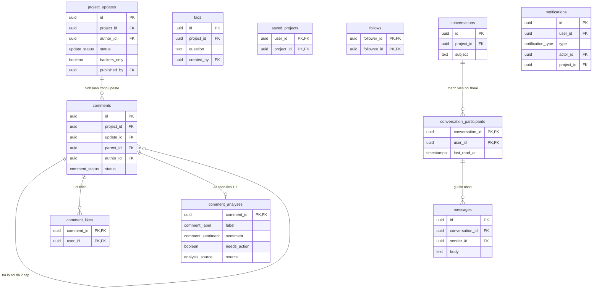

---

### 2.8. Miền 7 — Thống kê & AI (2 bảng)

Gồm: `project_daily_stats`, `ai_predictions`.

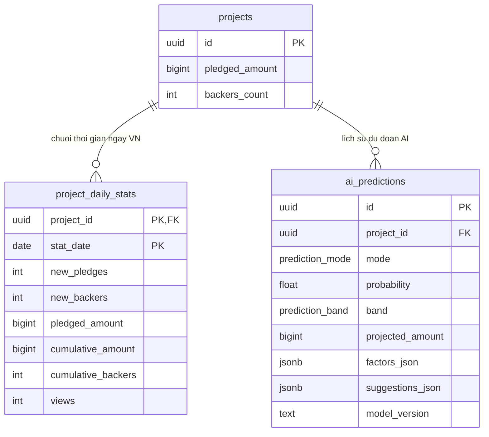

---

### 2.9. Miền 8 — Quản trị (3 bảng)

Gồm: `reports`, `audit_logs`, `scheduler_runs`.

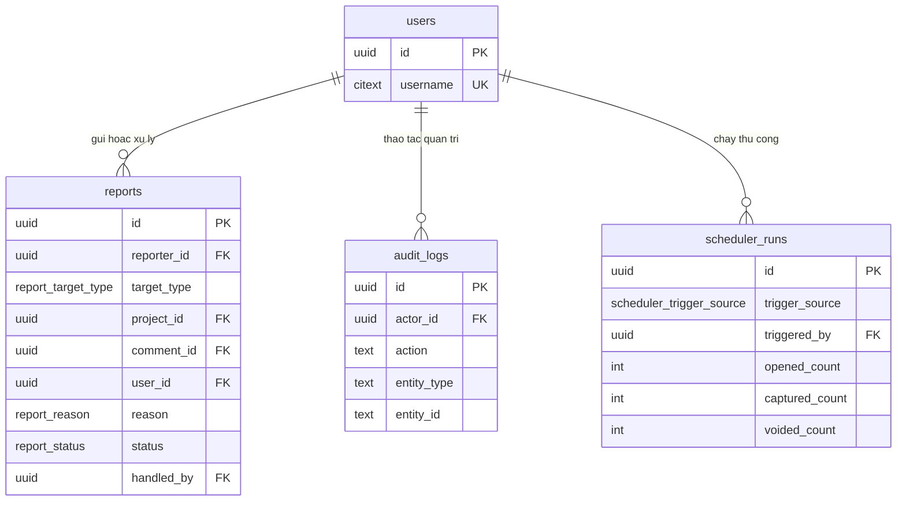

---

## 3. Từ điển dữ liệu đầy đủ

### Hạ tầng: `meta`

| Cột | SQLite | PostgreSQL 18 | Null | Mặc định / Ràng buộc | Mô tả |
|---|---|---|---|---|---|
| `key` | `TEXT` | `TEXT` | Không | `PRIMARY KEY` | Khoá cấu hình hệ thống (`schema_version`, `seeded_at`) |
| `value` | `TEXT` | `TEXT` | Không | — | Giá trị tương ứng |

---

### Miền 1: Danh tính & phân quyền (9 bảng)

#### 1.1. `users` — Tài khoản người dùng

| Cột | SQLite | PostgreSQL 18 | Null | Mặc định / Ràng buộc | Mô tả |
|---|---|---|---|---|---|
| `id` | `TEXT` | `UUID` | Không | `PK`, `DEFAULT gen_random_uuid()` | Định danh duy nhất tài khoản |
| `email` | `TEXT` | `CITEXT` | Không | `UNIQUE` | Email đăng nhập (không phân biệt hoa thường) |
| `username` | `TEXT` | `CITEXT` | Không | `UNIQUE`, dài 3–30, `[a-zA-Z0-9_.]` | Tên định danh URL `/u/:username` |
| `password_hash` | `TEXT` | `TEXT` | Không | — | Mật khẩu băm `scrypt$<salt>$<hash>` |
| `display_name` | `TEXT` | `TEXT` | Không | Dài 2–60 (sau `trim`) | Tên hiển thị công khai |
| `avatar_url` | `TEXT` | `TEXT` | Có | `NULL` | Đường dẫn ảnh đại diện |
| `bio` | `TEXT` | `TEXT` | Không | `''`, tối đa 500 ký tự | Tiểu sử ngắn |
| `country_code` | `TEXT` | `CHAR(2)` | Không | `'VN'`, đúng 2 ký tự | Mã quốc gia ISO-2 (phục vụ FR28) |
| `province` | `TEXT` | `TEXT` | Có | `NULL` | Tỉnh/Thành phố cư trú |
| `status` | `TEXT` | `user_status` | Không | `'ACTIVE'` (`ACTIVE`, `LOCKED`) | Trạng thái hoạt động tài khoản |
| `locked_reason` | `TEXT` | `TEXT` | Có | `(status='LOCKED') = (locked_reason IS NOT NULL)` | Lý do khoá tài khoản |
| `email_verified_at` | `TEXT` | `TIMESTAMPTZ` | Có | `NULL` | Thời điểm xác thực email |
| `last_login_at` | `TEXT` | `TIMESTAMPTZ` | Có | `NULL` | Lần đăng nhập gần nhất |
| `created_at` | `TEXT` | `TIMESTAMPTZ` | Không | `now()` | Thời điểm tạo tài khoản |
| `updated_at` | `TEXT` | `TIMESTAMPTZ` | Không | `now()` (trigger `trg_users_touch`) | Thời điểm cập nhật gần nhất |

#### 1.2. `user_settings` — Cấu hình cá nhân (1–1 với `users`)

| Cột | SQLite | PostgreSQL 18 | Null | Mặc định / Ràng buộc | Mô tả |
|---|---|---|---|---|---|
| `user_id` | `TEXT` | `UUID` | Không | `PK`, `FK → users(id) ON DELETE CASCADE` | Khoá chính kiêm khoá ngoại tới `users` |
| `notify_new_project` | `INTEGER (0/1)` | `BOOLEAN` | Không | `1` / `true` | Nhận thông báo khi creator theo dõi mở dự án mới |
| `notify_project_update` | `INTEGER (0/1)` | `BOOLEAN` | Không | `1` / `true` | Nhận thông báo bản tin Update từ dự án đã góp |
| `notify_comment_reply` | `INTEGER (0/1)` | `BOOLEAN` | Không | `1` / `true` | Nhận thông báo khi có trả lời bình luận |
| `notify_message` | `INTEGER (0/1)` | `BOOLEAN` | Không | `1` / `true` | Nhận thông báo tin nhắn nội bộ |
| `hide_backed_projects` | `INTEGER (0/1)` | `BOOLEAN` | Không | `0` / `false` | Ẩn danh sách dự án đã góp trên hồ sơ công khai |
| `theme` | `TEXT` | `theme_preference` | Không | `'system'` (`system`, `light`, `dark`) | Giao diện sáng/tối ưu tiên |
| `updated_at` | `TEXT` | `TIMESTAMPTZ` | Không | `now()` | Thời điểm cập nhật cấu hình |

#### 1.3. `roles` — Danh mục vai trò RBAC

| Cột | SQLite | PostgreSQL 18 | Null | Mặc định / Ràng buộc | Mô tả |
|---|---|---|---|---|---|
| `code` | `TEXT` | `TEXT` | Không | `PK`, `UNIQUE(code, scope)` | Mã vai trò (`MEMBER`, `ADMIN`, `CREATOR`, `COLLABORATOR`) |
| `scope` | `TEXT` | `rbac_scope` | Không | `'SYSTEM'` hoặc `'PROJECT'` | Phạm vi áp dụng vai trò |
| `name` | `TEXT` | `TEXT` | Không | — | Tên tiếng Việt hiển thị |
| `description` | `TEXT` | `TEXT` | Không | — | Mô tả phạm vi trách nhiệm |
| `badge_color` | `TEXT` | `TEXT` | Không | — | Mã màu hex hiển thị badge |

#### 1.4. `permissions` — Danh mục quyền chi tiết

| Cột | SQLite | PostgreSQL 18 | Null | Mặc định / Ràng buộc | Mô tả |
|---|---|---|---|---|---|
| `code` | `TEXT` | `TEXT` | Không | `PK`, `UNIQUE(code, scope)` | Mã quyền (vd `pledge.create`, `update.publish`) |
| `scope` | `TEXT` | `rbac_scope` | Không | `'SYSTEM'` hoặc `'PROJECT'` | Phạm vi kiểm tra quyền |
| `module` | `TEXT` | `TEXT` | Không | — | Nhóm chức năng trên ma trận (Tài khoản, Góp vốn, AI, Quản trị…) |
| `name` | `TEXT` | `TEXT` | Không | — | Mô tả tiếng Việt chức năng |

#### 1.5. `role_permissions` — Bảng nối vai trò × quyền

| Cột | SQLite | PostgreSQL 18 | Null | Mặc định / Ràng buộc | Mô tả |
|---|---|---|---|---|---|
| `role_code` | `TEXT` | `TEXT` | Không | `PK(role_code, permission_code)` | Mã vai trò |
| `permission_code` | `TEXT` | `TEXT` | Không | `PK(role_code, permission_code)` | Mã quyền |
| `scope` | `TEXT` | `rbac_scope` | Không | `FK(role_code, scope)`, `FK(permission_code, scope)` | Khoá ghép cưỡng chế cùng `scope` |

#### 1.6. `user_roles` — Phân vai trò cấp hệ thống

| Cột | SQLite | PostgreSQL 18 | Null | Mặc định / Ràng buộc | Mô tả |
|---|---|---|---|---|---|
| `user_id` | `TEXT` | `UUID` | Không | `PK(user_id, role_code)`, `FK → users(id)` | Người dùng được gán vai trò |
| `role_code` | `TEXT` | `TEXT` | Không | `PK(user_id, role_code)`, `FK(role_code, scope) → roles` | Vai trò hệ thống (`MEMBER` / `ADMIN`) |
| `scope` | `TEXT` | `rbac_scope` | Không | `'SYSTEM'`, `CHECK(scope = 'SYSTEM')` | Chỉ cho phép vai trò cấp hệ thống |
| `granted_by` | `TEXT` | `UUID` | Có | `FK → users(id) ON DELETE SET NULL` | Quản trị viên thực hiện cấp quyền |
| `granted_at` | `TEXT` | `TIMESTAMPTZ` | Không | `now()` | Thời điểm gán vai trò |

#### 1.7. `sessions` — Phiên đăng nhập

| Cột | SQLite | PostgreSQL 18 | Null | Mặc định / Ràng buộc | Mô tả |
|---|---|---|---|---|---|
| `id` | `TEXT` | `TEXT` | Không | `PK` | Mã băm SHA-256 (64 ký tự hex) của token cookie |
| `user_id` | `TEXT` | `UUID` | Không | `FK → users(id) ON DELETE CASCADE` | Chủ sở hữu phiên |
| `expires_at` | `TEXT` | `TIMESTAMPTZ` | Không | — | Thời điểm hết hạn phiên |
| `user_agent` | `TEXT` | `TEXT` | Có | `NULL` | Chuỗi trình duyệt/thiết bị |
| `created_at` | `TEXT` | `TIMESTAMPTZ` | Không | `now()` | Thời điểm tạo phiên |

#### 1.8. `addresses` — Sổ địa chỉ giao hàng nội bộ Việt Nam

| Cột | SQLite | PostgreSQL 18 | Null | Mặc định / Ràng buộc | Mô tả |
|---|---|---|---|---|---|
| `id` | `TEXT` | `UUID` | Không | `PK`, `UNIQUE(id, user_id)` | Định danh địa chỉ |
| `user_id` | `TEXT` | `UUID` | Không | `FK → users(id) ON DELETE CASCADE` | Chủ sở hữu sổ địa chỉ |
| `label` | `TEXT` | `TEXT` | Không | `'Nhà riêng'` | Nhãn gợi nhớ |
| `recipient_name` | `TEXT` | `TEXT` | Không | Dài `>= 2` | Tên người nhận quà |
| `phone` | `TEXT` | `VARCHAR(12)` | Không | 9–12 chữ số | Số điện thoại liên hệ |
| `line1` | `TEXT` | `TEXT` | Không | Dài `>= 3` | Số nhà, tên đường |
| `ward` | `TEXT` | `TEXT` | Không | `''` | Phường / Xã |
| `district` | `TEXT` | `TEXT` | Không | `''` | Quận / Huyện |
| `province` | `TEXT` | `TEXT` | Không | — | Tỉnh / Thành phố |
| `country_code` | `TEXT` | `CHAR(2)` | Không | `'VN'`, `CHECK(country_code = 'VN')` | Ràng buộc giao nội bộ Việt Nam (NFR05) |
| `is_default` | `INTEGER (0/1)` | `BOOLEAN` | Không | `0`/`false`, `uq_address_default` | Tối đa 1 địa chỉ mặc định mỗi người dùng |
| `created_at` | `TEXT` | `TIMESTAMPTZ` | Không | `now()` | Thời điểm lưu địa chỉ |

#### 1.9. `payment_methods` — Thẻ mô phỏng MockPay

| Cột | SQLite | PostgreSQL 18 | Null | Mặc định / Ràng buộc | Mô tả |
|---|---|---|---|---|---|
| `id` | `TEXT` | `UUID` | Không | `PK`, `UNIQUE(id, user_id)` | Định danh phương thức thanh toán |
| `user_id` | `TEXT` | `UUID` | Không | `FK → users(id) ON DELETE CASCADE` | Chủ sở hữu thẻ |
| `brand` | `TEXT` | `card_brand` | Không | `VISA`, `MASTERCARD`, `JCB`, `NAPAS` | Tổ chức phát hành thẻ |
| `last4` | `TEXT` | `CHAR(4)` | Không | Đúng 4 chữ số | 4 chữ số cuối hiển thị |
| `exp_month` | `INTEGER` | `SMALLINT` | Không | `1..12` | Tháng hết hạn |
| `exp_year` | `INTEGER` | `SMALLINT` | Không | `2024..2099` | Năm hết hạn |
| `holder_name` | `TEXT` | `TEXT` | Không | — | Tên chủ thẻ |
| `provider_token` | `TEXT` | `TEXT` | Không | `UNIQUE` | Token do MockPay cấp (không lưu PAN/CVV) |
| `is_default` | `INTEGER (0/1)` | `BOOLEAN` | Không | `0`/`false`, `uq_payment_default` | Tối đa 1 thẻ mặc định mỗi người dùng |
| `created_at` | `TEXT` | `TIMESTAMPTZ` | Không | `now()` | Thời điểm liên kết |

---

### Miền 2: Danh mục (1 bảng)

#### 2.1. `categories` — Thể loại dự án

| Cột | SQLite | PostgreSQL 18 | Null | Mặc định / Ràng buộc | Mô tả |
|---|---|---|---|---|---|
| `id` | `TEXT` | `UUID` | Không | `PK` | Định danh thể loại |
| `parent_id` | `TEXT` | `UUID` | Có | `FK → categories(id) ON DELETE RESTRICT`, `parent_id <> id` | Tham chiếu thể loại cha (nếu phân cấp) |
| `name` | `TEXT` | `TEXT` | Không | `UNIQUE` | Tên tiếng Việt (Nghệ thuật, Công nghệ…) |
| `slug` | `TEXT` | `TEXT` | Không | `UNIQUE` | Đường dẫn URL |
| `description` | `TEXT` | `TEXT` | Không | `''` | Mô tả ngắn |
| `image_url` | `TEXT` | `TEXT` | Có | `NULL` | Ảnh minh hoạ `/v3/categories/...` |
| `color` | `TEXT` | `TEXT` | Không | `'#7C3AED'` | Màu đại diện trên biểu đồ & thẻ |
| `sort_order` | `INTEGER` | `INTEGER` | Không | `0` | Thứ tự hiển thị |
| `is_active` | `INTEGER (0/1)` | `BOOLEAN` | Không | `1` / `true` | Cho phép hiển thị/chọn khi tạo dự án |
| `created_at` | `TEXT` | `TIMESTAMPTZ` | Không | `now()` | Thời điểm tạo |

---

### Miền 3: Dự án (6 bảng)

#### 3.1. `projects` — Chiến dịch gọi vốn

| Cột | SQLite | PostgreSQL 18 | Null | Mặc định / Ràng buộc | Mô tả |
|---|---|---|---|---|---|
| `id` | `TEXT` | `UUID` | Không | `PK` | Định danh dự án |
| `creator_id` | `TEXT` | `UUID` | Không | `FK → users(id) ON DELETE RESTRICT`, bất biến | Chủ sở hữu dự án |
| `category_id` | `TEXT` | `UUID` | Không | `FK → categories(id) ON DELETE RESTRICT` | Thể loại dự án |
| `title` | `TEXT` | `TEXT` | Không | Dài 5–80 (sau `trim`) | Tên chiến dịch |
| `slug` | `TEXT` | `TEXT` | Không | `UNIQUE` | Đường dẫn duy nhất `/p/:slug` |
| `blurb` | `TEXT` | `TEXT` | Không | `''`, tối đa 200 ký tự | Mô tả ngắn dưới tiêu đề |
| `cover_url` | `TEXT` | `TEXT` | Có | `NULL` | Ảnh bìa 16:10 |
| `video_url` | `TEXT` | `TEXT` | Có | `NULL` | URL video giới thiệu (nhúng) |
| `goal_amount` | `INTEGER` | `BIGINT` | Không | `1.000.000..2.000.000.000` | Mục tiêu gọi vốn (VND), khoá sau gửi duyệt |
| `duration_days` | `INTEGER` | `SMALLINT` | Không | `1..60` | Số ngày chạy chiến dịch, khoá sau gửi duyệt |
| `start_at` | `TEXT` | `TIMESTAMPTZ` | Có | `NULL` | Thời điểm bắt đầu (bắt buộc khi đã duyệt) |
| `end_at` | `TEXT` | `TIMESTAMPTZ` | Có | `NULL`, `end_at > start_at` | Thời điểm kết thúc chiến dịch |
| `status` | `TEXT` | `project_status` | Không | `'DRAFT'` (11 trạng thái) | Trạng thái vòng đời chiến dịch |
| `is_preview_public` | `INTEGER (0/1)` | `BOOLEAN` | Không | `1` / `true` | Bật/tắt trang xem trước khi `SCHEDULED` (FR06) |
| `risks` | `TEXT` | `TEXT` | Không | `''` | Rủi ro & phương án dự phòng |
| `completed_display` | `TEXT` | `completed_display_mode` | Không | `'SUMMARY'` (`SUMMARY`, `UPDATES`, `THANK_YOU`) | Chế độ hiển thị khi `COMPLETED` (FR08) |
| `completed_message` | `TEXT` | `TEXT` | Có | `NULL` | Lời cảm ơn / thông điệp hoàn thành |
| `pledged_amount` | `INTEGER` | `BIGINT` | Không | `0`, `>= 0` (trigger) | Counter cache tổng tiền giữ chỗ/đã thu |
| `backers_count` | `INTEGER` | `INTEGER` | Không | `0`, `>= 0` (trigger) | Counter cache số người ủng hộ hiệu lực |
| `submitted_at` | `TEXT` | `TIMESTAMPTZ` | Có | `NULL` | Thời điểm gửi duyệt |
| `approved_at` | `TEXT` | `TIMESTAMPTZ` | Có | `NULL` | Thời điểm Admin duyệt |
| `launched_at` | `TEXT` | `TIMESTAMPTZ` | Có | `NULL` | Thời điểm mở `LIVE` thực tế |
| `ended_at` | `TEXT` | `TIMESTAMPTZ` | Có | `NULL` | Thời điểm chốt kết quả `SUCCESS`/`FAILED` |
| `created_at` | `TEXT` | `TIMESTAMPTZ` | Không | `now()` | Thời điểm tạo bản nháp |
| `updated_at` | `TEXT` | `TIMESTAMPTZ` | Không | `now()` (trigger `trg_projects_touch`) | Thời điểm chỉnh sửa gần nhất |

#### 3.2. `project_sections` — Các section nội dung campaign

| Cột | SQLite | PostgreSQL 18 | Null | Mặc định / Ràng buộc | Mô tả |
|---|---|---|---|---|---|
| `id` | `TEXT` | `UUID` | Không | `PK` | Định danh section |
| `project_id` | `TEXT` | `UUID` | Không | `FK → projects(id) ON DELETE CASCADE` | Thuộc dự án |
| `kind` | `TEXT` | `section_kind` | Không | `TEXT`, `IMAGE`, `VIDEO` | Loại nội dung section |
| `heading` | `TEXT` | `TEXT` | Không | `''` | Tiêu đề section |
| `body` | `TEXT` | `TEXT` | Không | `''`, bắt buộc có chữ nếu `kind='TEXT'` | Nội dung văn bản |
| `media_url` | `TEXT` | `TEXT` | Có | Bắt buộc nếu `kind <> 'TEXT'` | Đường dẫn ảnh hoặc video |
| `sort_order` | `INTEGER` | `INTEGER` | Không | `UNIQUE(project_id, sort_order)` | Thứ tự hiển thị trong tab Campaign |
| `created_at` | `TEXT` | `TIMESTAMPTZ` | Không | `now()` | Thời điểm tạo |
| `updated_at` | `TEXT` | `TIMESTAMPTZ` | Không | `now()` | Thời điểm sửa |

#### 3.3. `project_members` — Thành viên dự án (RBAC tầng dự án)

| Cột | SQLite | PostgreSQL 18 | Null | Mặc định / Ràng buộc | Mô tả |
|---|---|---|---|---|---|
| `project_id` | `TEXT` | `UUID` | Không | `PK(project_id, user_id)`, `FK → projects(id)` | Dự án |
| `user_id` | `TEXT` | `UUID` | Không | `PK(project_id, user_id)`, `FK → users(id) RESTRICT` | Thành viên |
| `role_code` | `TEXT` | `TEXT` | Không | `FK(role_code, scope) → roles` | `CREATOR` hoặc `COLLABORATOR` |
| `scope` | `TEXT` | `rbac_scope` | Không | `'PROJECT'`, `CHECK(scope = 'PROJECT')` | Cưỡng chế vai trò dự án |
| `status` | `TEXT` | `member_status` | Không | `'ACTIVE'` (`ACTIVE`, `REMOVED`) | Trạng thái tham gia |
| `invited_by` | `TEXT` | `UUID` | Có | `FK → users(id) ON DELETE SET NULL` | Người mời (`NULL` với Creator) |
| `joined_at` | `TEXT` | `TIMESTAMPTZ` | Không | `now()` | Ngày tham gia |
| `removed_at` | `TEXT` | `TIMESTAMPTZ` | Có | `(status='REMOVED') = (removed_at IS NOT NULL)` | Ngày gỡ quyền Collaborator |

#### 3.4. `project_invitations` — Lời mời cộng tác Collaborator

| Cột | SQLite | PostgreSQL 18 | Null | Mặc định / Ràng buộc | Mô tả |
|---|---|---|---|---|---|
| `id` | `TEXT` | `UUID` | Không | `PK` | Định danh lời mời |
| `project_id` | `TEXT` | `UUID` | Không | `FK → projects(id) ON DELETE CASCADE` | Dự án mời cộng tác |
| `email` | `TEXT` | `CITEXT` | Không | `uq_invitation_pending(project_id, email) WHERE status='PENDING'` | Email người được mời |
| `invitee_id` | `TEXT` | `UUID` | Có | `FK → users(id) ON DELETE SET NULL` | Tài khoản khớp email (nếu đã đăng ký) |
| `invited_by` | `TEXT` | `UUID` | Không | `FK → users(id)` | Creator gửi lời mời |
| `role_code` | `TEXT` | `TEXT` | Không | `'COLLABORATOR'`, `CHECK(role_code='COLLABORATOR')` | Vai trò được mời |
| `message` | `TEXT` | `TEXT` | Không | `''` | Lời nhắn từ Creator |
| `status` | `TEXT` | `invitation_status` | Không | `'PENDING'` (`PENDING`, `ACCEPTED`, `DECLINED`, `REVOKED`, `EXPIRED`) | Trạng thái phản hồi |
| `token` | `TEXT` | `TEXT` | Không | `UNIQUE` | Token xác nhận lời mời |
| `expires_at` | `TEXT` | `TIMESTAMPTZ` | Không | — | Hạn chấp nhận lời mời |
| `created_at` | `TEXT` | `TIMESTAMPTZ` | Không | `now()` | Thời điểm gửi lời mời |
| `responded_at` | `TEXT` | `TIMESTAMPTZ` | Có | `(status='PENDING') = (responded_at IS NULL)` | Thời điểm phản hồi |

#### 3.5. `project_reviews` — Lịch sử kiểm duyệt của Admin

| Cột | SQLite | PostgreSQL 18 | Null | Mặc định / Ràng buộc | Mô tả |
|---|---|---|---|---|---|
| `id` | `TEXT` | `UUID` | Không | `PK` | Định danh bản ghi duyệt |
| `project_id` | `TEXT` | `UUID` | Không | `FK → projects(id) ON DELETE CASCADE` | Dự án được duyệt |
| `reviewer_id` | `TEXT` | `UUID` | Không | `FK → users(id)` (trigger `trg_reviews_guard`) | Admin thực hiện duyệt |
| `decision` | `TEXT` | `review_decision` | Không | `APPROVED`, `REJECTED`, `CHANGES_REQUESTED` | Quyết định thẩm định |
| `note` | `TEXT` | `TEXT` | Không | Bắt buộc `>= 5` ký tự nếu không `APPROVED` | Ghi chú / lý do gửi Creator |
| `created_at` | `TEXT` | `TIMESTAMPTZ` | Không | `now()` | Thời điểm ra quyết định |

#### 3.6. `project_status_history` — Nhật ký chuyển trạng thái dự án

| Cột | SQLite | PostgreSQL 18 | Null | Mặc định / Ràng buộc | Mô tả |
|---|---|---|---|---|---|
| `id` | `TEXT` | `UUID` | Không | `PK` | Định danh bản ghi |
| `project_id` | `TEXT` | `UUID` | Không | `FK → projects(id) ON DELETE CASCADE` | Dự án |
| `from_status` | `TEXT` | `project_status` | Có | `NULL` khi khởi tạo | Trạng thái trước |
| `to_status` | `TEXT` | `project_status` | Không | — | Trạng thái mới |
| `actor_id` | `TEXT` | `UUID` | Có | `FK → users(id) ON DELETE SET NULL` | Người thao tác (`NULL` = Scheduler tự động) |
| `reason` | `TEXT` | `TEXT` | Không | `''` | Lý do chuyển trạng thái |
| `created_at` | `TEXT` | `TIMESTAMPTZ` | Không | `now()` | Thời điểm chuyển trạng thái |

---

### Miền 4: Phần quà (4 bảng)

#### 4.1. `reward_tiers` — Mức góp vốn kèm phần quà

| Cột | SQLite | PostgreSQL 18 | Null | Mặc định / Ràng buộc | Mô tả |
|---|---|---|---|---|---|
| `id` | `TEXT` | `UUID` | Không | `PK`, `UNIQUE(id, project_id)` | Định danh gói quà |
| `project_id` | `TEXT` | `UUID` | Không | `FK → projects(id) ON DELETE CASCADE` | Dự án sở hữu |
| `title` | `TEXT` | `TEXT` | Không | Dài `>= 2` | Tên mức quà |
| `description` | `TEXT` | `TEXT` | Không | `''` | Mô tả quyền lợi |
| `amount` | `INTEGER` | `BIGINT` | Không | `>= 10000` (trigger khoá sửa khi `claimed_count > 0`) | Số tiền tối thiểu (VND) |
| `estimated_delivery` | `TEXT` | `TEXT` | Không | Định dạng `'YYYY-MM'` | Tháng giao dự kiến |
| `quantity_limit` | `INTEGER` | `INTEGER` | Có | `NULL` hoặc `> 0` | Giới hạn số suất (nếu có) |
| `claimed_count` | `INTEGER` | `INTEGER` | Không | `0`, `<= quantity_limit` | Số suất đã được chọn (trigger) |
| `ships_physical` | `INTEGER (0/1)` | `BOOLEAN` | Không | `1` / `true` | Có giao hàng vật lý hay quà số |
| `shipping_fee` | `INTEGER` | `BIGINT` | Không | `0`, `= 0` nếu `ships_physical = false` | Phí giao hàng cố định (VND) |
| `is_active` | `INTEGER (0/1)` | `BOOLEAN` | Không | `1` / `true` | Đang mở cho backer chọn |
| `sort_order` | `INTEGER` | `INTEGER` | Không | `0` | Thứ tự hiển thị |
| `created_at` | `TEXT` | `TIMESTAMPTZ` | Không | `now()` | Thời điểm tạo |

#### 4.2. `reward_items` — Vật phẩm bên trong một mức quà

| Cột | SQLite | PostgreSQL 18 | Null | Mặc định / Ràng buộc | Mô tả |
|---|---|---|---|---|---|
| `id` | `TEXT` | `UUID` | Không | `PK` | Định danh dòng vật phẩm |
| `tier_id` | `TEXT` | `UUID` | Không | `FK → reward_tiers(id) ON DELETE CASCADE` | Thuộc gói quà |
| `name` | `TEXT` | `TEXT` | Không | — | Tên vật phẩm (vd "Máy ORBIT One") |
| `quantity` | `INTEGER` | `INTEGER` | Không | `1`, `> 0` | Số lượng trong gói |
| `sort_order` | `INTEGER` | `INTEGER` | Không | `0` | Thứ tự liệt kê |

#### 4.3. `add_ons` — Sản phẩm mua kèm

| Cột | SQLite | PostgreSQL 18 | Null | Mặc định / Ràng buộc | Mô tả |
|---|---|---|---|---|---|
| `id` | `TEXT` | `UUID` | Không | `PK`, `UNIQUE(id, project_id)` | Định danh add-on |
| `project_id` | `TEXT` | `UUID` | Không | `FK → projects(id) ON DELETE CASCADE` | Dự án sở hữu |
| `title` | `TEXT` | `TEXT` | Không | — | Tên add-on |
| `description` | `TEXT` | `TEXT` | Không | `''` | Mô tả add-on |
| `price` | `INTEGER` | `BIGINT` | Không | `> 0` | Đơn giá VND |
| `stock` | `INTEGER` | `INTEGER` | Có | `NULL` hoặc `>= 0` | Tồn kho tối đa |
| `sold_count` | `INTEGER` | `INTEGER` | Không | `0`, `<= stock` (trigger) | Số lượng đã chọn |
| `max_per_pledge` | `INTEGER` | `SMALLINT` | Không | `5`, `1..99` | Giới hạn số lượng mỗi lượt góp |
| `is_active` | `INTEGER (0/1)` | `BOOLEAN` | Không | `1` / `true` | Trạng thái mở bán kèm |
| `created_at` | `TEXT` | `TIMESTAMPTZ` | Không | `now()` | Thời điểm tạo |

#### 4.4. `reward_tier_add_ons` — Ma trận tương thích gói quà × add-on

| Cột | SQLite | PostgreSQL 18 | Null | Mặc định / Ràng buộc | Mô tả |
|---|---|---|---|---|---|
| `tier_id` | `TEXT` | `UUID` | Không | `PK(tier_id, add_on_id)`, `FK(tier_id, project_id)` | Gói quà |
| `add_on_id` | `TEXT` | `UUID` | Không | `PK(tier_id, add_on_id)`, `FK(add_on_id, project_id)` | Add-on được phép mua kèm |
| `project_id` | `TEXT` | `UUID` | Không | Khoá ghép bảo đảm cùng dự án | Dự án sở hữu cả tier và add-on |

---

### Miền 5: Góp vốn & thanh toán (4 bảng)

#### 5.1. `pledges` — Cam kết góp vốn (thực thể kết hợp `users × projects`)

| Cột | SQLite | PostgreSQL 18 | Null | Mặc định / Ràng buộc | Mô tả |
|---|---|---|---|---|---|
| `id` | `TEXT` | `UUID` | Không | `PK`, `UNIQUE(id, project_id)` | Định danh cam kết |
| `code` | `TEXT` | `TEXT` | Không | `UNIQUE` | Mã biên nhận (vd `FV-001001`) |
| `project_id` | `TEXT` | `UUID` | Không | `FK → projects(id) ON DELETE RESTRICT` | Dự án nhận góp vốn |
| `backer_id` | `TEXT` | `UUID` | Không | `FK → users(id) ON DELETE RESTRICT` | Người góp vốn |
| `tier_id` | `TEXT` | `UUID` | Có | `FK(tier_id, project_id) → reward_tiers` | `NULL` = góp không nhận quà |
| `payment_method_id` | `TEXT` | `UUID` | Không | `FK(payment_method_id, backer_id) → payment_methods` | Thẻ của chính Backer |
| `address_id` | `TEXT` | `UUID` | Có | `FK(address_id, backer_id) → addresses` | Địa chỉ của chính Backer (nếu ship vật lý) |
| `reward_amount` | `INTEGER` | `BIGINT` | Không | `0`, `>= 0` | Tiền gói quà (bất biến) |
| `bonus_amount` | `INTEGER` | `BIGINT` | Không | `0`, `>= 0` | Tiền ủng hộ thêm tự nguyện |
| `add_on_amount` | `INTEGER` | `BIGINT` | Không | `0`, `>= 0` | Tổng tiền add-on |
| `shipping_amount` | `INTEGER` | `BIGINT` | Không | `0`, `>= 0` | Phí vận chuyển nội địa |
| `total_amount` | `INTEGER` | `BIGINT` | Không | `>= 10000`, `= reward + bonus + add_on + shipping` | Tổng tiền cam kết (bất biến) |
| `status` | `TEXT` | `pledge_status` | Không | `'AUTHORIZED'` (6 trạng thái), `uq_pledge_active` | Trạng thái thanh toán |
| `ship_recipient` | `TEXT` | `TEXT` | Có | `NULL` | Ảnh chụp tên người nhận lúc góp |
| `ship_phone` | `TEXT` | `TEXT` | Có | `NULL` | Ảnh chụp SĐT lúc góp |
| `ship_address` | `TEXT` | `TEXT` | Có | Bắt buộc nếu `shipping_amount > 0` | Ảnh chụp địa chỉ đầy đủ lúc góp |
| `ship_province` | `TEXT` | `TEXT` | Có | `NULL` | Ảnh chụp Tỉnh/Thành lúc góp |
| `is_anonymous` | `INTEGER (0/1)` | `BOOLEAN` | Không | `0` / `false` | Ẩn danh trước cộng đồng (Creator vẫn thấy) |
| `note` | `TEXT` | `TEXT` | Không | `''`, tối đa 300 ký tự | Ghi chú cho Creator |
| `created_at` | `TEXT` | `TIMESTAMPTZ` | Không | `now()` | Thời điểm giữ chỗ |
| `updated_at` | `TEXT` | `TIMESTAMPTZ` | Không | `now()` | Thời điểm cập nhật trạng thái |
| `captured_at` | `TEXT` | `TIMESTAMPTZ` | Có | `NULL` | Thời điểm trừ tiền thành công |
| `voided_at` | `TEXT` | `TIMESTAMPTZ` | Có | `NULL` | Thời điểm giải phóng (dự án `FAILED`) |
| `cancelled_at` | `TEXT` | `TIMESTAMPTZ` | Có | `NULL` | Thời điểm Backer tự huỷ trước hạn |

#### 5.2. `pledge_add_ons` — Chi tiết add-on đã chọn kèm snapshot đơn giá

| Cột | SQLite | PostgreSQL 18 | Null | Mặc định / Ràng buộc | Mô tả |
|---|---|---|---|---|---|
| `pledge_id` | `TEXT` | `UUID` | Không | `PK(pledge_id, add_on_id)`, `FK(pledge_id, project_id)` | Pledge |
| `add_on_id` | `TEXT` | `UUID` | Không | `PK(pledge_id, add_on_id)`, `FK(add_on_id, project_id)` | Add-on cùng dự án |
| `project_id` | `TEXT` | `UUID` | Không | Khoá ghép bảo đảm cùng dự án | Dự án |
| `quantity` | `INTEGER` | `INTEGER` | Không | `> 0`, `<= add_ons.max_per_pledge` | Số lượng mua |
| `unit_price` | `INTEGER` | `BIGINT` | Không | `> 0` | Đơn giá đóng băng lúc góp |

#### 5.3. `payment_transactions` — Sổ cái giao dịch thanh toán mô phỏng

| Cột | SQLite | PostgreSQL 18 | Null | Mặc định / Ràng buộc | Mô tả |
|---|---|---|---|---|---|
| `id` | `TEXT` | `UUID` | Không | `PK` | Định danh giao dịch |
| `pledge_id` | `TEXT` | `UUID` | Không | `FK → pledges(id) ON DELETE CASCADE` | Pledge liên quan |
| `kind` | `TEXT` | `payment_tx_kind` | Không | `AUTHORIZE`, `CAPTURE`, `VOID`, `REFUND` | Loại nghiệp vụ giao dịch |
| `amount` | `INTEGER` | `BIGINT` | Không | `> 0` | Số tiền giao dịch (VND) |
| `status` | `TEXT` | `payment_tx_status` | Không | `SUCCEEDED`, `FAILED` | Kết quả từ cổng thử |
| `idempotency_key` | `TEXT` | `TEXT` | Không | `UNIQUE` (`<pledge_id>:<KIND>`) | Khoá chống thực thi trùng (BR17) |
| `provider` | `TEXT` | `TEXT` | Không | `'MOCKPAY'` | Cổng thanh toán |
| `provider_ref` | `TEXT` | `TEXT` | Có | `NULL` | Mã tham chiếu của cổng |
| `message` | `TEXT` | `TEXT` | Không | `''` | Diễn giải giao dịch |
| `created_at` | `TEXT` | `TIMESTAMPTZ` | Không | `now()` | Thời điểm ghi nhận |

#### 5.4. `shipments` — Đơn giao quà vật lý (1–1 với `pledges`)

| Cột | SQLite | PostgreSQL 18 | Null | Mặc định / Ràng buộc | Mô tả |
|---|---|---|---|---|---|
| `pledge_id` | `TEXT` | `UUID` | Không | `PK`, `FK → pledges(id) ON DELETE CASCADE` | Pledge (`CAPTURED` + `ships_physical`) |
| `status` | `TEXT` | `shipment_status` | Không | `'PREPARING'` (`PREPARING`, `SHIPPED`, `DELIVERED`) | Trạng thái vận chuyển |
| `carrier` | `TEXT` | `TEXT` | Có | `NULL` | Đơn vị vận chuyển (GHN, GHTK, Viettel Post…) |
| `tracking_code` | `TEXT` | `TEXT` | Có | `NULL` | Mã vận đơn |
| `shipped_at` | `TEXT` | `TIMESTAMPTZ` | Có | Bắt buộc nếu `status <> 'PREPARING'` | Ngày gửi hàng |
| `delivered_at` | `TEXT` | `TIMESTAMPTZ` | Có | Bắt buộc nếu `status = 'DELIVERED'` | Ngày giao thành công |
| `updated_at` | `TEXT` | `TIMESTAMPTZ` | Không | `now()` | Thời điểm cập nhật |

---

### Miền 6: Nội dung & tương tác (11 bảng)

#### 6.1. `project_updates` — Bản tin tiến độ

| Cột | SQLite | PostgreSQL 18 | Null | Mặc định / Ràng buộc | Mô tả |
|---|---|---|---|---|---|
| `id` | `TEXT` | `UUID` | Không | `PK`, `UNIQUE(id, project_id)` | Định danh bản tin |
| `project_id` | `TEXT` | `UUID` | Không | `FK → projects(id) ON DELETE CASCADE` | Dự án |
| `author_id` | `TEXT` | `UUID` | Không | `FK → users(id)` (cần `update.draft`) | Creator hoặc Collaborator soạn |
| `title` | `TEXT` | `TEXT` | Không | Dài `>= 3` | Tiêu đề bản tin |
| `body` | `TEXT` | `TEXT` | Không | Dài `>= 10` | Nội dung chi tiết |
| `status` | `TEXT` | `update_status` | Không | `'DRAFT'` (`DRAFT`, `PUBLISHED`) | Bản nháp hay đã công khai |
| `backers_only` | `INTEGER (0/1)` | `BOOLEAN` | Không | `0` / `false` | Chỉ Backer đã góp mới đọc được |
| `published_by` | `TEXT` | `UUID` | Có | `FK → users(id)` (cần `update.publish` = Creator) | Người bấm đăng công khai |
| `published_at` | `TEXT` | `TIMESTAMPTZ` | Có | `(status='PUBLISHED') = (published_at IS NOT NULL AND published_by IS NOT NULL)` | Thời điểm đăng công khai |
| `created_at` | `TEXT` | `TIMESTAMPTZ` | Không | `now()` | Thời điểm soạn |
| `updated_at` | `TEXT` | `TIMESTAMPTZ` | Không | `now()` | Thời điểm sửa |

#### 6.2. `faqs` — Câu hỏi thường gặp

| Cột | SQLite | PostgreSQL 18 | Null | Mặc định / Ràng buộc | Mô tả |
|---|---|---|---|---|---|
| `id` | `TEXT` | `UUID` | Không | `PK` | Định danh FAQ |
| `project_id` | `TEXT` | `UUID` | Không | `FK → projects(id) ON DELETE CASCADE` | Dự án |
| `question` | `TEXT` | `TEXT` | Không | Dài `>= 5` | Câu hỏi |
| `answer` | `TEXT` | `TEXT` | Không | Dài `>= 2` | Câu trả lời |
| `sort_order` | `INTEGER` | `INTEGER` | Không | `0` | Thứ tự sắp xếp |
| `created_by` | `TEXT` | `UUID` | Không | `FK → users(id)` (cần `faq.manage`) | Creator hoặc Collaborator tạo |
| `updated_by` | `TEXT` | `UUID` | Có | `FK → users(id)` | Người chỉnh sửa cuối |
| `created_at` | `TEXT` | `TIMESTAMPTZ` | Không | `now()` | Thời điểm tạo |
| `updated_at` | `TEXT` | `TIMESTAMPTZ` | Không | `now()` | Thời điểm sửa |

#### 6.3. `comments` — Bình luận & trả lời (tối đa 2 cấp)

| Cột | SQLite | PostgreSQL 18 | Null | Mặc định / Ràng buộc | Mô tả |
|---|---|---|---|---|---|
| `id` | `TEXT` | `UUID` | Không | `PK`, `UNIQUE(id, project_id)` | Định danh bình luận |
| `project_id` | `TEXT` | `UUID` | Không | `FK → projects(id) ON DELETE CASCADE` | Dự án |
| `update_id` | `TEXT` | `UUID` | Có | `FK(update_id, project_id) → project_updates` | Gắn vào Update cụ thể (tuỳ chọn) |
| `parent_id` | `TEXT` | `UUID` | Có | `FK(parent_id, project_id) → comments`, `parent_id <> id` | Bình luận cha (tối đa 2 cấp qua trigger) |
| `author_id` | `TEXT` | `UUID` | Không | `FK → users(id)` | Người viết bình luận |
| `body` | `TEXT` | `TEXT` | Không | Dài 1–2000 | Nội dung bình luận |
| `status` | `TEXT` | `comment_status` | Không | `'VISIBLE'` (`VISIBLE`, `HIDDEN`, `DELETED`) | Trạng thái hiển thị |
| `moderated_by` | `TEXT` | `UUID` | Có | `FK → users(id)`, bắt buộc nếu `status <> 'VISIBLE'` | Người ẩn/xoá |
| `moderated_reason` | `TEXT` | `TEXT` | Có | `NULL` | Lý do kiểm duyệt |
| `created_at` | `TEXT` | `TIMESTAMPTZ` | Không | `now()` | Thời điểm đăng |
| `updated_at` | `TEXT` | `TIMESTAMPTZ` | Không | `now()` | Thời điểm cập nhật |

#### 6.4. `comment_likes` — Lượt thích bình luận

| Cột | SQLite | PostgreSQL 18 | Null | Mặc định / Ràng buộc | Mô tả |
|---|---|---|---|---|---|
| `comment_id` | `TEXT` | `UUID` | Không | `PK(comment_id, user_id)`, `FK → comments(id)` | Bình luận được thích |
| `user_id` | `TEXT` | `UUID` | Không | `PK(comment_id, user_id)`, `FK → users(id)` | Người thích |
| `created_at` | `TEXT` | `TIMESTAMPTZ` | Không | `now()` | Thời điểm thích |

#### 6.5. `comment_analyses` — Kết quả AI lọc góp ý (1–1 với `comments`)

| Cột | SQLite | PostgreSQL 18 | Null | Mặc định / Ràng buộc | Mô tả |
|---|---|---|---|---|---|
| `comment_id` | `TEXT` | `UUID` | Không | `PK`, `FK → comments(id) ON DELETE CASCADE` | Bình luận được AI phân tích |
| `label` | `TEXT` | `comment_label` | Không | `QUESTION`, `SUGGESTION`, `ISSUE`, `PRAISE`, `SPAM`, `OTHER` | Nhãn phân loại |
| `sentiment` | `TEXT` | `comment_sentiment` | Không | `POSITIVE`, `NEUTRAL`, `NEGATIVE` | Sắc thái cảm xúc |
| `needs_action` | `INTEGER (0/1)` | `BOOLEAN` | Không | `0` / `false` | Đánh dấu cần Creator/Collab xử lý |
| `topic` | `TEXT` | `TEXT` | Không | `''` | Chủ đề trích xuất (Giao hàng, Giá & phí, Thiết kế…) |
| `summary` | `TEXT` | `TEXT` | Không | `''` | Tóm tắt ngắn gọn |
| `suggested_reply` | `TEXT` | `TEXT` | Không | `''` | Nháp câu trả lời gợi ý (người thật duyệt mới gửi) |
| `confidence` | `REAL` | `DOUBLE PRECISION` | Không | `0.5`, `0..1` | Độ tin cậy |
| `source` | `TEXT` | `analysis_source` | Không | `'RULE'` (`RULE`, `LLM`) | Bộ phân loại đã dùng |
| `handled_by` | `TEXT` | `UUID` | Có | `FK → users(id)` | Thành viên đã xử lý / trả lời |
| `handled_at` | `TEXT` | `TIMESTAMPTZ` | Có | `(handled_at IS NULL) = (handled_by IS NULL)` | Thời điểm đánh dấu đã xử lý |
| `analyzed_at` | `TEXT` | `TIMESTAMPTZ` | Không | `now()` | Thời điểm AI chạy phân tích |

#### 6.6. `saved_projects` — Dự án đã lưu (FR16)

| Cột | SQLite | PostgreSQL 18 | Null | Mặc định / Ràng buộc | Mô tả |
|---|---|---|---|---|---|
| `user_id` | `TEXT` | `UUID` | Không | `PK(user_id, project_id)`, `FK → users(id)` | Người lưu |
| `project_id` | `TEXT` | `UUID` | Không | `PK(user_id, project_id)`, `FK → projects(id)` | Dự án được lưu |
| `created_at` | `TEXT` | `TIMESTAMPTZ` | Không | `now()` | Thời điểm lưu |

#### 6.7. `follows` — Theo dõi Creator (FR18)

| Cột | SQLite | PostgreSQL 18 | Null | Mặc định / Ràng buộc | Mô tả |
|---|---|---|---|---|---|
| `follower_id` | `TEXT` | `UUID` | Không | `PK(follower_id, followee_id)`, `FK → users(id)` | Người theo dõi |
| `followee_id` | `TEXT` | `UUID` | Không | `PK(follower_id, followee_id)`, `follower_id <> followee_id` | Creator được theo dõi |
| `created_at` | `TEXT` | `TIMESTAMPTZ` | Không | `now()` | Thời điểm theo dõi |

#### 6.8. `conversations` — Cuộc hội thoại nhắn tin nội bộ (FR26)

| Cột | SQLite | PostgreSQL 18 | Null | Mặc định / Ràng buộc | Mô tả |
|---|---|---|---|---|---|
| `id` | `TEXT` | `UUID` | Không | `PK` | Định danh hội thoại |
| `project_id` | `TEXT` | `UUID` | Có | `FK → projects(id) ON DELETE SET NULL` | Ngữ cảnh dự án (tuỳ chọn) |
| `subject` | `TEXT` | `TEXT` | Không | `''` | Tiêu đề hội thoại |
| `last_message_at` | `TEXT` | `TIMESTAMPTZ` | Không | `now()` | Mốc tin nhắn cuối (phục vụ sắp xếp) |
| `created_at` | `TEXT` | `TIMESTAMPTZ` | Không | `now()` | Thời điểm mở hội thoại |

#### 6.9. `conversation_participants` — Thành viên hội thoại

| Cột | SQLite | PostgreSQL 18 | Null | Mặc định / Ràng buộc | Mô tả |
|---|---|---|---|---|---|
| `conversation_id` | `TEXT` | `UUID` | Không | `PK(conversation_id, user_id)`, `FK → conversations(id)` | Hội thoại |
| `user_id` | `TEXT` | `UUID` | Không | `PK(conversation_id, user_id)`, `FK → users(id)` | Người tham gia |
| `last_read_at` | `TEXT` | `TIMESTAMPTZ` | Có | `NULL` | Mốc đọc tin nhắn gần nhất |
| `joined_at` | `TEXT` | `TIMESTAMPTZ` | Không | `now()` | Thời điểm tham gia |

#### 6.10. `messages` — Tin nhắn nội bộ

| Cột | SQLite | PostgreSQL 18 | Null | Mặc định / Ràng buộc | Mô tả |
|---|---|---|---|---|---|
| `id` | `TEXT` | `UUID` | Không | `PK` | Định danh tin nhắn |
| `conversation_id` | `TEXT` | `UUID` | Không | `FK(conversation_id, sender_id) → conversation_participants` | Hội thoại |
| `sender_id` | `TEXT` | `UUID` | Không | Phải là thành viên của chính hội thoại đó | Người gửi |
| `body` | `TEXT` | `TEXT` | Không | Dài 1–2000 | Nội dung tin nhắn |
| `created_at` | `TEXT` | `TIMESTAMPTZ` | Không | `now()` | Thời điểm gửi |

#### 6.11. `notifications` — Thông báo trong ứng dụng

| Cột | SQLite | PostgreSQL 18 | Null | Mặc định / Ràng buộc | Mô tả |
|---|---|---|---|---|---|
| `id` | `TEXT` | `UUID` | Không | `PK` | Định danh thông báo |
| `user_id` | `TEXT` | `UUID` | Không | `FK → users(id) ON DELETE CASCADE` | Người nhận |
| `type` | `TEXT` | `notification_type` | Không | 13 loại sự kiện nghiệp vụ | Phân loại thông báo |
| `title` | `TEXT` | `TEXT` | Không | — | Tiêu đề ngắn |
| `body` | `TEXT` | `TEXT` | Không | `''` | Nội dung chi tiết |
| `link` | `TEXT` | `TEXT` | Có | `NULL` | Đường dẫn điều hướng khi bấm |
| `actor_id` | `TEXT` | `UUID` | Có | `FK → users(id) ON DELETE SET NULL` | Người gây ra sự kiện |
| `project_id` | `TEXT` | `UUID` | Có | `FK → projects(id) ON DELETE CASCADE` | Dự án liên quan |
| `read_at` | `TEXT` | `TIMESTAMPTZ` | Có | `NULL` | Thời điểm đánh dấu đã đọc |
| `created_at` | `TEXT` | `TIMESTAMPTZ` | Không | `now()` | Thời điểm tạo |

---

### Miền 7: Thống kê & AI (2 bảng)

#### 7.1. `project_daily_stats` — Chuỗi thời gian theo ngày (FR29)

| Cột | SQLite | PostgreSQL 18 | Null | Mặc định / Ràng buộc | Mô tả |
|---|---|---|---|---|---|
| `project_id` | `TEXT` | `UUID` | Không | `PK(project_id, stat_date)`, `FK → projects(id)` | Dự án |
| `stat_date` | `TEXT` | `DATE` | Không | `PK(project_id, stat_date)` | Ngày theo giờ Việt Nam (`YYYY-MM-DD`) |
| `new_pledges` | `INTEGER` | `INTEGER` | Không | `0`, `>= 0` | Số lượt góp mới trong ngày |
| `new_backers` | `INTEGER` | `INTEGER` | Không | `0`, `>= 0` | Số backer ròng tăng trong ngày |
| `pledged_amount` | `INTEGER` | `BIGINT` | Không | `0` (có thể âm khi huỷ trong ngày) | Tiền tăng/giảm trong ngày (gồm cả khoản giữ chỗ) |
| `cumulative_amount` | `INTEGER` | `BIGINT` | Không | `0`, `>= 0` | Tổng luỹ kế đến cuối ngày |
| `cumulative_backers` | `INTEGER` | `INTEGER` | Không | `0`, `>= 0` | Tổng số người ủng hộ luỹ kế |
| `views` | `INTEGER` | `INTEGER` | Không | `0`, `>= 0` | Lượt xem trang dự án |
| `saves` | `INTEGER` | `INTEGER` | Không | `0`, `>= 0` | Lượt lưu dự án |
| `comments` | `INTEGER` | `INTEGER` | Không | `0`, `>= 0` | Số bình luận mới |

#### 7.2. `ai_predictions` — Lịch sử dự đoán thành công (FR30, FR31, NFR09)

| Cột | SQLite | PostgreSQL 18 | Null | Mặc định / Ràng buộc | Mô tả |
|---|---|---|---|---|---|
| `id` | `TEXT` | `UUID` | Không | `PK` | Định danh lần dự đoán |
| `project_id` | `TEXT` | `UUID` | Không | `FK → projects(id) ON DELETE CASCADE` | Dự án được dự đoán |
| `mode` | `TEXT` | `prediction_mode` | Không | `PRELAUNCH`, `LIVE` | Chế độ trước khi mở hoặc đang chạy |
| `probability` | `REAL` | `DOUBLE PRECISION` | Không | `0..1` | Xác suất thành công (hiển thị %) |
| `band` | `TEXT` | `prediction_band` | Không | `LOW`, `MEDIUM`, `HIGH` | Phân nhóm mức độ khả quan |
| `projected_amount` | `INTEGER` | `BIGINT` | Có | `NULL` khi `PRELAUNCH` | Dự phóng số tiền cuối chiến dịch |
| `factors_json` | `TEXT` | `JSONB` | Không | `'[]'` | Danh sách yếu tố ảnh hưởng (`key`, `label`, `impact`, `detail`) |
| `suggestions_json` | `TEXT` | `JSONB` | Không | `'[]'` | Danh sách gợi ý điều chỉnh (`title`, `detail`, `gain`) |
| `model_version` | `TEXT` | `TEXT` | Không | — | Phiên bản mô hình (`fv-logit-1.0`) |
| `requested_by` | `TEXT` | `UUID` | Có | `FK → users(id) ON DELETE SET NULL` | Người bấm chạy dự đoán |
| `created_at` | `TEXT` | `TIMESTAMPTZ` | Không | `now()` | Thời điểm dự đoán |

---

### Miền 8: Quản trị (3 bảng)

#### 8.1. `reports` — Báo cáo vi phạm

| Cột | SQLite | PostgreSQL 18 | Null | Mặc định / Ràng buộc | Mô tả |
|---|---|---|---|---|---|
| `id` | `TEXT` | `UUID` | Không | `PK` | Định danh báo cáo |
| `reporter_id` | `TEXT` | `UUID` | Không | `FK → users(id)` | Người báo cáo |
| `target_type` | `TEXT` | `report_target_type` | Không | `PROJECT`, `COMMENT`, `USER` | Đối tượng bị báo cáo |
| `project_id` | `TEXT` | `UUID` | Có | `FK → projects(id) ON DELETE CASCADE` | Khác `NULL` khi `target_type = 'PROJECT'` |
| `comment_id` | `TEXT` | `UUID` | Có | `FK → comments(id) ON DELETE CASCADE` | Khác `NULL` khi `target_type = 'COMMENT'` |
| `user_id` | `TEXT` | `UUID` | Có | `FK → users(id) ON DELETE CASCADE` | Khác `NULL` khi `target_type = 'USER'` |
| `reason` | `TEXT` | `report_reason` | Không | `SCAM`, `PROHIBITED`, `MISLEADING`, `SPAM`, `HARASSMENT`, `OTHER` | Lý do vi phạm |
| `detail` | `TEXT` | `TEXT` | Không | `''` | Mô tả chi tiết |
| `status` | `TEXT` | `report_status` | Không | `'OPEN'` (`OPEN`, `RESOLVED`, `DISMISSED`) | Trạng thái xử lý |
| `handled_by` | `TEXT` | `UUID` | Có | `FK → users(id)` | Quản trị viên xử lý |
| `handled_at` | `TEXT` | `TIMESTAMPTZ` | Có | `(status='OPEN') = (handled_at IS NULL)` | Thời điểm xử lý |
| `resolution` | `TEXT` | `TEXT` | Có | `NULL` | Kết quả xử lý |
| `created_at` | `TEXT` | `TIMESTAMPTZ` | Không | `now()` | Thời điểm gửi báo cáo |

#### 8.2. `audit_logs` — Nhật ký kiểm toán hệ thống

| Cột | SQLite | PostgreSQL 18 | Null | Mặc định / Ràng buộc | Mô tả |
|---|---|---|---|---|---|
| `id` | `TEXT` | `UUID` | Không | `PK` | Định danh bản ghi log |
| `actor_id` | `TEXT` | `UUID` | Có | `FK → users(id) ON DELETE SET NULL` | Người thao tác (`NULL` = tự động) |
| `action` | `TEXT` | `TEXT` | Không | — | Mã hành động (`project.approved`, `user.lock`, `scheduler.run`…) |
| `entity_type` | `TEXT` | `TEXT` | Không | — | Loại đối tượng (`project`, `user`, `category`, `scheduler`…) |
| `entity_id` | `TEXT` | `TEXT` | Có | `NULL` | ID đối tượng tác động |
| `detail` | `TEXT` | `TEXT` | Không | `''` | Thông tin bổ sung |
| `created_at` | `TEXT` | `TIMESTAMPTZ` | Không | `now()` | Thời điểm phát sinh |

#### 8.3. `scheduler_runs` — Lịch sử chạy bộ lập lịch tự động/thủ công

| Cột | SQLite | PostgreSQL 18 | Null | Mặc định / Ràng buộc | Mô tả |
|---|---|---|---|---|---|
| `id` | `TEXT` | `UUID` | Không | `PK` | Định danh lần chạy |
| `trigger_source` | `TEXT` | `scheduler_trigger_source` | Không | `AUTO`, `MANUAL` | Tự động định kỳ hay Admin kích hoạt tay |
| `triggered_by` | `TEXT` | `UUID` | Có | `FK → users(id) ON DELETE SET NULL` | Admin kích hoạt (nếu `MANUAL`) |
| `opened_count` | `INTEGER` | `INTEGER` | Không | `0` | Số dự án `SCHEDULED → LIVE` |
| `success_count` | `INTEGER` | `INTEGER` | Không | `0` | Số dự án chốt `SUCCESS` |
| `failed_count` | `INTEGER` | `INTEGER` | Không | `0` | Số dự án chốt `FAILED` |
| `captured_count` | `INTEGER` | `INTEGER` | Không | `0` | Số pledge đã `CAPTURE` thành công |
| `voided_count` | `INTEGER` | `INTEGER` | Không | `0` | Số pledge đã `VOID` giải phóng |
| `started_at` | `TEXT` | `TIMESTAMPTZ` | Không | — | Thời điểm bắt đầu quét |
| `finished_at` | `TEXT` | `TIMESTAMPTZ` | Không | — | Thời điểm kết thúc |
| `note` | `TEXT` | `TEXT` | Không | `''` | Ghi chú kết quả |

---

## 4. Phân loại quan hệ thực thể

### 4.1. Quan hệ 1–1 (One-to-One)

Tại tầng CSDL, quan hệ 1–1 được đảm bảo bằng cách dùng chính khoá ngoại làm **khoá chính (`PRIMARY KEY`)** của bảng mở rộng:

| Bảng cha (1) | Bảng con (0..1 / 1) | Khoá liên kết | Lý giải thiết kế |
|---|---|---|---|
| `users` | `user_settings` | `user_settings.user_id` (`PK, FK → users.id`) | **Phân mảnh dọc (Vertical Partitioning):** Tách các cờ tuỳ chọn thông báo và giao diện ít thay đổi khỏi bảng `users` vốn được join liên tục cho xác thực và hiển thị thẻ tác giả. |
| `pledges` | `shipments` | `shipments.pledge_id` (`PK, FK → pledges.id`) | **Thực thể mở rộng có điều kiện:** Chỉ các pledge đã thu tiền (`CAPTURED`) và có phần quà vật lý (`ships_physical = true`) mới phát sinh vận đơn; đảm bảo bởi trigger `trg_shipments_guard`. |
| `comments` | `comment_analyses` | `comment_analyses.comment_id` (`PK, FK → comments.id`) | **Tách dữ liệu làm giàu AI (AI Enrichment):** Cho phép chạy/tính lại phân tích AI độc lập với thao tác đăng bình luận, không phình bảng `comments` khi đọc cây thảo luận công khai. |

### 4.2. Quan hệ 1–N (One-to-Many)

| Bảng cha (1) | Bảng con (N) | Cột khoá ngoại | Chính sách `ON DELETE` | Ý nghĩa nghiệp vụ |
|---|---|---|---|---|
| `users` | `sessions` | `user_id` | `CASCADE` | Một tài khoản có nhiều phiên đăng nhập trên nhiều trình duyệt |
| `users` | `addresses` | `user_id` | `CASCADE` | Một tài khoản lưu nhiều địa chỉ giao hàng VN (tối đa 1 mặc định) |
| `users` | `payment_methods` | `user_id` | `CASCADE` | Một tài khoản liên kết nhiều thẻ MockPay (tối đa 1 mặc định) |
| `users` | `projects` | `creator_id` | `RESTRICT` | Một Creator tạo nhiều dự án (bảo vệ lịch sử dự án khi xoá user) |
| `users` | `notifications` | `user_id` / `actor_id` | `CASCADE` / `SET NULL` | Người dùng nhận nhiều thông báo; giữ thông báo dù actor bị ẩn |
| `users` | `reports` | `reporter_id`, `handled_by`, `user_id` | `RESTRICT` / `CASCADE` | Người dùng gửi hoặc xử lý nhiều báo cáo vi phạm |
| `users` | `audit_logs`, `scheduler_runs` | `actor_id`, `triggered_by` | `SET NULL` | Lưu vết thao tác quản trị |
| `categories` | `projects` | `category_id` | `RESTRICT` | Mỗi thể loại chứa nhiều dự án (chặn xoá thể loại đang có dự án) |
| `projects` | `project_sections` | `project_id` | `CASCADE` | Nội dung chiến dịch chia thành nhiều khối văn bản/ảnh/video |
| `projects` | `project_invitations` | `project_id` | `CASCADE` | Một dự án có thể gửi nhiều lời mời cộng tác |
| `projects` | `project_reviews` | `project_id` | `CASCADE` | Một dự án có nhiều vòng kiểm duyệt (`CHANGES_REQUESTED` → `APPROVED`) |
| `projects` | `project_status_history` | `project_id` | `CASCADE` | Nhật ký toàn bộ quá trình chuyển trạng thái của dự án |
| `projects` | `reward_tiers` | `project_id` | `CASCADE` | Một dự án có nhiều mức góp vốn/phần quà |
| `reward_tiers` | `reward_items` | `tier_id` | `CASCADE` | Một mức quà gồm nhiều vật phẩm cụ thể |
| `projects` | `add_ons` | `project_id` | `CASCADE` | Một dự án có nhiều sản phẩm mua kèm |
| `projects` | `project_updates` | `project_id` | `CASCADE` | Một dự án đăng nhiều bản tin tiến độ |
| `projects` | `faqs` | `project_id` | `CASCADE` | Một dự án có nhiều cặp hỏi–đáp |
| `projects` | `comments` | `project_id` | `CASCADE` | Một dự án có nhiều bình luận (và gắn `update_id` tuỳ chọn) |
| `projects` | `project_daily_stats` | `project_id` | `CASCADE` | Chuỗi thống kê theo từng ngày Việt Nam |
| `projects` | `ai_predictions` | `project_id` | `CASCADE` | Lịch sử các lần chạy mô hình dự đoán AI |
| `pledges` | `payment_transactions` | `pledge_id` | `CASCADE` | Một pledge trải qua chuỗi giao dịch `AUTHORIZE` → `CAPTURE`/`VOID`/`REFUND` |
| `conversations` | `messages` | `conversation_id` | `CASCADE` | Một hội thoại chứa nhiều tin nhắn (ràng buộc `sender` là participant) |

### 4.3. Quan hệ N–N (Many-to-Many / Bảng kết hợp)

Phân biệt rõ **bảng cầu thuần** (chỉ chứa khoá ghép và mốc thời gian) và **thực thể kết hợp mang thuộc tính nghiệp vụ (Associative Entity with Payload)**:

| Bảng kết hợp | Hai thực thể tham gia | Loại | Thuộc tính payload & Ràng buộc đặc biệt |
|---|---|---|---|
| `role_permissions` | `roles × permissions` | Bảng cầu có ràng buộc `scope` | Khoá ghép `(role_code, scope)` và `(permission_code, scope)` ngăn gán nhầm quyền hệ thống cho vai trò dự án |
| `user_roles` | `users × roles` | Kết hợp có payload | `granted_by`, `granted_at`, `CHECK (scope = 'SYSTEM')` |
| `project_members` | `projects × users` | Kết hợp có payload (RBAC dự án) | `role_code`, `status`, `invited_by`, `joined_at`, `removed_at`; partial unique `uq_project_one_creator` |
| `reward_tier_add_ons` | `reward_tiers × add_ons` | Bảng cầu cùng dự án | `project_id` dùng trong 2 FK ghép `(tier_id, project_id)` và `(add_on_id, project_id)` bảo đảm tier và add-on thuộc cùng dự án |
| **`pledges`** | **`users × projects`** | **Thực thể kết hợp trọng tâm** | Lưu chi tiết tài chính (`reward_amount`, `bonus_amount`, `add_on_amount`, `shipping_amount`, `total_amount`), trạng thái thanh toán, và **ảnh chụp địa chỉ giao hàng**. Partial unique `uq_pledge_active` giới hạn tối đa 1 pledge đang hiệu lực/backer/dự án |
| `pledge_add_ons` | `pledges × add_ons` | Kết hợp có payload snapshot | `quantity`, `unit_price` (đóng băng đơn giá tại thời điểm góp) |
| `comment_likes` | `comments × users` | Bảng cầu thuần | `created_at` |
| `saved_projects` | `users × projects` | Bảng cầu thuần | `created_at` |
| `follows` | `users × users` | Kết hợp tự tham chiếu | `created_at`, `CHECK (follower_id <> followee_id)` |
| `conversation_participants` | `conversations × users` | Kết hợp có payload | `last_read_at`, `joined_at`; làm đích cho FK ghép của `messages(conversation_id, sender_id)` |

### 4.4. Quan hệ tự tham chiếu (Self-Referencing / Recursive)

| Bảng | Cột tự tham chiếu | Kiểu | Ràng buộc chống vòng lặp / giới hạn độ sâu |
|---|---|---|---|
| `categories` | `parent_id → categories.id` | Cây 1–N | `CHECK (parent_id IS NULL OR parent_id <> id)` tránh tự trỏ chính mình |
| `comments` | `parent_id → comments.id` | Cây 1–N cùng dự án | `FOREIGN KEY (parent_id, project_id)` bảo đảm reply cùng dự án; `CHECK (parent_id <> id)`; trigger `trg_comments_guard` giới hạn tối đa **2 cấp** (không cho trả lời một bình luận vốn đã có `parent_id`) |
| `follows` | `(follower_id, followee_id) → users.id` | Đồ thị N–N có hướng | `CHECK (follower_id <> followee_id)` chặn tự theo dõi chính mình |

---

## 5. Mô hình phân quyền RBAC 2 tầng & Ma trận quyền

### 5.1. Kiến trúc 2 tầng

Theo biên bản phân tích yêu cầu, một tài khoản có thể vừa tạo dự án của mình, vừa làm cộng tác viên cho dự án khác, vừa góp vốn như Backer. Do đó hệ thống tách quyền thành **2 phạm vi (`scope`)**:

1. **Tầng hệ thống (`scope = 'SYSTEM'`):** Gán trong `user_roles`, đọc qua View **`v_user_system_permissions`**.
   - `MEMBER`: mặc định cho mọi tài khoản đăng ký. Có toàn bộ quyền Backer (`pledge.create`, `project.save`, `user.follow`, `comment.create`, `message.send`, …) và quyền tạo dự án mới (`project.create`).
   - `ADMIN`: quản trị nền tảng (`admin.dashboard.view`, `admin.project.review`, `admin.project.takedown`, `admin.user.lock`, `admin.category.manage`, `admin.transaction.view`, `admin.comment.moderate`, `admin.report.handle`, `admin.scheduler.run`, `admin.audit.view`). **Không** có `pledge.create` và **không** chỉnh sửa nội dung dự án thay Creator.
2. **Tầng dự án (`scope = 'PROJECT'`):** Gán trong `project_members` (`status = 'ACTIVE'`), đọc qua View **`v_project_permissions`**.
   - `CREATOR`: chủ sở hữu dự án duy nhất (`projects.creator_id`), tự động tạo qua `trg_projects_creator_member`. Có đủ 18 quyền trong dự án đó.
   - `COLLABORATOR`: do Creator mời, có **7 quyền vận hành hằng ngày** (`project.view_private`, `faq.manage`, `update.draft`, `comment.reply`, `comment.moderate`, `insight.view`, `stats.view`). Tuyệt đối **không** có quyền tài chính (`backer.view`, `fulfillment.manage`), công khai Update (`update.publish`), chạy AI (`ai.run`), hay cấu hình/huỷ/gán người (`project.edit`, `reward.manage`, `project.submit`, `project.schedule`, `project.cancel`, `member.manage`).
3. **Khách (Guest):** Chưa đăng nhập — chỉ xem dự án công khai (`LIVE`, `SCHEDULED` nếu `is_preview_public = 1`, `SUCCESS`, `FAILED`, `FULFILLING`, `COMPLETED`), tìm kiếm và xem thể loại.
4. **Backer (ngữ cảnh dự án):** Là người dùng có `MEMBER` khi tương tác/góp vốn trên dự án **mà họ không phải là thành viên** (`CREATOR` hoặc `COLLABORATOR`).

### 5.2. Ma trận phân quyền đầy đủ (đồng bộ `catalog.ts`)

| Nhóm | Chức năng / Mã quyền | Phạm vi | Khách | Backer | Creator | Collaborator | Admin |
|---|---|---|---|:-:|:-:|:-:|:-:|
| Khám phá | Xem dự án công khai, thể loại, tìm kiếm *(công khai)* | — | ✓ | ✓ | ✓ | ✓ | ✓ |
| Tài khoản | `account.manage` — Quản lý tài khoản cá nhân (username, mật khẩu, email) | SYSTEM | – | ✓ | ✓ | ✓ | ✓ |
| Góp vốn | `pledge.create` — Góp vốn: chọn pledge, add-on, thanh toán | SYSTEM | – | ✓ | ✓¹ | ✓¹ | – |
| Góp vốn | `pledge.history.view` — Xem lịch sử góp vốn của chính mình | SYSTEM | – | ✓ | ✓ | ✓ | – |
| Khám phá | `project.save` — Lưu dự án (Save Project) | SYSTEM | – | ✓ | ✓ | ✓ | – |
| Khám phá | `user.follow` — Theo dõi creator | SYSTEM | – | ✓ | ✓ | ✓ | – |
| Khám phá | `recommendation.view` — Xem dự án được đề xuất | SYSTEM | – | ✓ | ✓ | ✓ | – |
| Tương tác | `comment.create` — Bình luận và trả lời trên dự án | SYSTEM | – | ✓ | ✓ | ✓ | – |
| Tương tác | `message.send` — Nhắn tin nội bộ | SYSTEM | – | ✓ | ✓ | ✓ | – |
| Tương tác | `report.create` — Báo cáo vi phạm | SYSTEM | – | ✓ | ✓ | ✓ | – |
| Dự án | `project.create` — Tạo dự án mới (trở thành Creator của dự án đó) | SYSTEM | – | ✓ | ✓ | ✓ | – |
| Dự án | `project.view_private` — Xem dự án khi chưa công khai (nháp, chờ duyệt) | PROJECT | – | – | ✓ | ✓ | ✓*(duyệt)* |
| Dự án | `project.edit` — Sửa campaign, mục tiêu, thời hạn | PROJECT | – | – | ✓ | – | – |
| Dự án | `reward.manage` — Tạo / sửa pledge, reward, add-on | PROJECT | – | – | ✓ | – | – |
| Dự án | `project.submit` — Gửi duyệt dự án | PROJECT | – | – | ✓ | – | – |
| Dự án | `project.schedule` — Đặt ngày bắt đầu và bật trang preview | PROJECT | – | – | ✓ | – | – |
| Dự án | `project.cancel` — Huỷ dự án của mình (trước khi khởi chạy) | PROJECT | – | – | ✓ | – | – |
| Dự án | `project.completion` — Chọn nội dung hiển thị khi dự án hoàn thành | PROJECT | – | – | ✓ | – | – |
| Nội dung | `faq.manage` — Soạn và quản lý FAQ | PROJECT | – | – | ✓ | ✓ | – |
| Nội dung | `update.draft` — Soạn nháp Update | PROJECT | – | – | ✓ | ✓ | – |
| Nội dung | `update.publish` — Đăng (publish) Update công khai | PROJECT | – | – | ✓ | – | – |
| Tương tác | `comment.reply` — Trả lời bình luận với nhãn vai trò | PROJECT | – | – | ✓ | ✓ | – |
| Tương tác | `comment.moderate` — Ẩn / xoá bình luận vi phạm trong dự án | PROJECT | – | – | ✓ | ✓ | – |
| AI | `insight.view` — Xem bình luận AI đã lọc | PROJECT | – | – | ✓ | ✓ | – |
| AI | `stats.view` — Xem thống kê, biểu đồ, dự đoán AI | PROJECT | – | – | ✓ | ✓*(chỉ xem)* | – |
| AI | `ai.run` — Chạy dự đoán AI & nhận gợi ý điều chỉnh | PROJECT | – | – | ✓ | – | – |
| Tài chính | `backer.view` — Xem danh sách backer và địa chỉ giao hàng | PROJECT | – | – | ✓ | – | – |
| Tài chính | `fulfillment.manage` — Cập nhật giao quà | PROJECT | – | – | ✓ | – | – |
| Nhóm | `member.manage` — Gán hoặc gỡ Collaborator | PROJECT | – | – | ✓ | – | – |
| Quản trị | `admin.dashboard.view` — Xem thống kê toàn hệ thống | SYSTEM | – | – | – | – | ✓ |
| Quản trị | `admin.project.review` — Duyệt dự án trước khi công khai | SYSTEM | – | – | – | – | ✓ |
| Quản trị | `admin.project.takedown` — Gỡ / khôi phục dự án vi phạm | SYSTEM | – | – | – | – | ✓ |
| Quản trị | `admin.user.lock` — Khoá hoặc mở khoá tài khoản | SYSTEM | – | – | – | – | ✓ |
| Quản trị | `admin.category.manage` — Quản lý thể loại | SYSTEM | – | – | – | – | ✓ |
| Quản trị | `admin.transaction.view` — Xem toàn bộ giao dịch | SYSTEM | – | – | – | – | ✓ |
| Quản trị | `admin.comment.moderate` — Xoá bình luận vi phạm trên mọi dự án | SYSTEM | – | – | – | – | ✓ |
| Quản trị | `admin.report.handle` — Xử lý báo cáo vi phạm | SYSTEM | – | – | – | – | ✓ |
| Quản trị | `admin.scheduler.run` — Chạy bộ lập lịch chốt chiến dịch | SYSTEM | – | – | – | – | ✓ |
| Quản trị | `admin.audit.view` — Xem nhật ký hệ thống | SYSTEM | – | – | – | – | ✓ |

> **¹ Chú thích (Footnote):** Không góp vốn vào dự án của chính mình hoặc dự án mình được gán làm Collaborator. Ở các dự án khác trên nền tảng, tài khoản đó vẫn dùng quyền Backer (`MEMBER`) bình thường.

### 5.3. Ánh xạ cưỡng chế quyền tại tầng Trigger CSDL

| Trigger | Bảng | View RBAC / Bảng đối chiếu | Hành vi cưỡng chế |
|---|---|---|---|
| `trg_pledges_guard` | `pledges` (`BEFORE INSERT`) | `v_user_system_permissions` (`pledge.create`) + `project_members` | Chặn Admin hoặc tài khoản bị khoá góp vốn; chặn Creator/Collaborator tự góp vốn dự án của mình (`project members cannot back their own project`) |
| `trg_updates_author` | `project_updates` (`BEFORE INSERT`) | `v_project_permissions` (`update.draft`, `update.publish`) | Chặn người ngoài soạn nháp; chặn Collaborator chèn thẳng bản tin ở trạng thái `PUBLISHED` |
| `trg_updates_publish` | `project_updates` (`BEFORE UPDATE OF status`) | `v_project_permissions` (`update.publish`) | Chặn Collaborator tự chuyển nháp `DRAFT → PUBLISHED`; chỉ Creator có quyền đăng công khai |
| `trg_faqs_author` | `faqs` (`BEFORE INSERT`) | `v_project_permissions` (`faq.manage`) | Chỉ Creator hoặc Collaborator đang `ACTIVE` mới được thêm FAQ |
| `trg_comments_guard` | `comments` (`BEFORE INSERT`) | `v_user_system_permissions` (`comment.create`) hoặc `v_project_permissions` (`comment.reply`) | Yêu cầu quyền bình luận hợp lệ và tài khoản `ACTIVE`; đồng thời giới hạn độ sâu trả lời `<= 2` cấp |
| `trg_reviews_guard` | `project_reviews` (`BEFORE INSERT`) | `v_user_system_permissions` (`admin.project.review`) | Chỉ Admin có quyền duyệt mới được ghi bản ghi thẩm định |

---

## 6. Sơ đồ máy trạng thái

### 6.1. Vòng đời dự án (`projects.status`) — Trigger `trg_projects_status_flow`

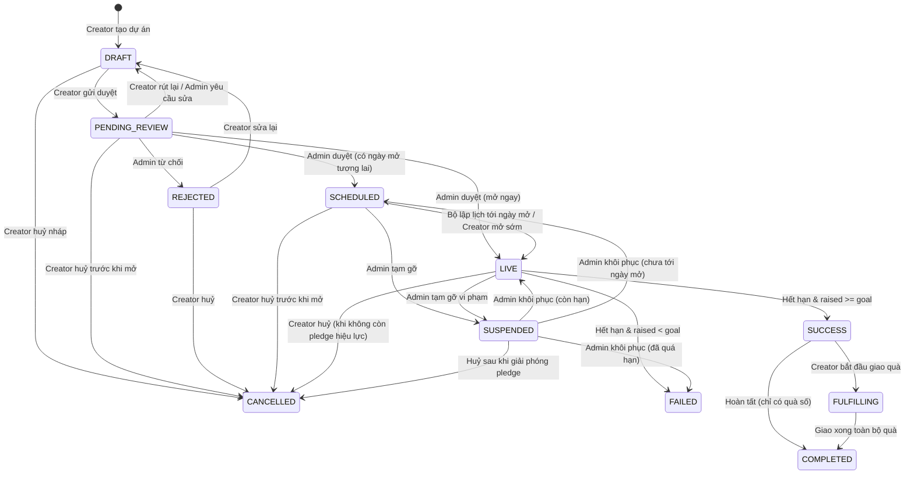

### 6.2. Vòng đời khoản góp vốn (`pledges.status`) — Trigger `trg_pledges_status_flow`

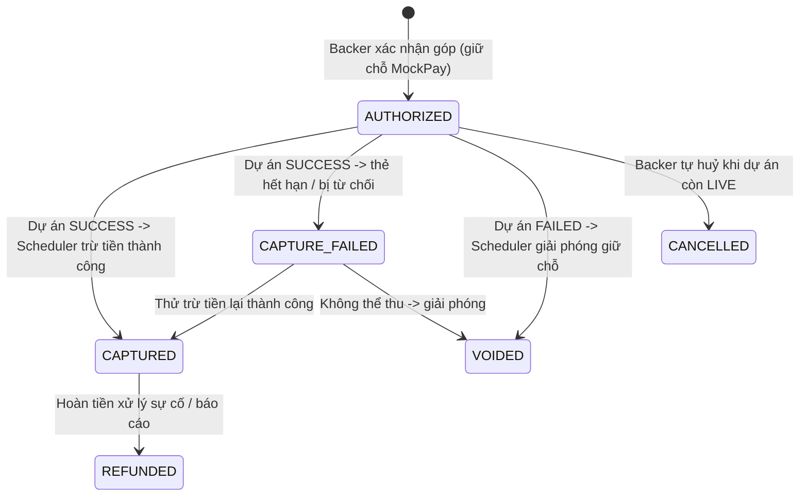

### 6.3. Vòng đời giao quà (`shipments.status`) & Lời mời (`project_invitations.status`)

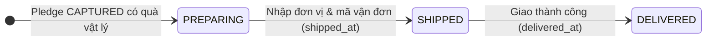

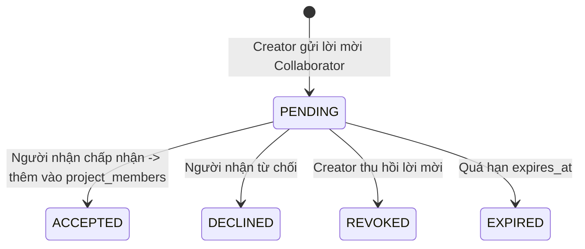

---

## 7. Ánh xạ quy tắc nghiệp vụ

| Mã | Quy tắc nghiệp vụ | Cách thực thi trong CSDL & Tầng dịch vụ |
|---|---|---|
| **BR01** | Mục tiêu gọi vốn từ `1.000.000đ` đến `2.000.000.000đ` | `projects`: `CHECK (goal_amount BETWEEN 1000000 AND 2000000000)` |
| **BR02** | Thời lượng từ `1` đến `60` ngày; `end_at > start_at` | `projects`: `CHECK (duration_days BETWEEN 1 AND 60)`, `CHECK (end_at IS NULL OR (start_at IS NOT NULL AND end_at > start_at))` |
| **BR03** | *All-or-Nothing*: chỉ thu tiền khi `raised >= goal` tại `end_at` | `pledges` khởi đầu `AUTHORIZED` (`trg_pledges_guard`), chỉ chuyển `CAPTURED` hoặc `VOIDED` qua `runScheduler` |
| **BR04** | Creator / Collaborator / Admin không góp vốn vào dự án cấm | `trg_pledges_guard` kiểm tra `pledge.create` & `project_members` + `pledgeBlocker()` |
| **BR05** | Mỗi user tối đa 1 pledge đang hiệu lực/dự án; muốn đổi → huỷ & tạo mới | Partial unique index `uq_pledge_active ON pledges(project_id, backer_id) WHERE status IN ('AUTHORIZED','CAPTURED','CAPTURE_FAILED')`; `createPledge(..., { replaceExisting: true })` |
| **BR06** | Số tiền tối thiểu `>= 10.000đ`; có chọn tier thì khớp giá tier | `pledges.total_amount >= 10000`, `total_amount = reward + bonus + add_on + shipping`, `trg_pledges_guard` kiểm khớp `reward_tiers.amount` |
| **BR07** | Chống bán vượt số suất gói quà & tồn kho add-on | `reward_tiers`: `CHECK (claimed_count <= quantity_limit)`; `add_ons`: `CHECK (sold_count <= stock)`; tăng nguyên tử trong transaction qua trigger `trg_pledges_after_insert` và `trg_pledge_add_ons_stock` |
| **BR08** | Sửa/huỷ pledge chỉ thực hiện khi dự án còn `LIVE` và trước `end_at` | `cancelPledgeInternal()` kiểm tra `pl.status = 'AUTHORIZED' AND p.status = 'LIVE' AND end_at > now` |
| **BR09** | Khoá `goal_amount`, `duration_days` sau khi gửi duyệt; khoá giá tier đã có người chọn | Trigger `trg_projects_lock_funding`, `trg_tiers_price_locked`, `trg_tiers_delete_locked` |
| **BR10** | Giao hàng chỉ trong phạm vi Việt Nam (`VN`); phí ship `0` nếu không ship vật lý | `addresses`: `CHECK (country_code = 'VN')`; `reward_tiers`: `CHECK (ships_physical = 1 OR shipping_fee = 0)`; `pledges`: `CHECK (shipping_amount = 0 OR ship_address IS NOT NULL)` |
| **BR11** | Bình luận tối đa `2000` ký tự; trả lời tối đa `2` cấp | `comments`: `CHECK (length <= 2000)` + trigger `trg_comments_guard` chặn trả lời cấp 3 |
| **BR12** | Chỉ dùng thẻ và địa chỉ của chính Backer | Khoá ngoại ghép `(payment_method_id, backer_id) → payment_methods(id, user_id)` và `(address_id, backer_id) → addresses(id, user_id)` |
| **BR13** | Cảnh báo Admin khi dự án có `>= 3` báo cáo `OPEN` | Truy vấn tổng hợp trên `reports` trong `adminBadges()` & `adminDashboard()` |
| **BR14** | Dự đoán AI chỉ hiển thị nội bộ (Creator / Collaborator / Admin), không công khai | Kiểm tra quyền `stats.view` / `admin.project.review` phía server trước khi truy vấn `ai_predictions` |
| **BR15** | AI gợi ý trả lời bình luận nhưng con người luôn bấm gửi | `comment_analyses.suggested_reply` tách khỏi bảng `comments`; `handled_by/handled_at` chỉ ghi nhận khi người dùng thao tác |
| **BR16** | Khoá chuyển trạng thái sai & chặn huỷ dự án khi còn pledge hiệu lực | `trg_projects_status_flow`, `trg_projects_cancel_guard`, `trg_pledges_status_flow` |
| **BR17** | Bộ lập lịch & thanh toán *idempotent* | `payment_transactions.idempotency_key UNIQUE` (`<pledge_id>:<KIND>`) + kiểm tra trước khi chèn trong `runScheduler` |
| **BR18** | Tiền tệ là số nguyên VND | Toàn bộ cột tiền dùng `INTEGER` (SQLite) / `BIGINT` (PostgreSQL) |
| **BR19** | Bảo mật thẻ: không lưu số thẻ thô | `payment_methods` chỉ lưu `last4` và `provider_token`; kiểm tra Luhn ở `pledge.ts` trước khi tạo token |
| **BR20** | Dự án `SCHEDULED` chỉ xem trước (nếu `is_preview_public`), chưa cho góp vốn | `canViewProject()` kiểm tra `is_preview_public`; `trg_pledges_guard` chỉ nhận `status = 'LIVE'` |

---

## 8. Phân tích chuẩn hoá (3NF / BCNF) & Phi chuẩn hoá có kiểm soát

### 8.1. Đánh giá đạt chuẩn 3NF / BCNF

1. **1NF (Nguyên tử hoá thuộc tính):**
   - Không lưu danh sách vật phẩm quà trong một chuỗi hay cột mảng: tách thành bảng `reward_items` (1–N với `reward_tiers`).
   - Không lưu danh sách add-on đã mua trong cột JSON trên `pledges`: tách thành bảng `pledge_add_ons`.
   - Không lưu danh sách quyền dạng chuỗi trên `users`: chuẩn hoá qua `roles`, `permissions`, `role_permissions`, `user_roles`, `project_members`.
2. **2NF (Loại bỏ phụ thuộc hàm bộ phận vào khoá chính ghép):**
   - Ở các bảng có PK ghép như `pledge_add_ons(pledge_id, add_on_id)`, `quantity` và `unit_price` phụ thuộc đầy đủ vào cặp `(pledge_id, add_on_id)`.
   - Ở `project_members(project_id, user_id)`, `role_code`, `status`, `joined_at` phụ thuộc đầy đủ vào cả dự án và thành viên.
   - Ở `project_daily_stats(project_id, stat_date)`, mọi chỉ số thống kê phụ thuộc đầy đủ vào cặp `(project_id, stat_date)`.
3. **3NF & BCNF (Loại bỏ phụ thuộc bắc cầu):**
   - Thông tin quốc gia/tỉnh thành của người dùng nằm ở `users`, thông tin danh mục nằm ở `categories`, mô tả mức quà nằm ở `reward_tiers` — không lặp lại ở bảng khác (ngoại trừ snapshot có chủ đích bên dưới).
   - Mọi định thức (`determinant`) ở các bảng chuẩn đều là siêu khoá (`candidate key`) — ví dụ cặp `(code, scope)` trên `roles` và `permissions` có `UNIQUE (code, scope)` nên không vi phạm BCNF.

### 8.2. Phi chuẩn hoá có kiểm soát (Deliberate Denormalization)

Vì bài toán **đọc nhiều hơn ghi** (trang chủ, thẻ dự án, bảng xếp hạng) và **bảo toàn lịch sử tài chính** (audit snapshot), lược đồ áp dụng 3 nhóm phi chuẩn hoá có kiểm soát nghiêm ngặt:

| Nhóm | Cột / Bảng phi chuẩn hoá | Lý do hiệu năng / nghiệp vụ | Cơ chế đồng bộ chống lệch dữ liệu |
|---|---|---|---|
| **Counter Cache trên dự án & phần quà** | `projects.pledged_amount`, `projects.backers_count`, `reward_tiers.claimed_count`, `add_ons.sold_count` | Tránh `SUM()` / `COUNT()` trên hàng nghìn dòng `pledges` mỗi lần tải trang chủ, trang Khám phá hoặc kiểm tra hết suất | Trigger `trg_pledges_after_insert`, `trg_pledges_after_release`, `trg_pledge_add_ons_stock` tự cộng/trừ nguyên tử ngay trong transaction; kết hợp `CHECK (claimed_count <= quantity_limit)` và `CHECK (sold_count <= stock)` |
| **Ảnh chụp (Snapshot) tài chính & giao hàng** | `pledges.reward_amount`, `pledges.ship_recipient`, `pledges.ship_phone`, `pledges.ship_address`, `pledges.ship_province`, `pledge_add_ons.unit_price` | Nếu Backer sửa/xoá địa chỉ trong `addresses` hoặc Creator điều chỉnh add-on về sau, biên nhận và đơn giao quà của pledge cũ **không được bị thay đổi** | Đóng băng tại thời điểm `createPledge()`, bảo vệ bất biến bằng trigger `trg_pledges_amount_immutable` |
| **Tổng hợp sẵn theo ngày** | `project_daily_stats` | Vẽ biểu đồ tiến độ 30–60 ngày (FR29) và cung cấp đầu vào tốc độ gọi vốn cho mô hình AI (`features.ts`) trong vài mili-giây | Hàm `bumpDailyStats()` chạy trong cùng `tx()` với `createPledge()` và `cancelPledge()` |

---

## 9. Chiến lược chỉ mục

### 9.1. Chỉ mục duy nhất từng phần (Partial Unique Indexes)

| Tên chỉ mục | Bảng & Cột | Điều kiện `WHERE` | Tác dụng |
|---|---|---|---|
| `uq_address_default` | `addresses(user_id)` | `is_default = 1` / `true` | Bảo đảm mỗi user có tối đa 1 địa chỉ mặc định |
| `uq_payment_default` | `payment_methods(user_id)` | `is_default = 1` / `true` | Bảo đảm mỗi user có tối đa 1 thẻ mặc định |
| `uq_project_one_creator` | `project_members(project_id)` | `role_code = 'CREATOR'` | Bảo đảm mỗi dự án chỉ có đúng 1 Creator |
| `uq_invitation_pending` | `project_invitations(project_id, email)` | `status = 'PENDING'` | Không gửi trùng lời mời đang chờ cho cùng email trên 1 dự án |
| `uq_pledge_active` | `pledges(project_id, backer_id)` | `status IN ('AUTHORIZED','CAPTURED','CAPTURE_FAILED')` | Mỗi Backer tối đa 1 pledge đang hiệu lực/dự án (cho phép góp lại nếu đã `CANCELLED`) |

### 9.2. Chỉ mục truy vấn nóng (Hot-Path Indexes)

| Chỉ mục | Bảng & Cột | Truy vấn được tối ưu |
|---|---|---|
| `idx_projects_status_end` | `projects(status, end_at)` | Bộ lập lịch quét `SCHEDULED`/`LIVE` hết hạn, trang Khám phá lọc theo trạng thái |
| `idx_projects_category` | `projects(category_id, status)` | Lọc dự án theo thể loại ở trang chủ & `/explore` |
| `idx_projects_creator` | `projects(creator_id)` | Danh sách dự án trong Studio & hồ sơ Creator |
| `idx_pledges_project` | `pledges(project_id, status)` | Danh sách backer của dự án, đối soát tiền theo dự án |
| `idx_pledges_backer` | `pledges(backer_id, created_at DESC)` | Trang `/me/backed` (lịch sử góp vốn cá nhân) |
| `idx_updates_project` | `project_updates(project_id, status, published_at DESC)` | Tab Updates & lọc bản nháp Studio |
| `idx_comments_project`, `idx_comments_parent` | `comments(project_id, created_at DESC)`, `comments(parent_id)` | Tải danh sách bình luận và gom nhóm trả lời cấp 2 |
| `idx_comment_analyses_action` | `comment_analyses(needs_action, handled_at)` | Hộp thư góp ý AI cần xử lý trong Studio |
| `idx_notifications_user` | `notifications(user_id, read_at, created_at DESC)` | Chuông thông báo & đếm số chưa đọc ở Navbar |
| `idx_predictions_project` | `ai_predictions(project_id, created_at DESC)` | Lấy kết quả dự đoán AI mới nhất & lịch sử |
| `idx_reports_status` | `reports(status, created_at DESC)` | Hàng đợi xử lý báo cáo của Admin |
| `idx_audit_created` | `audit_logs(created_at DESC)` | Nhật ký kiểm toán hệ thống |

---

## 10. Ma trận truy vết FR01–FR34 → Bảng & Thành phần

| Mã | Nhóm | Yêu cầu chức năng (Biên bản 18/11/2026) | Bảng CSDL liên quan | View / Trigger / Service chính |
|---|---|---|---|---|
| **FR01** | Tài khoản | Đăng ký, đăng nhập, đổi username/password/email | `users`, `sessions`, `user_roles`, `user_settings` | `trg_users_touch`, `auth/session.ts` |
| **FR02** | Tài khoản | Một tài khoản dùng được cả hai vai trò Creator & Backer | `user_roles`, `project_members`, `pledges` | `v_user_system_permissions`, `v_project_permissions` |
| **FR03** | Tài khoản | Hồ sơ cá nhân: đã góp, đã lưu, đang follow | `users`, `pledges`, `saved_projects`, `follows` | `user_settings.hide_backed_projects` |
| **FR04** | Dự án | Tạo dự án: tên, mô tả, nhiều section hình/video, goal, duration | `projects`, `project_sections`, `categories` | `trg_projects_creator_member`, `trg_projects_lock_funding` |
| **FR05** | Dự án | Tạo & sửa các mức pledge/reward, thời gian giao, số item | `reward_tiers`, `reward_items`, `add_ons`, `reward_tier_add_ons` | `trg_tiers_price_locked`, `trg_tiers_delete_locked` |
| **FR06** | Dự án | Đặt ngày bắt đầu chiến dịch & mở trang preview | `projects` (`start_at`, `is_preview_public`), `project_status_history` | `setSchedule()`, `canViewProject()` |
| **FR07** | Dự án | Trang chi tiết dự án 7 tab (Campaign, Rewards, Creator, FAQ, Updates, Comments, Community) | `projects`, `project_sections`, `reward_tiers`, `users`, `faqs`, `project_updates`, `comments` | `v_project_backer_countries` |
| **FR08** | Dự án | Hiển thị tiến độ; hoàn thành ẩn thanh tiến trình & chọn nội dung hiển thị | `projects` (`pledged_amount`, `backers_count`, `completed_display`, `completed_message`) | `trg_projects_status_flow` |
| **FR09** | Dự án | Đăng và quản lý FAQ | `faqs` | `trg_faqs_author` (`faq.manage`) |
| **FR10** | Dự án | Đăng Update tiến độ như bản tin | `project_updates` | `trg_updates_author`, `trg_updates_publish` |
| **FR11** | Dự án | Gán Collaborator & hiển thị nhãn bên cạnh tên | `project_members`, `project_invitations`, `roles` | `trg_members_creator_guard`, `trg_members_no_promote` |
| **FR12** | Dự án | Collaborator trả lời bình luận và theo dõi hoạt động | `project_members`, `comments`, `project_updates`, `faqs`, `project_daily_stats` | `v_project_permissions` |
| **FR13** | Khám phá | Trang chủ liệt kê dự án đang chạy (`LIVE`) và sắp mở (`SCHEDULED`) | `projects`, `categories`, `pledges` | `idx_projects_status_end` |
| **FR14** | Khám phá | Duyệt dự án theo thể loại | `categories`, `projects` | `idx_projects_category` |
| **FR15** | Khám phá | Tìm kiếm và lọc dự án | `projects`, `categories`, `users`, `project_daily_stats` | `listPublicProjects()` |
| **FR16** | Khám phá | Save Project | `saved_projects` | `idx_saved_project` |
| **FR17** | Khám phá | Recommended: hệ thống đề xuất dự án | `projects`, `saved_projects`, `follows`, `pledges`, `categories` | Truy vấn chấm điểm tương đồng thể loại + tương tác |
| **FR18** | Khám phá | Follow creator & nhận thông báo khi mở dự án mới | `follows`, `notifications` | `runScheduler()`, `reviewProject()` |
| **FR19** | Góp vốn | Chọn pledge hoặc góp không nhận quà | `pledges`, `reward_tiers` (`tier_id NULL`) | `trg_pledges_guard`, `quotePledge()` |
| **FR20** | Góp vốn | Nhập địa chỉ giao hàng nội bộ Việt Nam | `addresses`, `pledges` (cột `ship_*`) | `CHECK(country_code='VN')`, FK ghép `(address_id, backer_id)` |
| **FR21** | Góp vốn | Chọn add-on mua kèm, hiển thị tổng tiền | `add_ons`, `reward_tier_add_ons`, `pledge_add_ons` | `trg_pledge_add_ons_guard`, `trg_pledge_add_ons_stock` |
| **FR22** | Góp vốn | Nhập thông tin thẻ, giữ chỗ chưa trừ tiền ngay | `payment_methods`, `pledges`, `payment_transactions` | `createPledge()`, `AUTHORIZE` |
| **FR23** | Góp vốn | Hết chiến dịch: đạt mục tiêu trừ tiền, không đạt không trừ | `projects`, `pledges`, `payment_transactions`, `scheduler_runs` | `runScheduler()` (idempotent `CAPTURE`/`VOID`) |
| **FR24** | Góp vốn | Lịch sử góp vốn và trạng thái hiện tại (kèm giao quà) | `pledges`, `payment_transactions`, `shipments` | `trg_shipments_guard`, `idx_pledges_backer` |
| **FR25** | Tương tác | Bình luận và trả lời qua lại trên dự án | `comments`, `comment_likes` | `trg_comments_guard` (`<= 2` cấp) |
| **FR26** | Tương tác | Tin nhắn nội bộ | `conversations`, `conversation_participants`, `messages` | FK ghép `(conversation_id, sender_id)` |
| **FR27** | Tương tác | Activity: bảng tin cập nhật về các dự án đã góp | `notifications`, `project_updates`, `pledges` | `idx_notifications_user` |
| **FR28** | Tương tác | Thống kê cộng đồng góp vốn theo quốc gia, số người | `pledges`, `users` | View `v_project_backer_countries` |
| **FR29** | Thống kê & AI | Biểu đồ số người & số tiền theo ngày (tính cả giữ chỗ) | `project_daily_stats`, `pledges` | `bumpDailyStats()` |
| **FR30** | Thống kê & AI | AI dự đoán % thành công chiến dịch (cả trước khi đăng) | `ai_predictions`, `projects`, `reward_tiers`, `project_sections`, `faqs` | `predictSuccess()`, `buildPredictionInput()` |
| **FR31** | Thống kê & AI | AI gợi ý điều chỉnh chiến dịch theo thị hiếu & hoạt động | `ai_predictions` (`suggestions_json`), `saved_projects`, `follows` | `predictSuccess()` |
| **FR32** | Thống kê & AI | AI lọc các bình luận góp ý để Creator/Collaborator xử lý | `comment_analyses`, `comments` | `analyzeComment()`, `idx_comment_analyses_action` |
| **FR33** | Quản trị | Quản trị hệ thống (dashboard, nhật ký, lập lịch) | `audit_logs`, `scheduler_runs`, `pledges`, `projects` | `v_user_system_permissions` |
| **FR34** | Quản trị | Duyệt/gỡ dự án, khoá/mở tài khoản, quản lý thể loại & báo cáo | `project_reviews`, `project_status_history`, `users`, `categories`, `reports` | `trg_reviews_guard`, `reviewProject()`, `suspendProject()` |

---

## 11. Đối chiếu SQLite và PostgreSQL 18

| Khía cạnh | SQLite (`node:sqlite` — chạy local demo) | PostgreSQL 18 (`database/postgres/schema.sql`) |
|---|---|---|
| **Khoá chính định danh** | `TEXT PRIMARY KEY` (UUID v4 sinh từ `crypto.randomUUID()`) | `UUID PRIMARY KEY DEFAULT gen_random_uuid()` (giữ `TEXT PK` cho `roles.code`, `permissions.code`, `sessions.id`, `meta.key`) |
| **Email & Username không phân biệt hoa thường** | `TEXT UNIQUE COLLATE NOCASE` | `CITEXT UNIQUE` (qua extension `citext`) |
| **Trạng thái & phân loại** | `TEXT CHECK (col IN (...))` | Kiểu `ENUM` tường minh (`project_status`, `pledge_status`, …) |
| **Tiền tệ VND** | `INTEGER` (64-bit signed trong SQLite) | `BIGINT` (64-bit signed, hỗ trợ tới hàng nghìn tỷ VND) |
| **Boolean** | `INTEGER CHECK (col IN (0,1))` | `BOOLEAN` (`true` / `false`) |
| **Mốc thời gian & Ngày VN** | `TEXT` (ISO-8601 UTC / `YYYY-MM-DD`) | `TIMESTAMPTZ` (UTC) và `DATE` cho `project_daily_stats.stat_date` |
| **Payload AI** | `TEXT` chứa JSON | `JSONB` (hỗ trợ truy vấn/index bên trong tài liệu JSON) |
| **Trigger & Báo lỗi** | SQLite trigger syntax + `SELECT RAISE(ABORT, '...')` | Hàm PL/pgSQL (`RETURNS TRIGGER`) + `RAISE EXCEPTION '...'` |
| **Đồng thời & Khoá ghi** | `PRAGMA journal_mode = WAL` + `busy_timeout = 5000` (1 tiến trình Next.js) | MVCC đa kết nối, hỗ trợ `SELECT ... FOR UPDATE` khi triển khai đa instance |
| **Tính tương đương** | Cùng tên 40 bảng, cùng tên cột, cùng 3 View, cùng 25 Trigger & quy tắc kiểm tra | Sẵn sàng chuyển đổi trực tiếp qua bộ công cụ SQL hoặc Prisma |
