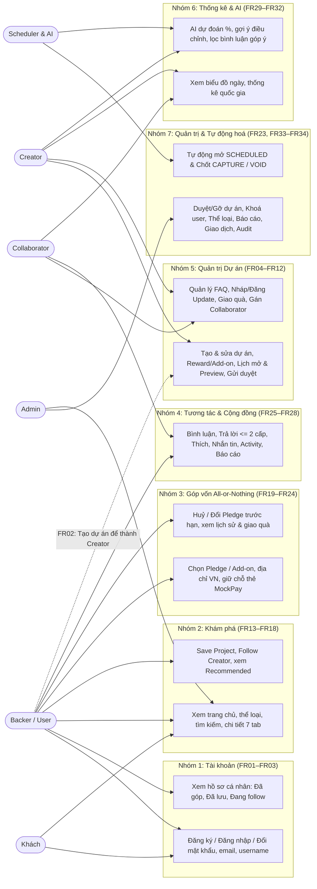
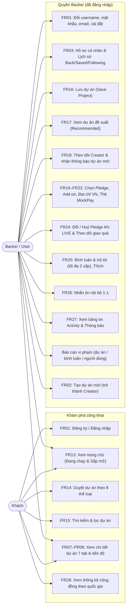
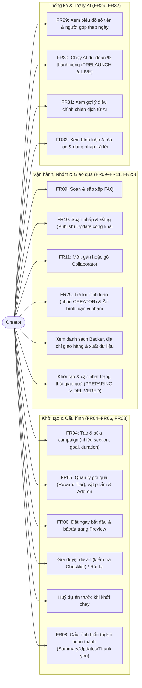
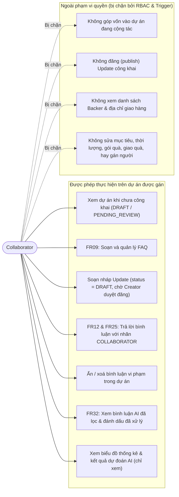
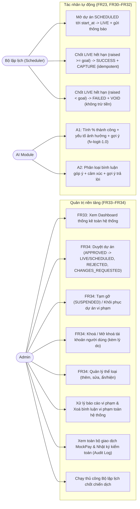

# Lược đồ Use Case Hệ thống — FundViet v3

> Tài liệu mô tả **Lược đồ Use Case tổng quan** và **lược đồ Use Case chi tiết theo từng vai trò** (Khách, Backer/User, Creator, Collaborator, Admin, Bộ lập lịch & AI) theo đúng yêu cầu biên bản họp ngày 18/11/2026 và 34 chức năng (**FR01–FR34**).

---

## 1. Danh sách Tác nhân (Actors)

| Tác nhân | Phân loại | Mô tả vai trò |
|---|---|---|
| **Khách (Guest)** | Con người (chưa đăng nhập) | Xem dự án công khai (`LIVE`, `SCHEDULED` preview, `SUCCESS`/`FAILED`/`FULFILLING`/`COMPLETED`), duyệt thể loại, tìm kiếm. |
| **Backer / User (`MEMBER`)** | Con người (đã đăng nhập) | Mọi tài khoản đã đăng nhập đều có quyền Backer: quản lý tài khoản, góp vốn, lưu dự án, theo dõi Creator, bình luận, nhắn tin, báo cáo vi phạm, tạo dự án mới. |
| **Creator (`CREATOR`)** | Vai trò theo dự án | Chủ sở hữu dự án: tạo và sửa campaign, gói quà, đặt lịch mở, đăng Update, quản lý FAQ, xem thống kê & chạy AI, xem danh sách backer & giao quà, gán/gỡ Collaborator, huỷ dự án trước khi chạy. |
| **Collaborator (`COLLABORATOR`)** | Vai trò theo dự án | Cộng sự được Creator mời: trả lời bình luận (có nhãn vai trò), xử lý góp ý AI đã lọc, ẩn bình luận vi phạm, soạn nháp Update, quản lý FAQ, xem thống kê (chỉ xem). Không đụng tới tiền, địa chỉ backer, hay cấu hình dự án. |
| **Admin (`ADMIN`)** | Con người (toàn hệ thống) | Kiểm duyệt dự án trước khi công khai, tạm gỡ/khôi phục dự án vi phạm, khoá/mở khoá tài khoản, quản lý thể loại, xem giao dịch, xử lý báo cáo, kích hoạt bộ lập lịch, xem nhật ký hệ thống. |
| **Scheduler & AI (Hệ thống)** | Tác nhân tự động | **Scheduler** tự động mở dự án `SCHEDULED` đến hạn và chốt *All-or-Nothing* (`CAPTURE` / `VOID`) khi `LIVE` hết hạn. **AI Module** dự đoán % thành công, gợi ý điều chỉnh và phân loại bình luận góp ý. |

---

## 2. Lược đồ Use Case Tổng quan Hệ thống

---

## 3. Lược đồ Use Case Chi tiết theo từng Vai trò

### 3.1. Vai trò Khách (Guest) & Backer / User (FR01–FR03, FR13–FR28)

> Mọi tài khoản đã đăng nhập (`MEMBER`) đều là **Backer**. Khi chọn "Tạo dự án mới" (FR02), tài khoản đó trở thành **Creator** của riêng dự án vừa tạo, đồng thời vẫn là Backer ở các dự án khác.

---

### 3.2. Vai trò Creator (Chủ dự án — FR04–FR11, FR29–FR32)

> Áp dụng trên các dự án do chính tài khoản đó tạo (`role_code = 'CREATOR'`). Ở dự án khác, Creator vẫn dùng các quyền Backer bình thường, nhưng **bị chặn góp vốn vào dự án của chính mình** (Chú thích `¹`).

---

### 3.3. Vai trò Collaborator (Cộng tác viên — FR11–FR12, FR25, FR32)

> Collaborator có 7 quyền cấp dự án tập trung vào **vận hành cộng đồng và nội dung nháp**, tuyệt đối **không** có quyền tài chính (`backer.view`, `fulfillment.manage`), công khai bản tin (`update.publish`), chạy AI (`ai.run`), chỉnh sửa cấu hình/mức quà hay gán/gỡ thành viên. Không được góp vốn vào dự án mình làm Collaborator (`¹`).

---

### 3.4. Vai trò Admin & Hệ thống Tự động (Scheduler / AI — FR23, FR30–FR34)

> Admin giám sát toàn nền tảng và **không** góp vốn hay đăng/sửa nội dung chiến dịch thay Creator. Scheduler & AI thực hiện tự động hoá vòng đời *All-or-Nothing* và hỗ trợ ra quyết định.

---

## 4. Tóm tắt Quy trình Nghiệp vụ Đầu–Cuối (End-to-End Flow)

1. **Chuẩn bị & Thẩm định (Creator → Admin):** Creator tạo dự án `DRAFT` → hoàn thành checklist → gửi duyệt `PENDING_REVIEW` (tự động khoá `goal_amount` và `duration_days`) → Admin thẩm định (`APPROVED` mở ngay `LIVE` hoặc hẹn ngày `SCHEDULED` có trang preview công khai; hoặc `CHANGES_REQUESTED` / `REJECTED`).
2. **Gọi vốn & Tương tác (Backer ↔ Creator & Collaborator):** Backer chọn gói quà + add-on + địa chỉ VN → MockPay tạo `pledge` ở trạng thái `AUTHORIZED` (chưa trừ tiền), đồng thời trigger tự cập nhật counter cache và kiểm tra giới hạn suất quà. Collaborator hỗ trợ trả lời bình luận, xử lý góp ý AI đã lọc và soạn nháp Update; Creator duyệt đăng Update công khai.
3. **Chốt chiến dịch tự động (Scheduler — All-or-Nothing):** Khi quá `end_at`, nếu `raised >= goal` → `SUCCESS`, thực hiện `CAPTURE` từng pledge với `idempotency_key`; nếu thiếu mục tiêu → `FAILED`, thực hiện `VOID` giải phóng toàn bộ tiền giữ chỗ.
4. **Giao quà & Hoàn tất (Creator → Backer):** Creator chuyển dự án sang `FULFILLING`, hệ thống sinh `shipments` cho các pledge `CAPTURED` có quà vật lý → cập nhật `PREPARING → SHIPPED → DELIVERED` → hoàn tất `COMPLETED`.
