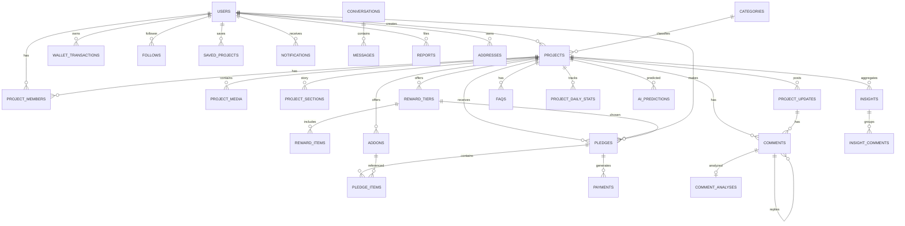

# FUNDVIET — TÀI LIỆU MÔ TẢ HỆ THỐNG HOÀN CHỈNH

> **Phiên bản:** 1.0 — 13/11/2026
> **Phạm vi:** CHỈ Web responsive + Web App (không mobile native)
> **Tên sản phẩm:** FundViet (tên cũ trong mã nguồn: Góp)
> **Nhóm:** 2 sinh viên CNTT — Võ Phước Thịnh và Nguyễn Nhựt Thanh
> Tài liệu này mô tả **toàn bộ giao diện** (từng trang, từng vai trò, từng chi tiết), **toàn bộ Use Case** (kèm actor) và **cơ sở dữ liệu đầy đủ** của nền tảng gọi vốn cộng đồng FundViet.

---

## MỤC LỤC

1. [Tổng quan đề tài](#1-tổng-quan-đề-tài)
2. [Kiến trúc & công nghệ](#2-kiến-trúc--công-nghệ)
3. [Nghiệp vụ lõi: All-or-Nothing & MockPay](#3-nghiệp-vụ-lõi-all-or-nothing--mockpay)
4. [Ba module AI](#4-ba-module-ai)
5. [Vai trò & ma trận phân quyền](#5-vai-trò--ma-trận-phân-quyền)
6. [Design system & thành phần chung](#6-design-system--thành-phần-chung)
7. [MÔ TẢ GIAO DIỆN TỪNG TRANG — Guest / Public](#7-mô-tả-giao-diện-từng-trang--guest--public)
8. [MÔ TẢ GIAO DIỆN TỪNG TRANG — Backer](#8-mô-tả-giao-diện-từng-trang--backer)
9. [MÔ TẢ GIAO DIỆN TỪNG TRANG — Creator](#9-mô-tả-giao-diện-từng-trang--creator)
10. [MÔ TẢ GIAO DIỆN TỪNG TRANG — Collaborator](#10-mô-tả-giao-diện-từng-trang--collaborator)
11. [MÔ TẢ GIAO DIỆN TỪNG TRANG — Admin](#11-mô-tả-giao-diện-từng-trang--admin)
12. [MÔ TẢ GIAO DIỆN — Trang hệ thống & trạng thái](#12-mô-tả-giao-diện--trang-hệ-thống--trạng-thái)
13. [TOÀN BỘ USE CASE (kèm Actor)](#13-toàn-bộ-use-case-kèm-actor)
14. [Đặc tả 6 Use Case quan trọng](#14-đặc-tả-6-use-case-quan-trọng)
15. [CƠ SỞ DỮ LIỆU ĐẦY ĐỦ](#15-cơ-sở-dữ-liệu-đầy-đủ)
16. [Business Rules](#16-business-rules)
17. [Thiết kế API (tóm tắt)](#17-thiết-kế-api-tóm-tắt)
18. [Ghi chú demo & hạn chế](#18-ghi-chú-demo--hạn-chế)

---

## 1. TỔNG QUAN ĐỀ TÀI

### 1.1. Tên đề tài
**Xây dựng nền tảng gọi vốn cộng đồng (crowdfunding) trên nền tảng Web, tích hợp AI hỗ trợ dự đoán khả năng thành công của chiến dịch và phân tích góp ý từ cộng đồng.**

### 1.2. Giới thiệu
FundViet là nền tảng crowdfunding dạng **All-or-Nothing** dưới dạng website responsive và web app:

- **Creator** đăng ý tưởng qua trình tạo nhiều bước, gửi Admin duyệt, có trang **xem trước (preview)** trước ngày chạy.
- **Backer** xem dự án, chọn **mức góp (reward tier)** kèm quà, chọn **add-on**, nhập **địa chỉ Việt Nam**, xác nhận góp vốn.
- Hệ thống **giữ chỗ** khoản góp (mô phỏng bằng ví ảo MockPay), chỉ **thu** khi chiến dịch đạt mục tiêu lúc hết hạn; ngược lại **nhả toàn bộ**.
- Một tài khoản có thể **vừa tạo dự án, vừa góp vốn dự án khác**.
- Creator đăng **Update**, trả lời **Comment**, quản lý **FAQ**, mời **Collaborator**, xem **dashboard** thống kê người góp – tiền về theo ngày – phân bố địa lý.

### 1.3. Phạm vi & giới hạn
- ✅ Chỉ **website responsive + web app** (điện thoại dùng qua trình duyệt, tối ưu từ 360px). Không app native.
- ✅ Thanh toán **mô phỏng bằng ví ảo MockPay** — không cổng thật, không KYC, không lưu thẻ, không rút tiền thật.
- ✅ Một loại tiền **VND** (số nguyên BIGINT), giao hàng **chỉ Việt Nam**.
- ✅ AI là module trong backend, **có fallback chạy offline** khi tắt LLM.
- ⛔ Không làm: Flutter/mobile, VNPay/tiền thật, đa tiền tệ, ship quốc tế, blockchain, K8s, deep learning, SHAP/embedding.

### 1.4. Đóng góp / điểm nhấn
- **A1 – Dự đoán khả năng thành công:** % thành công + yếu tố ảnh hưởng + gợi ý điều chỉnh (bộ chấm điểm có trọng số, tùy chọn Logistic Regression hệ số JSON).
- **A2 – Phân tích góp ý cộng đồng:** phân loại bình luận (Câu hỏi/Góp ý/Khen/Phàn nàn/Spam), gom nhóm thành **Insight** ("27 người muốn thêm màu đen"), sinh **nháp trả lời** — luôn cần người bấm Gửi. Fallback luật từ khóa tiếng Việt.
- **A3 – Gợi ý dự án:** cùng thể loại + độ phổ biến + lịch sử lưu/góp; chạy bằng SQL.
- Mọi kết quả AI gắn nhãn **"AI · Chỉ mang tính tham khảo"**.

---

## 2. KIẾN TRÚC & CÔNG NGHỆ

```
┌─────────────────────────────────────────────┐
│  WEB / WEB APP — Next.js (App Router) + TS  │
│  Public site · Backer area · Creator Studio │
│  Admin panel (chung 1 app, route /admin)    │
└──────────────────┬──────────────────────────┘
                   │ REST (polling; Socket.IO nếu kịp)
                   ▼
┌─────────────────────────────────────────────┐
│  BACKEND — NestJS + TypeScript + Prisma     │
│  Auth · Projects · Pledges · Comments       │
│  Notifications · Admin · Cron · MockPay     │
│  AI Module (chấm điểm + LLM + rule)         │
└──────────────────┬──────────────────────────┘
                   ▼
┌─────────────────────────────────────────────┐
│  PostgreSQL 16                              │
└─────────────────────────────────────────────┘
Ngoài (tùy chọn): Cloudinary (ảnh) · Mailtrap/Resend (email) · LLM API
```

| Lớp | Công nghệ |
|---|---|
| Frontend | Next.js (App Router) + TypeScript + TailwindCSS + TanStack Query + Recharts |
| UI | Lucide icon, component tự dựng theo design system riêng |
| Form | React Hook Form + Zod |
| Backend | NestJS (apps/api) + Prisma ORM |
| Database | PostgreSQL 16 (bản demo web chạy SQLite local + cookie, chưa nối hết PostgreSQL) |
| Auth | JWT access + refresh cookie HttpOnly |
| Realtime | Mặc định polling; Socket.IO là Should-have |
| AI | Module trong backend: chấm điểm + logistic JSON + LLM API + luật từ khóa tiếng Việt |

**Cấu trúc repo:** `apps/web` (frontend), `apps/api` (backend NestJS/Prisma), `docs/` (tài liệu, spec, sơ đồ).

---

## 3. NGHIỆP VỤ LÕI: ALL-OR-NOTHING & MOCKPAY

### 3.1. Vòng đời dự án
```
DRAFT ──gửi duyệt──► PENDING_REVIEW ──┬──duyệt (ngay)──► LIVE
   ▲                                  ├──duyệt (hẹn)──► SCHEDULED ──cron──► LIVE
   │                                  ├──yêu cầu sửa──► DRAFT
   └──sửa lại── REJECTED ◄────────────┴──từ chối

LIVE ──(hết hạn, raised ≥ goal)──► SUCCESS ──► FULFILLING ──► COMPLETED
LIVE ──(hết hạn, raised < goal)──► FAILED
LIVE ──(Creator hủy, chưa pledge)──► CANCELLED
LIVE ──(Admin treo)──► SUSPENDED ──► LIVE | CANCELLED
```

### 3.2. Vòng đời pledge & tiền
```
PENDING (giữ chỗ - HOLD)
 ├─ dự án SUCCESS → COLLECTED (CAPTURE) → quà: PREPARING → SHIPPED → DELIVERED
 ├─ dự án FAILED/CANCELLED → VOIDED (RELEASE)
 ├─ backer hủy trước deadline → CANCELLED (RELEASE)
 ├─ backer sửa trước deadline → PENDING (Release cũ + Hold mới)
 └─ admin hoàn tiền (xử lý report) → REFUNDED
```

### 3.3. MockPay (ví ảo mô phỏng)
- Mỗi user có ví: `wallet_available` (khả dụng) + `wallet_held` (đang giữ) — đối soát từ ledger.
- `POST /me/wallet/topup`: nạp tiền ảo (≤100tr/lần) — UI có nhãn **"TIỀN ẢO – DEMO"**.
- `MockPayService`: `hold` / `capture` / `release` / `refund` — ghi `payments` + `wallet_transactions` trong transaction, idempotency_key.
- Khi SUCCESS: ghi phí nền tảng 5% (chỉ số liệu). `MOCK_FAIL_RATE=0.05` tùy chọn để demo lỗi capture & retry.
- **Không** form nhập thẻ, **không** cổng thật.

> ⚠️ Bản web hiện tại **chưa nối MockPay thật**: UI mô phỏng trạng thái `AUTHORIZED` (giữ chỗ), `CAPTURED`, `CANCELED` và ghi rõ "chưa thu tiền". Khi triển khai backend NestJS sẽ thay bằng ví ảo theo thiết kế trên.

---

## 4. BA MODULE AI

### A1 — Dự đoán khả năng thành công
- **Feature tĩnh:** log_goal, duration_days, category, goal_vs_category_avg, tier_count, has_low_entry_tier, min_tier_price_ratio, story_word_count, image_count, has_video, faq_count, creator_past_projects, creator_success_rate.
- **Feature động (LIVE):** elapsed_ratio, goal_progress, pace_ratio, backers_count, avg_pledge, momentum_3d, comments_per_day, sentiment_mean, saves_per_day, days_left.
- **Công thức PRELAUNCH:** base 0.35 + 0.18·video + 0.10·tier rẻ + 0.10·story + 0.08·duration hiệu quả + 0.06·≥3 tier + 0.05·FAQ + 0.08·tỉ lệ thành công creator − 0.20·goal cao − 0.10·duration >45 → clamp 0.05–0.95.
- **Công thức LIVE:** 0.65·sigmoid(2.5·(pace_ratio−1)) + 0.35·p_static.
- **Đầu ra:** probability, band (LOW/MEDIUM/HIGH), top_factors (giải thích tiếng Việt), suggestions (kèm expected_gain), forecast_curve, source (SCORE/LOGISTIC/FALLBACK), model_version.

### A2 — Phân tích góp ý cộng đồng
- Phân loại: `QUESTION | SUGGESTION | PRAISE | COMPLAINT | SPAM | OTHER` + sentiment (POS/NEU/NEG) + actionability 1–5 + summary.
- Gom nhóm theo `cluster_key` cố định: price, color_variant, size_variant, shipping_time, shipping_fee, quality_material, feature_request, packaging, warranty, payment, capacity_stock, other.
- Xếp hạng: `priority = 0.5·log(1+distinct_user) + 0.3·(actionability/5) + 0.2·negativity`.
- Sinh **nháp trả lời** (xưng "team", không hứa điều chưa có). **Luôn có người bấm Gửi** — AI không tự đăng.
- Fallback luật tiếng Việt: từ khóa "nên/giá như/mong..." → SUGGESTION, "?"/"khi nào" → QUESTION, "thất vọng/lừa/chậm" → COMPLAINT...

### A3 — Gợi ý dự án
```
score = 0.45·cùng thể loại + 0.25·creator đã follow + 0.20·popularity + 0.10·freshness
```
Cold start → trending. Lý do gợi ý hiển thị trên thẻ ("Vì bạn đã lưu dự án Công nghệ").

---

## 5. VAI TRÒ & MA TRẬN PHÂN QUYỀN

### 5.1. Mô hình role 2 tầng
- **Tầng hệ thống (`users.system_role`):** `USER` | `ADMIN`.
- **Tầng dự án (`project_members.role`):** `CREATOR` (1 chủ/dự án) | `COLLABORATOR` (nhiều).
- **Backer KHÔNG phải role hệ thống** — là quan hệ phát sinh khi user có pledge vào dự án. Một tài khoản có thể đồng thời: Creator dự án A, Collaborator dự án B, Backer dự án C.

### 5.2. Nhãn hiển thị cạnh tên trong dự án
| Nhãn | Màu | Ý nghĩa |
|---|---|---|
| `CREATOR` | vàng `#FEF3C7/#92400E` | Chủ dự án đó |
| `COLLAB` | xanh dương `#DBEAFE/#1E40AF` | Được mời cộng tác |
| `BACKER` | xanh lá `#DCFCE7/#166534` | Đã góp vào dự án đang xem |
| `ADMIN` | đỏ `#FEE2E2/#991B1B` | Quản trị viên can thiệp |

Ưu tiên: CREATOR > COLLAB > BACKER.

### 5.3. Quyền chi tiết Collaborator (Creator tick khi mời)
| Quyền | Mặc định | Ý nghĩa |
|---|---|---|
| `comment.reply` | ✅ | Trả lời bình luận với nhãn COLLAB |
| `comment.moderate` | ✅ | Ẩn/xóa bình luận trong dự án |
| `update.manage` | ✅ | Tạo/sửa/xóa Update |
| `faq.manage` | ✅ | CRUD FAQ |
| `stats.view` | ✅ | Xem dashboard + danh sách backer |
| `insight.manage` | ✅ | Xem Insight Board, duyệt nháp trả lời |
| `project.edit` | ❌ | Sửa nội dung (chỉ DRAFT/PENDING) |
| `reward.manage` | ❌ | Sửa tier/add-on |
| `fulfillment.manage` | ❌ | Cập nhật trạng thái giao quà |

> **Không bao giờ cấp:** xóa dự án, đổi chủ, mời/xóa collaborator khác, hủy chiến dịch, tạm ứng/rút tiền.

### 5.4. Ma trận phân quyền
| Chức năng | Guest | User | Collaborator | Creator | Admin |
|---|:--:|:--:|:--:|:--:|:--:|
| Xem trang chủ / danh sách / chi tiết LIVE, PREVIEW | ✅ | ✅ | ✅ | ✅ | ✅ |
| Xem DRAFT/PENDING | ❌ | ❌ | ✅*(có quyền)* | ✅ | ✅ |
| Tìm kiếm, lọc, xem Update/FAQ/Comment | ✅ | ✅ | ✅ | ✅ | ✅ |
| Đăng ký / đăng nhập | ✅ | – | – | – | – |
| Tạo dự án | ❌ | ✅ | – | ✅ | ✅ |
| Sửa/xóa nháp | ❌ | ❌ | nếu `project.edit` | ✅ | ✅ |
| Gửi duyệt / hẹn mở / hủy chiến dịch | ❌ | ❌ | ❌ | ✅ | ✅ (force) |
| Góp vốn | ❌ | ✅ | ✅ | ❌ *vào dự án mình* | ❌ |
| Sửa/hủy pledge trước deadline | ❌ | ✅ (của mình) | – | – | ✅ (hỗ trợ) |
| Comment / reply / like | ❌ | ❌ | ✅ | ✅ | ✅ |
| Xóa comment người khác | ❌ | ❌ | nếu `comment.moderate` | ✅ | ✅ |
| Đăng Update / FAQ | ❌ | ❌ | ✅ | ✅ | ✅ |
| Xem dashboard + backer list | ❌ | ❌ | nếu `stats.view` | ✅ | ✅ |
| Xem AI Insight + dự đoán | ❌ | ❌ | nếu `insight.manage` | ✅ | ✅ |
| Mời/xóa Collaborator | ❌ | ❌ | ❌ | ✅ | ✅ |
| Follow / Save / Nhắn tin / Báo cáo | ❌ | ✅ | ✅ | ✅ | ✅ |
| Duyệt/từ chối dự án | ❌ | ❌ | ❌ | ❌ | ✅ |
| Khóa/mở user, phân role | ❌ | ❌ | ❌ | ❌ | ✅ |
| CRUD Category, cấu hình, banner | ❌ | ❌ | ❌ | ❌ | ✅ |
| Xử lý report, audit log | ❌ | ❌ | ❌ | ❌ | ✅ |
| Dashboard hệ thống | ❌ | ❌ | ❌ | ❌ | ✅ |

---

## 6. DESIGN SYSTEM & THÀNH PHẦN CHUNG

### 6.1. Màu sắc
| Token | Giá trị | Dùng cho |
|---|---|---|
| Primary | `#16A34A` | Nút chính, accent, progress |
| Primary-dark | `#15803D` | Hover, nút đậm |
| Ink | `#0F172A` | Chữ chính, tiêu đề |
| Body | `#475569` | Chữ phụ |
| Muted | `#94A3B8` | Placeholder, chú thích |
| Border | `#E2E8F0` | Viền card/input |
| BG | `#F8FAFC` | Nền trang |
| Success / Warning / Danger / Info | `#22C55E` `#F59E0B` `#EF4444` `#3B82F6` | Trạng thái |
| AI accent | `#8B5CF6` | Nhãn AI + icon ✨ |
| Footer/Hero nền tối | `#0B1F16` (xanh đậm FundViet) | Footer, hero, panel tối |

### 6.2. Typography
- Body: **Inter** 400/500/600/700; Display (tiêu đề): **Manrope** extrabold.
- H1 32–40 · H2 24–32 · H3 20–28 · Body 15/24 · Caption 13/20.

### 6.3. Thành phần chung
| Thành phần | Quy định |
|---|---|
| Card | bo 12–16px, viền `#E2E8F0`, shadow-sm → hover nhấc 2–3px + shadow-md |
| Nút | primary xanh / secondary trắng / ghost / dark; min-height 44px; bo 12px; loading spinner + disabled |
| Input | label trên, helper dưới, lỗi đỏ + icon, bắt buộc có `*`, focus ring xanh |
| Progress | nền `#E2E8F0`, fill gradient `#22C55E→#15803D`, hiệu ứng sheen |
| Status badge | pill có chấm màu: LIVE xanh lá · PRE_LAUNCH xanh dương · IN_REVIEW hổ phách · SUSPENDED đỏ · FAILED xám · SUCCESSFUL xanh đậm |
| Nhãn AI | tím + ✨ + "AI · Tham khảo" |
| Tiền tệ | `1.250.000 ₫`, rút gọn `1,25 tỷ ₫` / `633 triệu đ` |
| Đếm ngược | `12 ngày 04:33:21`, <48h đỏ + 🔥 |
| Empty / Loading / Error | Skeleton shimmer · icon + 1 câu + 1 CTA · thông báo + nút thử lại |
| Toast / Modal | góc trên phải 4s · giữa màn, ESC đóng, focus trap, khóa scroll |

### 6.4. Header & Footer dùng chung
- **Header sticky 64px:** logo FundViet (chữ "F" xanh gradient + chữ "FundViệt" + dòng "Gọi vốn cộng đồng") · nav `Khám phá / Sắp ra mắt / Cách hoạt động / Hướng dẫn` · nút tìm kiếm (mở ô tìm vào `/discover`) · bên phải: đăng nhập / chuông thông báo / avatar (dropdown: không gian hiện tại, hồ sơ, việc nhóm, đăng xuất) / nút **Bắt đầu dự án** hoặc **Tạo chiến dịch mới** (đổi theo vai trò đang chọn).
- Mobile: hamburger menu, logo, chuông + avatar; menu mở toàn màn.
- **Footer** (chỉ trang công khai): nền xanh đậm `#0B1F16`, 4 cột (Giới thiệu + slogan · Khám phá · Dành cho chủ dự án · Hỗ trợ) + dòng cuối **"© 2026 FundViet"** và **"Đồ án tốt nghiệp — dữ liệu & thanh toán mô phỏng"**.

### 6.5. Workspace theo vai trò
Mỗi khu làm việc có **shell riêng** (header + sidebar khác nhau, không phải template đổi màu):

| Workspace | Cảm giác | Sidebar | Dữ liệu căn cứ |
|---|---|---|---|
| Backer | Sổ cam kết cá nhân | Dự án đã góp · Đã lưu · Đang theo dõi · Tin nhắn | Pledge, saved, followed, message |
| Creator | Xưởng chiến dịch | Tổng quan · Câu hỏi · Tạo chiến dịch · Vận hành | Campaign, prediction, task, question, team |
| Collaborator | Bảng việc nhóm | Việc hôm nay · Câu hỏi được giao · Thông báo | Membership, permission, task, handoff, question |
| Admin | Bàn kiểm soát | Tổng quan · Duyệt · Fraud · User · Phí & nhật ký | Review queue, fraud, user, setting |

Trang thuộc workspace không hiển thị SiteHeader/SiteFooter chung.

---

## 7. MÔ TẢ GIAO DIỆN TỪNG TRANG — GUEST / PUBLIC

### 7.1. Trang chủ `/`

**Mục đích:** giới thiệu nền tảng, đưa người dùng vào khám phá/tạo dự án.

Thứ tự các khối từ trên xuống:

1. **HERO** (`home-showcase`, nền xanh đậm gradient + lưới mờ):
   - Trái: badge "✨ FundViet · Gọi vốn cộng đồng tích hợp AI" → H1 **"Biến ý tưởng thành hiện thực."** → mô tả All-or-Nothing → 2 nút **[Khám phá dự án]** (xanh) và **[Tạo dự án của bạn]** (viền trắng).
   - Dưới: dải 3 thống kê minh họa: **1.250 dự án · 8,4 tỷ ₫ đã gây quỹ · 62% chiến dịch thành công** + chú thích "Số liệu minh họa của bản demo".
   - Phải: **card dự án nổi bật** (campaign LIVE đầu tiên): ảnh 16:10, chip thể loại, pill xanh "Đang gọi vốn" (chấm nhấp nháy), tên creator + BadgeCheck + địa điểm, tiêu đề, blurb, progress bar, 3 số liệu (Đã cam kết / Người ủng hộ / Mục tiêu), 2 nút [Xem dự án] [Chọn gói ủng hộ], nút thông tin **"Cam kết ủng hộ được xử lý thế nào?"**.
2. **Bản đồ vai trò tương tác** (`CampaignRoleMap`): "Cùng một chiến dịch, mỗi người một việc" — 4 ô chọn vai trò (Người ủng hộ / Chủ dự án / Cộng tác viên / Quản trị viên), bấm vào hiện nhiệm vụ của vai trò đó trên cùng chiến dịch; link "Xem hành trình 4 chặng dạng tương tác".
3. **Dải thể loại** (`CategoryLinks`): 6 chip có icon (Công nghệ · Thiết kế · Trò chơi · Âm nhạc · Xuất bản · Đời sống xanh), cuộn ngang trên mobile, mỗi chip → `/discover?category=...`.
4. **"Đang gây quỹ nổi bật"** (đăng nhập + BACKER thì đổi thành "Dành cho bạn" kèm lý do gợi ý trên từng thẻ): lưới 1/2/3 cột tối đa 6 card dự án LIVE + nút [Xem tất cả].
5. **"Sắp kết thúc"** (chỉ khi có campaign LIVE còn ≤3 ngày): tối đa 3 card, thẻ có badge đỏ 🔥 "n ngày".
6. **"Sắp ra mắt"** (campaign PRE_LAUNCH đầu tiên): panel chia đôi — trái tiêu đề + mô tả + nút **[Nhắc tôi khi mở]** + link xem trước; phải ảnh lớn có badge xanh dương "✨ Bản xem trước".
7. **"Cách FundViet hoạt động"** (`FundingGuide`): giải thích All-or-Nothing + ảnh minh họa + 3 bước đánh số 01/02/03 (Xem kỹ dự án → Chọn mức muốn góp → Chờ chiến dịch kết thúc).
8. **CTA Chủ dự án** (`CreatorInvitation`): panel xanh nhạt "Bạn đang có một ý tưởng?" + 3 checklist + nút **[Bắt đầu hồ sơ của bạn]** + ảnh minh họa buổi giới thiệu bản mẫu.

**Trạng thái đặc biệt:** đang tải → skeleton shimmer; chưa đăng nhập → không có khối "Dành cho bạn".

### 7.2. Khám phá `/discover`

**Mục đích:** tìm/lọc/sắp xếp toàn bộ dự án công khai.

- **Đầu trang:** eyebrow "KHÁM PHÁ DỰ ÁN" + H1 "Tìm dự án bạn muốn ủng hộ" + chip "{n} dự án" + chú thích mốc dữ liệu mẫu (13/09/2026).
- **Tìm kiếm:** so khớp **không dấu** (normalize NFD) trên title + blurb + tags, nút xóa từ khóa.
- **Bộ lọc nâng cao** (nút "Lọc" có badge đếm trên mobile): Danh mục (tự sinh từ dữ liệu) + Sắp xếp 4 lựa chọn: Thứ tự mặc định / Sắp kết thúc (PRE_LAUNCH xếp cuối) / Nhiều người ủng hộ / Tiến độ cao.
- **Chips lọc nhanh:** Tất cả · Ủng hộ nhiều (top 1/3 LIVE theo backerCount) · Gần đạt mục tiêu (75–<100%) · Mới mở (LIVE mở trong 21 ngày) · Sắp ra mắt (PRE_LAUNCH).
- **Đồng bộ URL:** mọi filter ghi vào query (`q`, `category`, `status`, `view`, `sort`) sau debounce 180ms; đọc lại khi vào trang.
- **Chip "Đang áp dụng":** liệt kê filter đang bật + nút "Xóa bộ lọc".
- **Kết quả:** dòng "{n} kết quả phù hợp" (aria-live) + lưới card 1/2/3 cột.
- **Empty state:** "Chưa có dự án phù hợp — Thử đổi từ khóa hoặc xóa bớt bộ lọc" + nút "Đặt lại bộ lọc".
- *(Ghi chú: bản hiện tại lọc/sắp xếp chạy client-side trên danh sách đã tải, chưa phân trang server.)*

### 7.3. Trang chi tiết dự án `/projects/[slug]`

**Mục đích:** màn quan trọng nhất — quyết định góp vốn.

**Khối trên (nền `canvas-soft`):**
1. Breadcrumb: Khám phá / Thể loại / Tên dự án.
2. Hàng tiêu đề: StatusBadge → H1 tiêu đề (chữ lớn Manrope) → blurb → hàng meta: 📍 địa điểm · creator + BadgeCheck · 📅 "Mở ngày dd/MM/yyyy" (PRE_LAUNCH: "Dự kiến mở").
3. Góc phải: nút **[Lưu dự án]** (♥ toggle, đổi "Đã lưu") + **[Chia sẻ]** (Web Share API hoặc copy link).
4. Khi chạy SQLite local: link "Xem tiến độ và cập nhật đã ghi →" đến `/campaigns/[id]/timeline`.

**Lưới chính (trái ảnh – phải khối gây quỹ):**
- **Trái:** ảnh bìa 16:10 bo 20px (hoặc visual gradient + mô hình 3D nếu chưa có ảnh).
- **Phải — Khối gây quỹ (card trắng):**
  - Số tiền đã cam kết (to, xanh đậm) + "đã cam kết trên mục tiêu X".
  - Progress bar.
  - 3 số liệu: % mục tiêu · người ủng hộ · ngày còn lại (hoặc lịch mở).
  - **Hộp All-or-Nothing** (viền trái xanh lá): nội dung đổi theo trạng thái:
    | Trạng thái | Nội dung hộp | Nút chính |
    |---|---|---|
    | PRE_LAUNCH | "Sắp mở gọi vốn — đăng ký nhận thông báo" | [Nhắc tôi khi mở] |
    | LIVE | "Bảo vệ All-or-Nothing: chỉ quyết toán khi đạt 100% mục tiêu" | [Chọn gói ủng hộ] |
    | SUCCESSFUL | "Đã đạt mục tiêu — chuyển sang sản xuất và bàn giao quà" | Pill "Đã gọi vốn thành công" |
    | FAILED | "Chưa đạt mục tiêu — toàn bộ ủy quyền đã giải tỏa" | Pill "Đã kết thúc · không thu tiền" |
    | SUSPENDED | "Đang tạm dừng nhận cam kết" | Pill "Tạm dừng nhận cam kết" |
  - Dòng chú thích nhỏ dưới nút (theo trạng thái).

**Khối dưới — 7 tab (`ProjectExperience`, thứ tự thật trong code):**

| Tab | Nội dung chi tiết |
|---|---|
| **Câu chuyện** | Lead in nghiêng, các đoạn nội dung, lưới highlights, note xanh (campaign mới: "đồng bộ từ hồ sơ đã gửi duyệt"), **Kế hoạch sử dụng vốn** (từng khoản + % + thanh bar), **Căn cứ để cộng đồng kiểm tra** (chip Đã đối chiếu/Đang thực hiện/Đã lên kế hoạch), **Lộ trình thực hiện** (timeline dọc), khối tối **Rủi ro và thách thức** |
| **Gói ủng hộ** | Mỗi gói 1 card: chip đỏ "Gói nổi bật" (nếu featured), giá, tiêu đề, mô tả, danh sách vật phẩm ✓, "Giao dự kiến {tháng/năm}", "Còn {remaining}/{limit}" hoặc "{claimed} đã chọn", nút "Chọn gói này" (chỉ LIVE; trạng thái khác hiện text tương ứng) |
| **Chủ dự án** | Avatar, tên + BadgeCheck, bio, 3 số liệu (dự án đã tạo / đã ủng hộ / người theo dõi), nút **Theo dõi**, lưới "Nhóm dự án" (từng thành viên + vai trò) |
| **Hỏi đáp** | Accordion hỏi–đáp (câu đầu mở sẵn) + nút **"Gửi câu hỏi mới"** (chuyển sang tab Bình luận chế độ "Hỏi nhóm dự án"); empty state nếu chưa có |
| **Cập nhật** | Danh sách bản tin đánh số #n (ngược), ngày, tiêu đề, excerpt, "{n} bình luận", nút **"Đọc bản tin đầy đủ"** (modal); empty state |
| **Bình luận** | Nút "Viết bình luận" + modal 2 chế độ (Viết bình luận / Hỏi nhóm dự án), textarea ≤1000; hiển thị 8 bình luận + nút "Xem thêm {n}"; mỗi bình luận: avatar, tên, **badge vai trò** (Chủ dự án / Cộng tác viên / Ủng hộ tích cực / Người ủng hộ), thời gian, nội dung, nút 👍 **Thích** (đếm, đổi màu khi liked), nút **Trả lời** (chỉ cấp 1, reply lồng có đường viền); SUSPENDED → banner chặn viết/thích/trả lời |
| **Cộng đồng** | Số người ủng hộ (PRE_LAUNCH: "chưa mở nhận cam kết"), 2 ô "% Người mới / % Quay lại", biểu đồ thanh **"Thành phố nổi bật"**, note bảo mật "không làm lộ địa chỉ hay thông tin cá nhân" |

Sidebar phải (desktop): chuyển nhanh 3 gói đầu (tiêu đề, giá, giao, items) + CTA theo trạng thái. Mobile: thanh đáy cố định "Gói dự kiến từ {giá}" + nút Ủng hộ.

**Mobile (≤390px):** ảnh → tiêu đề → khối gây quỹ rút gọn → tabs cuộn ngang → thanh đáy cố định (% mục tiêu + nút Góp vốn).

### 7.4. Đăng nhập / Đăng ký `/auth`

- Chế độ chuyển tab: **Đăng nhập** / **Tạo tài khoản**; tiêu đề đổi theo chế độ ("Chào bạn quay lại — Đăng nhập vào FundViet" / "Tham gia cộng đồng FundViet — Tạo tài khoản mới").
- Đăng nhập: Email · Mật khẩu (nút hiện/ẩn) · link "Quên mật khẩu?" · checkbox "Duy trì đăng nhập trên thiết bị này" · nút [Đăng nhập] → `POST /api/v1/auth/session`.
- Đăng ký: Họ và tên · Email · Mật khẩu (≥6 ký tự ở bản demo) · nút [Tạo tài khoản] → sau khi đăng ký chuyển `/onboarding` (trừ khi đích là creator/collaborator).
- **4 tài khoản nhanh** (`#tai-khoan-mau`, mật khẩu chung demo): Phạm Minh Anh (Backer) · Nguyễn Hoàng Linh (Backer+Creator) · Lê Gia Huy (Collaborator) · Trần Khánh An (Admin) — mỗi ô: icon vai trò, tên, nhãn vai trò; bấm đăng nhập luôn và đi đúng workspace theo vai trò.
- **`/auth/forgot-password`:** 3 giai đoạn — REQUEST (nhập email → tạo mã đặt lại; mã mẫu hiện ngay trên màn hình vì bản demo không gửi email) → RESET (nhập mã + mật khẩu mới ≥8) → DONE (thông báo hoàn tất + nút về đăng nhập).
- **RoleGate** (component chặn dùng ở nhiều trang): đang kiểm phiên → spinner; chưa đăng nhập → thẻ "Đăng nhập để tiếp tục" + nút Tạo tài khoản; đăng nhập nhưng thiếu vai trò → thẻ liệt kê vai trò hiện có + nút **"Mở vai trò Chủ dự án trên tài khoản hiện tại"** (nếu có BACKER mà thiếu CREATOR) + "Đăng nhập tài khoản khác"; riêng role COLLABORATOR luôn cho qua (quyền xét theo từng campaign).

### 7.5. Chọn sở thích `/onboarding`

- Hai cột: trái panel xanh nhạt giải thích ("Để FundViet hiểu bạn quan tâm điều gì") + phải danh sách chọn **ít nhất 2 lĩnh vực** quan tâm.
- Nút **[Lưu và vào FundViet]** — lưu vào hồ sơ để gợi ý cold-start; có thể bỏ qua và cập nhật sau trong tài khoản.

### 7.6. Hướng dẫn `/huong-dan`

- H1 "Dùng FundViet theo từng bước" + aside "Đây là website dùng thử" (chọn tài khoản mẫu, nút ủng hộ chỉ ghi dữ liệu mẫu).
- Nav neo 5 phần đánh số 01–05: **Khách xem** (tìm dự án, đọc kỹ trước khi quyết định) → **Người ủng hộ** (chọn gói, kiểm tra tổng tiền, xem kết quả — nhắc tài khoản Phạm Minh Anh) → **Chủ dự án** (mở vai trò, tạo/lưu nháp, gửi duyệt, mở gọi vốn) → **Cộng tác viên** (nhận lời mời, làm việc) → **Quản trị viên** (duyệt hồ sơ, kiểm cảnh báo, bước 3 đổi theo môi trường: local → "/local-data" đối chiếu dữ liệu, web → "/system-design" xem sơ đồ).
- Cuối trang: sơ đồ **"Từ ý tưởng nguyên mẫu đến giao quà tận tay"** (ProjectJourneyPreview) — 4 chặng (Chuẩn bị & Khởi tạo → Thẩm định & Xét duyệt → Gọi vốn All-or-Nothing → Sản xuất & Giao quà), mỗi chặng có 4 thẻ "Ai làm gì ở chặng này?" gắn 4 tài khoản mẫu (Linh/Gia Huy/Khánh An/Minh Anh) + link mở đúng khu vực (chưa đủ quyền thì hiện "Đăng nhập để mở"); bên phải Sa bàn 3D "Mô hình vận hành 4 chặng FundViet".

### 7.7. Tài liệu hệ thống `/system-design`

Trang tĩnh tổng hợp hồ sơ phân tích thiết kế:

1. **Hero:** "Từ yêu cầu, vai trò đến từng màn hình dùng thử" + 3 nút tải (Draw.io 4 trang · PNG tổng quan · Kế hoạch thực thi).
2. **3 thẻ tóm tắt:** Cây tham chiếu theo vai trò (03) · Danh mục Use Case (54) · Bảng dữ liệu (38, PostgreSQL DDL/constraint/index/trigger/funding view).
3. **Ba cây dẫn đường:** Cây chức năng (Vai trò → Use Case, 54 UC) · Cây yêu cầu phi chức năng · Cây UI/UX & màn hình — mỗi cây có PNG + tải Draw.io + SVG.
4. **Banner kiểm tra liên kết dữ liệu mẫu:** số nhóm record + read model + vai trò + cam kết mẫu + nút "Xem kết quả JSON" (`/api/v1/health/data-integrity`).
5. **8 tài liệu kiểm soát** (tải .md): hỏi đáp theo vai trò, thảo luận & lượt thích, vòng đời chiến dịch, kiểm định dự án, kế hoạch, ma trận truy vết, tiến độ, cách dùng AI.
6. **7 sơ đồ Use Case** (PNG + Draw.io): Tổng quan 54 UC · Guest 5 · Backer 16 · Creator 15 · Collaborator 3 · Admin 10 · System 8.
7. **PostgreSQL schema:** 3 ERD (tổng quan / nghiệp vụ lõi / AI & cộng đồng) + nút tải `database-schema.sql` + giải thích quan hệ Collaborator/pledge snapshot/AI model version/audit.
8. **3 nguyên tắc cuối:** Nguồn yêu cầu · Phạm vi AI · Giới hạn an toàn (không tiền thật, AI không tự khóa, không lộ IP/device).

---

## 8. MÔ TẢ GIAO DIỆN TỪNG TRANG — BACKER

### 8.1. Dashboard Backer `/dashboard`

Shell riêng (workspace Backer). Header đổi theo tab + thẻ chào người dùng ("Xin chào {tên} · thành viên từ {ngày}"). 4 thẻ thống kê bấm được (Đã ủng hộ / Đã lưu / Đang theo dõi / Tin nhắn mới). 6 tab (`?tab=`):

| Tab | Nội dung chi tiết |
|---|---|
| **Dự án đã ủng hộ** | Danh sách pledge: ảnh dự án, StatusBadge tiền (`AUTHORIZED · Đã giữ chỗ · chờ chốt` vàng / `CAPTURED · Đã đối soát & thu tiền` xanh / `CANCELED · Đã hủy giữ chỗ` xám), tên gói quà, mã tham chiếu + ngày cam kết, tổng tiền; dòng trạng thái giao quà theo fulfillment (Không giao vì cam kết đã hủy / Chưa đến bước giao / Mẫu: đang chuẩn bị / Mẫu: đã gửi vận chuyển / Mẫu: đã giao); 3 nút mỗi khoản: **Xem biên nhận** (modal: mã tham chiếu, pledgeId, tiền, badge trạng thái, tiến độ quà, mốc tiếp theo, link nhật ký chiến dịch), **Nhắn chủ dự án**, **Chi tiết**; ô "Mốc kế tiếp". Dưới danh sách: khối giải thích All-or-Nothing (**PledgeLifecycleGuide**) tổng hợp số liệu thật từ các pledge đang hiển thị (Đang chạy · chờ chốt / Đạt mục tiêu / Không đạt mục tiêu) và **sơ đồ khoản ủng hộ** (cây ReactFlow hoặc Sa bàn 3D: Người ủng hộ → Khoản cam kết → Dự án/Dòng tiền/Gói quà). Trước danh sách: **AttentionRail** "Cần bạn xác nhận" (vd "Chọn màu cho máy ORBIT One" trước 20/09 + mục liên quan) |
| **Đã lưu** | Lưới thẻ dự án đã lưu (danh mục, tiêu đề, nút "Xem lại" + **"Bỏ lưu"**) |
| **Đang theo dõi** | Thẻ mỗi creator (initials, tên, số dự án) + toggle "Đang theo dõi"/"Theo dõi lại" |
| **Tin nhắn** | Badge "{n} chưa đọc" + nút **Soạn tin** (modal: select người nhận theo dự án đã ủng hộ, chủ đề ≤80, nội dung ≤240, đếm ký tự); danh sách thư đến (chấm đỏ chưa đọc, bấm mở rộng = đánh dấu đã đọc, nút Phản hồi); thư vừa gửi hiện ở khối "Vừa gửi" |
| **Hoạt động** | Timeline dọc các tương tác gần đây (cam kết, lưu, theo dõi, gửi tin, cập nhật dự án đã ủng hộ) kèm thời gian |
| **Cài đặt** | Thẻ tài khoản + 4 shortcut: Hồ sơ · Lĩnh vực quan tâm · Thông báo · Bảo mật |

Mọi hành động gọi `POST /api/v1/me/dashboard` với action tương ứng (SAVE_PROJECT, SET_CREATOR_FOLLOW, SEND_MESSAGE, MARK_MESSAGE_READ...). Empty state từng tab có CTA đi khám phá.

### 8.2. Flow góp vốn `/pledge/[slug]`

Header: "Bảo vệ All-or-Nothing · Chỉ thu khi đạt 100% mục tiêu". 4 bước (thanh stepper; bước Giao hàng **tự ẩn** nếu không có quà vật lý):

1. **Gói ủng hộ:** radio từng reward tier (tiêu đề, giá, mô tả, "Dự kiến giao {tháng/năm}", trạng thái "Gói đã hết lượt chọn" nếu hết suất / "Quà vật lý · cần địa chỉ" / "Quà số · không phát sinh phí giao") + lựa chọn cuối **"Ủng hộ không nhận quà — Từ 50.000 ₫"**. Chọn gói theo `?reward=` hoặc gói featured còn suất.
2. **Phần bổ sung:** checkbox add-on (tên, mô tả, +giá) + input "Góp thêm tự nguyện" (nếu chọn gói) hoặc input "Số tiền muốn ủng hộ" ≥50.000đ (nếu không nhận quà).
3. **Giao hàng:** radio phương thức giao (tên, dự kiến min–max ngày, phí) + form địa chỉ: Họ tên*, SĐT* (regex `^0\d{9}$`), Địa chỉ*, Tỉnh/Thành phố* (datalist TP.HCM/Hà Nội/Đà Nẵng/Cần Thơ/Huế).
4. **Kiểm tra & xác nhận:** bảng tóm tắt (gói + add-on + giao + tổng), ô amber giải thích All-or-Nothing, checkbox bắt buộc **"Tôi đồng ý với quy tắc ủy quyền All-or-Nothing..."**, nút **[Ghi nhận cam kết mẫu]** → `POST /api/v1/pledges/authorize` (server tính lại giá, chặn tự pledge dự án mình, chỉ nhận khi LIVE; lỗi có mã: PLEDGE_TOO_LOW, REWARD_SOLD_OUT, SHIPPING_REQUIRED...).

**Sidebar tóm tắt sticky:** tên dự án, gói đã chọn, từng add-on, giao hàng, tổng cam kết — cập nhật theo từng bước.

**Màn thành công:** icon check xanh + "Cảm ơn bạn đã góp sức." + **Mã ủy quyền cam kết** (mono) + **"Trạng thái: ĐÃ ỦY QUYỀN · CHỜ ĐỐI SOÁT"** + nút [Xem dự án đã ủng hộ] [Trở lại dự án]. Không yêu cầu thông tin thẻ.

**Xử lý lỗi:** validation từng bước (`#pledge-step-errors` liệt kê, field vi phạm có aria-invalid); giữ dữ liệu đã nhập; hết suất → chọn lại gói.

### 8.3. Trung tâm tài khoản `/account`

Sidebar riêng + 5 tab (`?tab=`):

| Tab | Nội dung |
|---|---|
| **Hồ sơ** | Form: Họ và tên* (2–80), Email (readOnly), Giới thiệu ngắn (≤120, đếm ký tự) + nút Lưu hồ sơ |
| **Sở thích** | 7 lĩnh vực (Công nghệ, Thiết kế, Đời sống xanh, Trò chơi, Âm nhạc, Xuất bản, Ẩm thực) dạng thẻ toggle, chọn ≥2 mới lưu được |
| **Vai trò & quyền** | Thẻ từng vai trò (Backer/Creator/Admin) + nút "Chuyển sang vai trò này" hoặc "Mở quyền Chủ dự án"; mục "Làm cộng tác viên" liệt kê lời mời ("Đang tham gia"/"Chờ bạn xác nhận") + link mở việc |
| **Thông báo** | Khối "Câu hỏi được giao cho bạn" (fetch GET/PATCH `/api/v1/notifications`: tên chiến dịch, badge Đã có phản hồi/Đã đọc/Mới giao, nội dung, giờ giao, nút mở câu hỏi + đánh dấu đã đọc) + khối "Lựa chọn nhắc tin" checkbox theo vai trò (lưu lựa chọn — demo chưa gửi email/push) |
| **Bảo mật** | Banner "Phiên hiện tại hợp lệ · Hết hạn lúc..." + form đổi mật khẩu (hiện tại/mới/nhập lại ≥8 ký tự); tài khoản mẫu hiện ghi chú mật khẩu cố định |

### 8.4. Nút "Nhắc tôi khi mở" (`NotifyButton`)

Trên dự án PRE_LAUNCH: toggle đăng ký nhắc (`SET_PRELAUNCH_NOTIFICATION`; server chỉ nhận campaign PRE_LAUNCH, lỗi 409 `CAMPAIGN_NOT_PRELAUNCH`). Nhãn: [Nhắc tôi khi mở] ↔ [Đã đăng ký nhắc]. Chưa đăng nhập → chuyển `/auth` và quay lại.

---

## 9. MÔ TẢ GIAO DIỆN TỪNG TRANG — CREATOR

Shell riêng (workspace Creator, nền tối `#0b1f16`, active lime). Sidebar 252px với context campaign đang chọn (mã hồ sơ, tên, chấm màu) + menu đổi theo trạng thái campaign. Header có chip trạng thái + thanh progress % mục tiêu + nút hành động theo trạng thái ("Vận hành chiến dịch" / "Sửa hồ sơ" / "Tiếp tục bản nháp"...).

### 9.1. Dashboard Chủ dự án `/creator`

- **Trang chào mừng** (`CreatorOnboarding`) khi tài khoản chưa có campaign riêng: "Chào {tên}", 3 bước lộ trình (01 Kể rõ ý tưởng / 02 Lập kế hoạch gọi vốn / 03 Gửi xét duyệt), nút "Tạo chiến dịch mới".
- **Hero:** "Chào {tên}, bạn đang quản lý {n} chiến dịch" + nút Tạo chiến dịch mới / Xem trang công khai + thẻ trạng thái gửi duyệt (bản gửi lần n, ĐÃ ĐƯỢC DUYỆT/CẦN CHỈNH SỬA/ĐÃ BỊ TỪ CHỐI/ĐANG CHỜ DUYỆT + phản hồi, nút "Mở bản nháp").
- **4 KPI card (bấm được):** Đã cam kết (% mục tiêu) · Cam kết ở mốc dữ liệu (+backerCount) · **Dự báo tham khảo** (score%, dữ liệu 12/09) · Việc cần xử lý (số task mở + số HIGH).
- **Card chiến dịch chính:** ảnh + StatusBadge + "Còn X ngày tại mốc mẫu", tiêu đề, blurb, progress, 3 ô (Còn thiếu / Người ủng hộ / Mốc kết thúc), nút Vận hành / Xem dự báo.
- **"Việc cần ưu tiên":** danh sách task mở (icon theo area, tone theo priority HIGH, title + detail + người phụ trách + hạn) — mỗi dòng là link.
- **Sidebar phải:** "Tín hiệu dự báo" (số % + khoảng dự kiến tiền về) · "Nhóm dự án" (từng thành viên: initials, tên, vai trò, số việc mở) · "Bàn giao gần nhất".
- **Danh mục campaign** (CreatorPortfolioBoard): 4 ô tổng (Tổng / Đang gọi vốn / Đang chuẩn bị / Đã thành công); card campaign đang vận hành (nền tối): progress + 3 facts + tiến trình 4 cột (Hồ sơ/Gọi vốn/Chốt/Giao quà) + **biểu đồ cột nhịp gọi vốn** (từ fundingTrend) + 3 ô (Còn thiếu / Cần mỗi ngày / Bình quân cam kết) + nút hành động; card campaign khác (DRAFT/SUCCESSFUL...) với hành động tương ứng.
- **Bản đồ chiến dịch** (CreatorCampaignTree): chọn campaign để đổi context; 2 chế độ **Sơ đồ cây** (ReactFlow 5 node: Chủ dự án → Chiến dịch → Admin xét duyệt / Nhóm được mời / Cộng đồng) và **Sa bàn 3D** (5 chặng, auto-play dẫn đường, xoay góc); aside tóm tắt + CTA theo trạng thái.

### 9.2. Wizard tạo chiến dịch `/creator/campaigns/new`

Trình **5 bước** (stepper: đang xem nền accent, đã qua check xanh), header có nút **[Điền thử ví dụ Bếp Mây]** (nạp dữ liệu mẫu khi form trống), nút **Lưu bản nháp** (lưu thủ công; chưa có autosave), chip trạng thái lưu:

| Bước | Nội dung chi tiết |
|---|---|
| **① Thông tin** | Tên chiến dịch (≤90), Mô tả ngắn (≤180), Danh mục (select 5 thể loại), Địa điểm (4 thành phố), Mục tiêu (đ, ≥10.000.000), Thời lượng (15–60 ngày) + note cách đặt mục tiêu |
| **② Câu chuyện & media** | Câu chuyện (đếm từ; gợi ý vấn đề/giải pháp/bản mẫu/kế hoạch vốn), Rủi ro & thách thức; chọn ảnh minh họa (2 ô: "Chưa có ảnh" / "Ảnh mẫu Bếp Mây" — API chỉ nhận mã trong thư viện); checkbox "Video giới thiệu" (khai báo, chưa upload) |
| **③ Quà & phần bổ sung** | Danh sách gói ủng hộ (Thêm gói: tên, mức ủng hộ ≥50.000, số lượng giới hạn ≥1, giao dự kiến MM/YYYY, nút xóa — giữ tối thiểu 1 gói) + khu "Phần bổ sung" (tên + giá) |
| **④ Giao hàng & nhóm** | Khu vực giao (cố định "Việt Nam"), Phí giao tiêu chuẩn (≥0); mời Cộng tác viên (tối đa 5: email, tên 2–80, 3 checkbox quyền "Đăng cập nhật / Trả lời bình luận / Xem dự báo" — 2 cái đầu mặc định bật) |
| **⑤ Xem trước** | Ảnh preview theo danh mục + tiêu đề/mô tả + 4 chỉ số (Mục tiêu, Thời lượng, Số gói, Phần bổ sung) + **checklist gửi duyệt** (4 mục bắt buộc + video tùy chọn, icon ✓/!/–) |

- **Sidebar phải sticky:** "Độ sẵn sàng / Điểm bản nháp" — điểm tính có trọng số (tiêu đề 30–70 ký tự, blurb ≥60, goal, duration, story ≥180 từ, risks ≥80, video, reward, add-on, phí giao, cộng sự; gốc 35, tối đa 100) + progress bar + thẻ "Gợi ý theo bước" đổi theo bước đang xem.
- **Validation từng bước:** bấm Tiếp tục khi lỗi → khối đỏ `#campaign-step-errors` liệt kê; bước cuối yêu cầu điểm ≥70.
- **Hành động:** Lưu nháp (lần đầu cấp mã `cmp_preview_*` và gắn `?draft=` vào URL) · Gửi xét duyệt (submit kèm title/category/rewardCount/readiness).
- **Trạng thái khóa (`locked`):** campaign đang chờ duyệt/đã mở → form disabled + banner "Đang chờ quản trị viên duyệt" / "Hồ sơ đã duyệt" + link xem tiến độ; có phản hồi → banner hổ phách "Góp ý từ quản trị viên: …".
- **Sau khi gửi:** màn thành công "Bản nháp của bạn đã vào hàng chờ" + link Xem tiến độ xét duyệt.
- *(Ghi chú: bản chốt FUNDVIET thiết kế wizard 6 bước có AI ở bước 6; hiện tại code là 5 bước và AI nằm ở trang `/creator/ai` riêng — sẽ nâng lên theo spec ở đợt sau.)*

### 9.3. Quản lý campaign `/creator/campaigns/[slug]/manage`

Chia nhánh theo loại campaign:

**a) Campaign mẫu đang LIVE (ORBIT One)** — `CreatorCampaignOperations`, 4 tab pill có badge đếm:

| Tab | Nội dung |
|---|---|
| **Tổng quan** | Card trạng thái (4 giai đoạn BẢN NHÁP→ĐANG DUYỆT→SẮP MỞ→GỌI VỐN, nút "Mở gọi vốn" khi PRE_LAUNCH) + card xanh "Phản hồi xét duyệt" (đã duyệt có điều kiện, checklist 8/8, duyệt bởi ai lúc nào) + 4 KPI + khối "Đầu việc & bàn giao ca" (danh sách task: chip trạng thái, phụ trách + hạn, nút Chốt xong/Mở lại, đếm X/Y hoàn tất; cột nhật ký bàn giao) |
| **Nội dung & nhóm** | Cột "Cấu hình bán" (gói ủng hộ, phần bổ sung, khu vực giao, mục tiêu đã khóa) + cột "Cộng tác viên" (từng member: quyền chip, nút "Sửa quyền" mở 3 checkbox) |
| **Cộng đồng** | Filter luồng (Tất cả / Hộp thư & Bình luận / Bản tin); Hộp thư từ người ủng hộ (badge TIN MỚI/ĐÃ ĐỌC/ĐÃ TRẢ LỜI, modal trả lời ≤500); **CommentInsights** (phân tích sentiment + chủ đề + "Cần xem trước" + nút Gợi ý phản hồi); Đăng cập nhật tiến độ (mẫu điền nhanh, tiêu đề ≤100, nội dung ≤2000); Hộp thư bình luận (trả lời ≤500, badge CREATOR) |
| **Giao quà** | Khi LIVE: card tối "Chưa phát hành đơn giao" chip ĐANG KHÓA + danh sách reservations (chip ỦY QUYỀN · CHƯA THU, modal giải thích All-or-Nothing); khi SUCCESSFUL (ORBIT Drip): bộ lọc đơn ALL/PENDING/PREPARING/SHIPPED/DELIVERED + bảng đơn (đổi trạng thái trực tiếp) + nút **Xuất CSV giao hàng** |

**b) Hồ sơ tự tạo (`cmp_preview_*`)** — trang "Tiến độ xét duyệt và mở chiến dịch": 4 bước (Soạn → Xét duyệt → Mở gọi vốn → Theo dõi cam kết) với state done/current/waiting; phản hồi Admin hiện dưới cây + nút chỉnh hồ sơ; nội dung đã lưu (danh mục, địa điểm, blurb, mục tiêu, gói ủng hộ); khi LIVE: bản tin công khai + bảng việc + cam kết vừa ghi + tin nhắn cần trả lời + bàn thảo luận; aside "Bước tiếp theo" (Tiếp tục chỉnh / Xem bản đã gửi / Xem trang cộng đồng / **Mở chiến dịch** (modal xác nhận) / **Xóa bản nháp** (chỉ DRAFT chưa từng gửi)).

**c) Campaign trạng thái khác** — header copy theo status (DRAFT/IN_REVIEW/PRE_LAUNCH/LIVE/SUCCESSFUL/FAILED/SUSPENDED); SUCCESSFUL → workspace "Tổng kết gọi vốn" (vượt mục tiêu, 4 mốc sau gọi vốn: Đạt mục tiêu → Thu tiền → Xác nhận địa chỉ → Giao quà) + tab "Giao quà & đối soát" (4 KPI + danh sách đơn + CSV); DRAFT/IN_REVIEW/PRE_LAUNCH/LIVE → tab "Tổng quan hồ sơ" (3 ô + checklist 5 mục + nút theo trạng thái) + "Tiến độ xét duyệt" (4 mốc, mỗi mốc có modal giải thích).

### 9.4. Dự báo AI `/creator/ai`

- Header đổi theo chế độ model ("Mô phỏng dự báo ORBIT One") + card "Kịch bản đang xem" (tên campaign + mốc dữ liệu đầu vào + múi giờ VN).
- **Score card:** vòng tròn conic-gradient hiện % (≥75 xanh, ≥55 vàng, <55 đỏ) + chip rủi ro + nhãn "xác suất minh họa" + hộp cảnh báo "Đây chưa phải xác suất từ mô hình đã huấn luyện".
- **Nhịp gọi vốn:** biểu đồ line SVG (đường tham chiếu đứt nét vs dữ liệu mẫu, chấm theo ngày).
- **Yếu tố ảnh hưởng:** từng factor (label + detail + chip "+/−N điểm (giả định)" + bar xanh/đỏ theo hướng).
- **Tín hiệu trước khi mở:** Lượt lưu / Nhận nhắc / Theo dõi.
- **Thông tin mô hình:** tên, phiên bản, ROC-AUC ("Chưa đo"), nguồn dữ liệu + ngày.
- **Việc nên làm tiếp:** 3 thẻ gợi ý (chip Cần làm sớm/Nên cân nhắc/Theo dõi).
- **CampaignContentAssistant** (`#content-assistant`): sửa tiêu đề (≤80) + mô tả (≤160); gợi ý "Ba cách đặt tiêu đề" + "Mô tả có thêm bằng chứng" (nút Dùng phương án này / Đưa vào bản nháp, có Hoàn tác); nút Phân tích lại + Lưu vào bản nháp; sidebar: độ sẵn sàng nội dung, đếm từ + phút đọc, "Thông tin lần gợi ý" (engine, promptVersion, inputSnapshotAt), danh sách checks (Ổn/Nên bổ sung/Đang thiếu).
- **CommentInsights** (dùng ở manage tab Cộng đồng): "Đã phân tích n bình luận" + 3 thanh sentiment + chủ đề đang tăng + danh sách "Cần xem trước" (chip intent Đề xuất/Câu hỏi/Ủng hộ/Cần xử lý, chip Ưu tiên cao, nút Soạn thủ công + Gợi ý phản hồi) + footer "Bản thử {promptVersion} · người dùng duyệt trước khi đăng".

---

## 10. MÔ TẢ GIAO DIỆN TỪNG TRANG — COLLABORATOR

Shell riêng (workspace Collaborator, nền xanh navy `#173d65`, active xanh nhạt). Sidebar 236px: "Việc của tôi", "Thông báo việc", từng campaign được mời, "Lời mời chưa nhận", "Quyền của tôi", hướng dẫn.

### 10.1. Bảng việc `/collaborator`

- **Hero:** chip "Vai trò: {chuyên môn}", H1 "Ca làm việc {campaign} của {tên}", nút Bàn nội dung & phản hồi / Xem dự báo / "+N chiến dịch khác".
- **InvitationBoard** (đầu/cuối trang):
  - `#loi-moi` (lời mời đang chờ): "Bạn có N lời mời cần xác nhận" — mỗi card: campaign, quyền được đề nghị, nút **Chấp nhận tham gia** / Từ chối (modal xác nhận) → `ACCEPT/DECLINE`.
  - Campaign đã tham gia: "Mở phần việc của tôi" kèm anchor.
  - Rỗng: "Chào {name}, bạn chưa có việc nhóm" + giải thích cơ chế mời qua email.
- **"Nhịp làm việc trong ca trực"** (khối nền navy): tiến độ ca trực (workProgress% = task DONE/tổng) + progress bar + 3 ô: Đang mở / Ưu tiên cao / Mốc gần nhất.
- **Danh sách việc** (`#viec-hom-nay`): chỉ task gán cho người đang đăng nhập; toggle **Danh sách / Bảng Kanban** (3 cột Cần làm/Đang xử lý/Đã xong); filter Tất cả/Đang mở/Đã xong; mỗi task: priority, trạng thái (Cần làm/Đang làm/Chờ duyệt/Đã xong), hạn, nút **Nhận xử lý** / **Đánh dấu đã xong** (modal xác nhận) / Mở lại / Mở phần làm việc / "Xem luồng việc" (modal: 3 nút chuyển trạng thái, liên thông về Chủ dự án).
- **Card campaign đang chọn:** ảnh + badge + chủ dự án + 3 chỉ số (Cam kết trong ca / Chờ phản hồi — số bình luận chưa trả lời / Nhóm vận hành) + nút Mở nội dung / Xem trang công khai / Nhật ký liên thông.
- **Aside "Quyền & lối tắt thao tác":** liệt kê từng permission dạng link (Xem dự báo → /collaborator/forecast; còn lại → manage?tab=community); trống → "Bạn chưa được cấp quyền thao tác"; khối "Bàn giao gần nhất".
- **Bản đồ tác vụ** (CollaboratorTaskTree): chọn task/campaign; Sơ đồ cây (5 node: Nguồn giao việc → Tác vụ → Quyền cộng tác / Trạm 3D & bàn giao / Liên thông dữ liệu) hoặc Sa bàn 3D; modal giải thích từng node.

### 10.2. Dự báo chỉ đọc `/collaborator/forecast`

Header xanh "Kịch bản dự báo {campaign}" + nút về không gian cộng tác. Nội dung dùng lại `CreatorAiDashboard` variant="collaborator": score vòng tròn, biểu đồ nhịp, yếu tố ảnh hưởng, tín hiệu trước mở, thông tin mô hình, gợi ý — **chỉ xem, không nút thao tác**; chú thích đổi giọng ("Nhóm vẫn cần trao đổi với chủ dự án trước khi đổi kế hoạch"). Chặn nếu không có quyền xem AI.

### 10.3. Màn cộng tác theo campaign `/collaborator/campaigns/[slug]/manage`

- Chặn nếu chưa nhận lời mời (notFound) hoặc chưa chấp nhận (notice + nút Xem lời mời).
- Khối **"Quyền trong chiến dịch này"**: 3 ô Đăng cập nhật / Trả lời cộng đồng / Xem dự báo bật/tắt theo quyền được cấp.
- **Bảng việc** (chỉ task của mình + handoff liên quan) khi PRE_LAUNCH/LIVE.
- **Đăng cập nhật:** chỉ khi `canUpdate && LIVE` (form tiêu đề 8–80, nội dung 30–1000); ngược lại ô giải thích lý do.
- **Bản tin của chiến dịch:** chỉ sửa/gỡ được bài do chính mình đăng; badge CHỦ DỰ ÁN / CỘNG TÁC VIÊN.
- **Bàn thảo luận:** trả lời bình luận khi có quyền và chiến dịch không SUSPENDED; kèm phân công câu hỏi.
- Aside: link trang công khai, bài cập nhật, lịch sử chia sẻ.

### 10.4. Thông báo câu hỏi `/account?tab=notifications`

Chuông thông báo đếm số câu mới giao; mỗi mục: tên chiến dịch, nội dung câu hỏi, giờ giao, trạng thái **Mới giao / Đã đọc / Đã có phản hồi**; nút mở đúng câu hỏi và đánh dấu đã đọc; bỏ phân công → mục biến mất; giao lại → tạo lượt chưa đọc mới.

---

## 11. MÔ TẢ GIAO DIỆN TỪNG TRANG — ADMIN

Shell riêng (workspace Admin, accent đỏ). **5 tab** (`?tab=`: overview / reviews / fraud / users / fees) + **dải 5 KPI** luôn hiển thị (mỗi ô bấm chuyển tab): Tổng cam kết · Doanh thu phí · Hồ sơ theo dõi (n chờ duyệt) · Cảnh báo đang mở · Hồ sơ người dùng. Mỗi tab có header riêng + chip "Chốt dữ liệu {snapshotAt}".

### 11.1. Tổng quan `/admin?tab=overview`

- Khối "Ca trực vận hành · 13/09/2026": hồ sơ đến hạn trong ca (+ số quá hạn), cam kết đang ủy quyền (chưa thu), yêu cầu hỗ trợ đang mở.
- Biểu đồ cột **"Cam kết theo tháng"** (tooltip hiện tiền, cột cuối màu accent) + chip tăng trưởng.
- Thẻ tối **"Cảnh báo mới nhất"** (alert đầu tiên: chiến dịch, người liên quan, risk score to, signals) + nhắc "Điểm số chỉ giúp sắp thứ tự kiểm tra, không tự động khóa tài khoản".
- **"Nhật ký quyết định"**: thời gian · hành động · người thực hiện · đối tượng · lý do.
- **Bản đồ xét duyệt** (AdminReviewTree): sơ đồ ReactFlow hoặc Sa bàn 3D "Trạm kiểm định 5 bước" (Chủ dự án → Chiến dịch → Hồ sơ xét duyệt → Nội dung cần đọc / Phụ trách xử lý); chip chọn hồ sơ + panel tóm tắt + nút "Mở đúng hồ sơ này" (nhảy sang tab duyệt và cuộn tới đúng card).

### 11.2. Duyệt chiến dịch `/admin?tab=reviews`

- Mỗi hồ sơ 1 card: chip **CHỜ DUYỆT** (vàng) / **CẦN BỔ SUNG** (đỏ); tiêu đề; "creator · category · gửi duyệt lần {n}"; số mục nội dung khai báo; phụ trách; hạn xử lý (đỏ nếu "Quá hạn"); thanh "{completeness}% đầy đủ"; 3 chip checklist (PASS ✓ xanh / WARN vàng / MISSING đỏ).
- Nút **"Xem hồ sơ"** mở vùng bằng chứng: checklist chi tiết, blurb, mục tiêu, thời gian/địa điểm, phí giao, câu chuyện, rủi ro, danh sách gói ủng hộ (title · amount · limit · giao) + add-ons.
- **3 quyết định:** Yêu cầu sửa / Từ chối / Duyệt — validation: phải mở xem hồ sơ trước khi duyệt; Yêu cầu sửa & Từ chối bắt buộc nhập phản hồi; mọi quyết định qua **modal xác nhận lần hai** → `POST /api/v1/admin/actions` (REVIEW_CAMPAIGN) → card rời hàng chờ + ghi nhật ký vận hành.
- Empty state: "Hàng chờ trong phiên đã xử lý xong".

### 11.3. Cảnh báo gian lận `/admin?tab=fraud`

- Ô tìm kiếm (tên chiến dịch/người liên quan, nút xóa từ khóa).
- Mỗi cảnh báo: **risk score** (≥85 đỏ, ≥70 vàng cam, còn lại vàng), tên chiến dịch, chip trạng thái (Mới / Đang xem / Không có rủi ro / Kiểm tra sâu), người liên quan · số tiền · thời gian, các chip **signals** (tín hiệu đã tổng hợp), textarea **"Lý do xử lý"** bắt buộc.
- 2 nút: **"Không có rủi ro"** (CLEARED) / **"Kiểm tra sâu"** (ESCALATED) → modal xác nhận → `RESOLVE_FRAUD` → chip đổi trạng thái ngay.
- Footer: "Không tự khóa người dùng dựa trên mô hình. Giao diện chỉ hiển thị tín hiệu tổng hợp, không công khai IP hoặc dấu vân tay thiết bị."

### 11.4. Người dùng `/admin?tab=users`

- Ô tìm kiếm (tên/email/địa điểm/vai trò/trạng thái/dự án liên quan) + 2 view: **Tài khoản dùng được** / **Hồ sơ dữ liệu mẫu**.
- Bảng 6 cột: Người dùng (avatar, tên, email, nhãn loại tài khoản) · Vai trò (+địa điểm) · Liên quan dự án (details OWNER/COLLABORATOR/INVITED/REVOKED, link timeline) · Trạng thái (Đang hoạt động/Đã khóa + lý do gần nhất) · Hoạt động cuối · Thao tác.
- **Khóa/Mở khóa:** disabled cho chính tài khoản đang dùng và hồ sơ mẫu; modal xác nhận + textarea lý do (≤240, bắt buộc) → `SET_USER_STATUS`. Header: "Khóa tài khoản không xóa dự án hay lịch sử."

### 11.5. Phí & nhật ký `/admin?tab=fees`

- **Cấu hình phí nền tảng:** input 0–20% (step 0.1) + nhãn "Mức đang lưu: x% · chưa tính vào cam kết mẫu" + nút Lưu cấu hình.
- **Khóa/khôi phục chiến dịch:** select campaign (tên + mã 6 ký tự + trạng thái; hiện "Điểm rủi ro x · y cảnh báo liên quan"), textarea lý do bắt buộc, nút Khóa/Khôi phục → modal xác nhận → `SET_CAMPAIGN_STATUS`.
- **"Vừa thực hiện trong phiên xem":** audit cục bộ (tối đa 4 mục) + link nhật ký campaign (khi có local DB).

### 11.6. Kiểm tra dữ liệu SQLite `/local-data` (chỉ Admin, chế độ local)

- 3 thẻ số liệu: Chiến dịch · Thao tác mới (`campaign_events`) · **Lỗi khóa ngoại** (đỏ nếu >0) + "{n} bảng dữ liệu · {m} bản ghi".
- **Duyệt campaign local:** tìm kiếm + filter Tất cả / Mới tạo (LOCAL) / Dữ liệu mẫu (SEED); thẻ mỗi chiến dịch (nhãn nguồn, tiêu đề, owner · trạng thái, 4 số: Thành viên/Gói quà/Lượt duyệt/Cam kết, "{n} thao tác mới") → link timeline.
- Các khối chứng cứ: "Vừa diễn ra trên máy" (timeline sự kiện) · "Bình luận vừa thử" · "Việc nhóm đã giao" (+ các lần bàn giao) · "Phân công câu hỏi" · "Ảnh minh họa gắn với hồ sơ mới" · "Hồ sơ mới đã lưu" · "Xét duyệt và cam kết vừa thử".
- **"Cấu trúc đang lưu":** details liệt kê từng bảng SQLite + số dòng.
- **Reset:** nút đỏ "Đặt lại dữ liệu đã thử" → modal bắt buộc **gõ đúng "ĐẶT LẠI"** → `POST /api/v1/local-db {action:"RESET"}` — chỉ xóa phần phát sinh, giữ seed.

### 11.7. Dữ liệu dùng chung `/du-lieu-chung` (nối backend NestJS/PostgreSQL)

- Notice: "Dữ liệu trong khu vực này lấy từ API NestJS và PostgreSQL. Cam kết chỉ ở trạng thái chờ thanh toán; trang không thu tiền."
- Sidebar 5 góc nhìn (Khám phá / Chủ dự án / Quản trị / Người ủng hộ / Cộng tác viên) + hộp tài khoản; đăng nhập nhanh theo vai trò hoặc form email/password (proxy `/api/connected/*`).
- **Chủ dự án:** form tạo bản nháp (title, category, location, blurb ≤220, story, risks, goal ≥1000, duration 15–60) → DRAFT: checklist 3 mục (kế hoạch/ảnh/gói quà) + 3 form thu gọn (thêm ảnh — nút "Dùng ảnh Bếp Mây có sẵn"; thêm gói ủng hộ; thêm cách giao quà) + nút **Gửi quản trị viên duyệt** → IN_REVIEW chờ → PRE_LAUNCH nút **Mở gọi vốn** → LIVE nút mời Collaborator (email → role COLLABORATOR, quyền canPostUpdates/canReplyComments) + lịch sử trạng thái hồ sơ.
- **Quản trị:** hàng chờ hồ sơ + chi tiết (kế hoạch, rủi ro, checklist) + select quyết định APPROVED/CHANGES_REQUESTED/REJECTED + ghi chú bắt buộc (trừ APPROVED) → `POST admin/campaigns/{id}/review`.
- **Người ủng hộ:** chỉ campaign LIVE; pledge form (gói + add-ons + góp thêm + địa chỉ nếu cần giao; tạm tính live; nút "Lưu cam kết chờ thanh toán") + mục "Cam kết của tôi" (trạng thái PENDING/AUTHORIZED/CANCELED...).
- **Cộng tác viên:** chiến dịch được giao, nhật ký tiến độ, form đăng cập nhật (chỉ LIVE + canPostUpdates), thảo luận (reply khi canReplyComments).
- **Thảo luận chung:** phân trang 10 bình luận, reply lồng 1 cấp, form câu hỏi ≤4000 ký tự. **Thông báo:** 5 gần nhất + nút "Đã đọc".

---

## 12. MÔ TẢ GIAO DIỆN — TRANG HỆ THỐNG & TRẠNG THÁI

### 12.1. Nhật ký campaign `/campaigns/[id]/timeline` (khi chạy SQLite local)

- Header đổi theo quyền người xem: link quay về (Admin → /local-data, Owner → /creator, Collaborator → /collaborator, Backer → /dashboard, Guest → trang dự án); tiêu đề + chủ dự án + mã + chip trạng thái; dòng "Bạn đang xem với quyền {…}" + số mục bị ẩn ngoài phạm vi quyền.
- **Sơ đồ ReactFlow 4 chặng:** Chuẩn bị → Xét duyệt → Gọi vốn → Sau gọi vốn; mỗi node ghi "{n} hoạt động" + trạng thái (Đã qua / Đang ở chặng này / Chặng tiếp theo); bấm node để lọc; nút "Mô hình 3D & quy tắc chặng" mở modal giải thích.
- **Dòng hoạt động:** timeline dọc các sự kiện thật từ SQLite — nhãn chặng, thời gian, **phạm vi hiển thị** (Mọi người / Nhóm chiến dịch / Người liên quan), tiêu đề, "Vai trò · Người thực hiện", nút "Chi tiết bản ghi".
- **Sidebar:** "Ai nhìn thấy mục nào?" (cập nhật công khai cho mọi người; việc nhóm cho chủ dự án/cộng tác viên/quản trị; cam kết cá nhân không hiện cho cộng tác viên) + số mục ngoài phạm vi.
- Chỉ ghi sự kiện mới phát sinh; không dựng giả lịch sử seed.

### 12.2. Trạng thái dùng chung

| Loại | Cách hiển thị |
|---|---|
| Loading | Skeleton shimmer theo bố cục từng khu, không spinner toàn trang |
| Empty | Icon + 1 câu giải thích + 1 CTA dẫn tiếp (VD "Chưa có bài cập nhật", "Không tìm thấy dự án phù hợp" + nút xóa lọc) |
| Lỗi | Thông báo tiếng Việt dễ hiểu + nút thử lại; form giữ nguyên dữ liệu đã nhập |
| Mất mạng | Banner "Đang mất kết nối" + nhắc dữ liệu nhập vẫn được giữ; `clientRequest` timeout 12s |
| 404 | Trang not-found nền canvas-soft + link về trang chủ/khám phá |
| 500 | Global error nền trắng xanh, nút "Thử tải lại" |
| Đọc dễ | Nút **Chữ dễ đọc** tăng cỡ chữ (lưu localStorage), giữ bố cục |

### 12.3. Responsive
- **360px:** header gọn, lưới 1 cột, tab cuộn ngang, filter bottom-sheet, wizard từng bước toàn màn, bảng thành card-list.
- **768px:** lưới 2 cột, sidebar thành drawer.
- **1024px+:** lưới 3 cột, sidebar cố định, khối gây quỹ sticky.
- Tiêu chuẩn: không tràn ngang ở 390px (`scrollWidth = clientWidth`), touch target ≥44px, skip-link vào `main#noi-dung-chinh`.

---

## 13. TOÀN BỘ USE CASE (KÈM ACTOR)

### 13.1. Actors
| Actor | Mô tả |
|---|---|
| **Guest** | Người chưa đăng nhập — chỉ xem, tìm kiếm, đăng ký/đăng nhập |
| **Registered User (Backer)** | Thành viên đã đăng nhập, có thể góp vốn, tương tác |
| **Creator** | Chủ sở hữu dự án (nhãn CREATOR), tạo & vận hành chiến dịch |
| **Collaborator** | Được Creator mời, quyền theo từng dự án |
| **Admin** | Duyệt dự án, quản lý người dùng/thể loại/vi phạm, cấu hình |
| **Scheduler (Cron)** | Tác vụ định kỳ: mở/đóng dự án, thống kê, phân tích AI |
| **AI Module** | Dự đoán thành công, phân tích bình luận, gợi ý dự án |
| **MockPay** | Ví ảo: HOLD / CAPTURE / RELEASE / REFUND |
| **Email Service** | Gửi thư xác thực, quên mật khẩu, thông báo |

### 13.2. Nhóm 1 — Tài khoản (7 UC)

| Mã | Use Case | Actor chính | Mô tả & kết quả |
|---|---|---|---|
| UC01 | Đăng ký | Guest | Nhập email + mật khẩu ≥8 ký tự + tên hiển thị → tạo account USER, gửi mail xác thực (bcrypt) |
| UC02 | Đăng nhập | Guest | Email + mật khẩu → JWT access 15' + refresh 7 ngày (cookie HttpOnly); khóa 5 lần sai trong 15' |
| UC03 | Xác thực email | User | Bấm link token 24h → `email_verified_at`; chưa xác thực không tạo dự án/pledge |
| UC04 | Quên/đổi mật khẩu | Guest, User | Email token 30' → đặt mật khẩu mới, hủy token cũ |
| UC05 | Xem/sửa hồ sơ | User | Avatar, tên, bio ≤500, tỉnh/thành, link MXH ≤3 |
| UC06 | Cài đặt thông báo | User | Bật/tắt theo loại, kênh in-app/email, ẩn số tiền góp |
| UC07 | Xem hồ sơ công khai | Guest | `/u/:handle`: Giới thiệu · Dự án đã tạo · Đã góp (ẩn tiền nếu chọn) |

### 13.3. Nhóm 2 — Khám phá (7 UC)

| Mã | Use Case | Actor chính | Mô tả & kết quả |
|---|---|---|---|
| UC10 | Xem trang chủ | Guest | Hero + dự án nổi bật + sắp kết thúc + sắp mở + thể loại |
| UC11 | Duyệt/tìm/lọc dự án | Guest | Lọc thể loại/trạng thái, sort, tìm kiếm ILIKE+unaccent, phân trang |
| UC12 | Xem chi tiết dự án | Guest | 7 tab: Câu chuyện/Phần quà/Cập nhật/Bình luận/FAQ/Cộng đồng + khối gây quỹ |
| UC13 | Xem Update | Guest | Timeline bài cập nhật tiến độ, comment riêng |
| UC14 | Xem FAQ | Guest | Accordion hỏi–đáp do Creator sắp |
| UC15 | Xem cộng đồng backer | Guest | Tổng backer, top tỉnh/thành, phân bố tier |
| UC16 | Nhận gợi ý dự án | User, AI Module | "Dành cho bạn" 8 dự án + lý do; cold-start dùng trending |

### 13.4. Nhóm 3 — Góp vốn (8 UC)

| Mã | Use Case | Actor chính | Mô tả & kết quả |
|---|---|---|---|
| UC20 | Chọn reward tier | Backer | Chọn gói kèm quà hoặc "góp không quà" ≥10.000đ; hết suất → 409 |
| UC21 | Chọn add-on | Backer | Thêm sản phẩm mua kèm (số lượng, giới hạn/backer) |
| UC22 | Nhập địa chỉ VN | Backer | Tên, SĐT regex VN, tỉnh→huyện→xã, chi tiết; sổ địa chỉ ≤5 |
| UC23 | Xác nhận pledge (Hold) | Backer, MockPay | Tính tier+add-on+ship → MockPay HOLD → pledge PENDING → cập nhật raised/backers → mã PLG-… |
| UC24 | Sửa pledge | Backer | Đổi tier/add-on/địa chỉ trước deadline (Release cũ + Hold mới) |
| UC25 | Hủy pledge | Backer | Confirm 2 bước → RELEASE, hoàn số dư, cập nhật số liệu |
| UC26 | Xem "Dự án đã góp" | Backer | `/me/backed`: Đang giữ/Đã thu/Đã hủy + trạng thái quà |
| UC27 | Theo dõi trạng thái quà | Backer | PREPARING → SHIPPED → DELIVERED, mã vận đơn |

### 13.5. Nhóm 4 — Tương tác (8 UC)

| Mã | Use Case | Actor chính | Mô tả & kết quả |
|---|---|---|---|
| UC30 | Bình luận | Backer | ≤2000 ký tự, đăng nhập mới gửi được |
| UC31 | Trả lời bình luận | Creator, Collaborator | Reply 2 cấp, badge CREATOR/COLLAB; ghim 1 bình luận |
| UC32 | Thích bình luận | Backer | Toggle 👍, đếm, chống bấm trùng |
| UC33 | Báo cáo | User | Lý do (lừa đảo/cấm/sai sự thật/spam/quấy rối/khác) → hàng đợi Admin |
| UC34 | Follow Creator | Backer | Toggle, đếm; notify khi creator có dự án mới được duyệt |
| UC35 | Lưu dự án | Backer | Toggle ♥, trang `/me/saved` |
| UC36 | Nhắn tin 1-1 | Backer, Creator | Hội thoại theo campaign, đã đọc, chặn user |
| UC37 | Nhận/đọc thông báo | User | Chuông + badge, dropdown 10, đánh dấu đã đọc từng/tất cả |

### 13.6. Nhóm 5 — Creator (16 UC)

| Mã | Use Case | Actor chính | Mô tả & kết quả |
|---|---|---|---|
| UC40 | Tạo nháp (wizard 6 bước) | Creator | Cơ bản → Nội dung → Goal → Phần quà → FAQ&Cộng sự → Xem lại&AI; autosave |
| UC41 | Sửa dự án | Creator (+Collab có `project.edit`) | Sửa nội dung; LIVE chỉ sửa story/ảnh/thêm tier; ghi audit |
| UC42 | Quản lý reward/add-on | Creator (+Collab có `reward.manage`) | CRUD tier (giá, limit/remaining, tháng giao, ship), CRUD add-on |
| UC43 | Xem trước | Creator | "Xem như người dùng" → banner preview, copy link |
| UC44 | AI dự đoán trước đăng | Creator, AI Module | Chấm điểm → % + yếu tố + gợi ý; lưu `ai_predictions`; source rule/logistic/fallback |
| UC45 | Gửi duyệt | Creator | Validate checklist → `PENDING_REVIEW`, khóa sửa, notify Admin; rút lại được |
| UC46 | Hẹn ngày mở | Creator | Chọn ngày/giờ mở, bật/tắt preview công khai, đếm ngược |
| UC47 | Đăng Update | Creator, Collaborator | Markdown, ghim, nháp, đếm xem/comment |
| UC48 | Quản lý FAQ | Creator, Collaborator | CRUD, kéo thả thứ tự |
| UC49 | Dashboard & biểu đồ | Creator | KPI + tiền/ngày (area+bar) + backer/ngày + dự báo nét đứt |
| UC50 | Backer list + CSV | Creator | Bảng backer (tên, email, tier, tiền, tỉnh, ngày), filter, export CSV |
| UC51 | Giao quà | Creator (+Collab có `fulfillment.manage`) | PREPARING→SHIPPED→DELIVERED, mã vận đơn, bulk, notify |
| UC52 | Mời/phân quyền Collaborator | Creator | Invitation email (token 7 ngày) → Accept/Decline → membership + permissions |
| UC53 | AI Insight Board | Creator, Collaborator, AI Module | Gom nhóm góp ý thành thẻ insight (số người, cảm xúc, khả thi) |
| UC54 | Duyệt nháp trả lời | Creator, Collaborator | Dùng nháp → sửa → bấm Gửi (người thật luôn gửi) → insight RESOLVED |
| UC55 | Hủy chiến dịch | Creator | Chỉ khi chưa pledge; lý do; notify người lưu/follow |

### 13.7. Nhóm 6 — Admin (8 UC)

| Mã | Use Case | Actor chính | Mô tả & kết quả |
|---|---|---|---|
| UC60 | Duyệt/từ chối dự án | Admin | Xem preview + checklist tự động → Duyệt ngay/Duyệt theo lịch/Yêu cầu sửa/Từ chối (lý do) |
| UC61 | Quản lý user | Admin | Tìm kiếm, chi tiết, khóa/mở (lý do), cấp/thu ADMIN |
| UC62 | CRUD Category | Admin | Tên, slug, icon, mô tả, thứ tự, ẩn/hiện; chặn xóa nếu có dự án |
| UC63 | Xử lý report | Admin | Hàng đợi báo cáo → bỏ qua/ẩn nội dung/treo dự án/cảnh cáo; notify người báo |
| UC64 | Dashboard hệ thống | Admin | KPI user/dự án/tiền hold-collected/tỉ lệ thành công/phí + chart |
| UC65 | Cấu hình phí/ngưỡng/banner | Admin | Goal min/max, duration max, phí %, bật/tắt đăng ký |
| UC66 | Audit log | Admin | Ai–hành động–đối tượng–thời gian–IP; filter + export |
| UC67 | Treo dự án vi phạm | Admin | LIVE → SUSPENDED (lý do), khôi phục hoặc hủy |

### 13.8. Nhóm 7 — Hệ thống (7 UC)

| Mã | Use Case | Actor chính | Mô tả & kết quả |
|---|---|---|---|
| UC70 | Cron mở dự án | Scheduler | Mỗi 5': SCHEDULED → LIVE; notify follow/save |
| UC71 | Cron đóng & chốt kết quả | Scheduler | Hết hạn → SUCCESS/FAILED, khóa nhận pledge, idempotent |
| UC72 | Capture/Release hàng loạt | Scheduler, MockPay | SUCCESS → CAPTURE từng pledge (retry ≤3); FAILED → RELEASE toàn bộ |
| UC73 | Thống kê ngày | Scheduler | 00:05 chốt daily stats hôm trước |
| UC74 | Phân tích comment | Scheduler, AI Module | Cron 15' phân loại + gom nhóm insight |
| UC75 | Gửi thông báo/email | Scheduler, Email Service | Theo sự kiện (duyệt, pledge, thu/nhả, hết hạn ≤48h...) |
| UC76 | Tính lại dự đoán | Scheduler, AI Module | Cron 6h cập nhật dự đoán cho dự án LIVE |

---

## 14. ĐẶC TẢ 6 USE CASE QUAN TRỌNG

### UC23 — Xác nhận góp vốn (Pledge & Hold)
| Mục | Nội dung |
|---|---|
| Actor | User (Backer), MockPay |
| Tiền điều kiện | Đã đăng nhập + xác thực email; dự án `LIVE`; còn hạn; user ≠ Creator |
| Luồng chính | 1. Chọn tier (hoặc "góp không quà") → 2. Chọn add-on → 3. Nhập/chọn địa chỉ VN → 4. Tính `tier + Σ(add-on×qty) + ship` → 5. Bảng tóm tắt + điều khoản All-or-Nothing → 6. Bấm xác nhận → 7. MockPay `HOLD` → 8. Tạo pledge `PENDING`, cập nhật raised/backers, giảm tier.remaining → 9. Ghi daily stats, notify Creator, gửi mail → 10. Màn cảm ơn + mã pledge |
| Luồng phụ | Thiếu số dư → nút "Nạp tiền demo"; tier hết suất → 409 + gợi ý tier khác; hết hạn trong lúc thao tác → 422 |
| Hậu điều kiện | pledge `PENDING`, tiền `HOLD`, số liệu cập nhật, audit log |
| Ràng buộc | amount ≥ tier.min_amount; 1 user chỉ 1 pledge active/dự án (muốn đổi → UC24) |

### UC44 — AI dự đoán trước khi đăng
1. Creator ở bước 6 wizard bấm "Phân tích bằng AI" → backend gom dữ liệu → chạy bộ chấm điểm (hoặc logistic JSON) → trả `% + yếu tố + gợi ý` → lưu `ai_predictions`.
2. Thiếu dữ liệu → 422 + danh sách field cần bổ sung.
3. AI tắt → vẫn chạy công thức nội bộ, gắn nhãn `source: "rule" | "logistic" | "fallback"`.

### UC45/UC60 — Gửi duyệt & duyệt dự án
- Creator bấm gửi duyệt → validate checklist → `PENDING_REVIEW`, khóa sửa, notify Admin.
- Admin xem preview + checklist tự động (ảnh, độ dài story, goal/duration hợp lệ, tier hợp lệ, từ khóa cấm) → **Duyệt** (mở ngay/theo lịch) / **Từ chối** (lý do bắt buộc) / **Yêu cầu sửa** (về DRAFT + ghi chú).
- Kết quả: `SCHEDULED`/`LIVE` hoặc `REJECTED`/`DRAFT`; email + notify Creator; ghi `project_reviews` + audit.

### UC53/UC54 — Insight Board & duyệt nháp trả lời
1. Mở tab "Góp ý cộng đồng" → bấm "Phân tích bình luận mới" (hoặc cron 15').
2. AI phân loại từng comment + gom nhóm chủ đề → upsert `insights`.
3. UI hiện thẻ: tiêu đề nhóm, số người, cảm xúc, trích 3 comment, mức khả thi, **nháp trả lời**.
4. Creator bấm "Dùng nháp" → sửa → **bấm Gửi** (người thật luôn gửi) → insight `RESOLVED`, tùy chọn tạo Update từ insight.
- Fallback: LLM lỗi → luật từ khóa + template trả lời.

### UC71/UC72 — Cron đóng chiến dịch & chốt tiền (mỗi 5 phút, idempotent)
1. Lấy dự án `LIVE` có `end_at ≤ now` → transaction + khóa dòng.
2. `raised ≥ goal` → `SUCCESS`: mỗi pledge `PENDING` → `CAPTURE` → `COLLECTED`; notify backer.
3. Ngược lại → `FAILED`: mỗi pledge → `RELEASE` → `VOIDED`; notify.
4. Ghi daily stats cuối + điền `actual_outcome` vào `ai_predictions`.
5. Lỗi capture 1 pledge → `CAPTURE_FAILED`, retry ≤3 lần, không ảnh hưởng pledge khác.

### UC52 — Mời Collaborator
Creator nhập email + tick quyền → tạo invitation (token, hạn 7 ngày) → gửi mail → Accept/Decline → tạo `project_members(COLLABORATOR, permissions)` → nhãn COLLAB khi comment. Creator thu hồi quyền/xóa bất cứ lúc nào.

---

## 15. CƠ SỞ DỮ LIỆU ĐẦY ĐỦ

### 15.1. ERD


### 15.2. Chi tiết 34 bảng

**1) users** — tài khoản người dùng
| Cột | Kiểu | Ghi chú |
|---|---|---|
| id | UUID PK | |
| email | CITEXT UNIQUE NOT NULL | |
| password_hash | TEXT | bcrypt |
| display_name | VARCHAR(60) | |
| handle | VARCHAR(40) UNIQUE | slug `/u/:handle` |
| avatar_url, bio, province_code | TEXT/VARCHAR | bio ≤500 |
| social_links | JSONB | ≤3 |
| system_role | ENUM | USER, ADMIN |
| email_verified_at | TIMESTAMPTZ | NULL = chưa xác thực |
| status | ENUM | ACTIVE, LOCKED, DELETED |
| locked_reason | TEXT | |
| hide_pledge_amount | BOOL | default false |
| notify_prefs | JSONB | |
| wallet_available, wallet_held | BIGINT | cache ví ảo, cập nhật trong transaction |
| failed_login_count, locked_until | INT/TIMESTAMPTZ | |
| created_at, updated_at | TIMESTAMPTZ | |

**2) refresh_tokens:** id, user_id FK, token_hash UNIQUE, expires_at, revoked_at, user_agent, ip, created_at.

**3) categories:** id, name, slug UNIQUE, description, icon, sort_order, is_active, created_at.

**4) projects** — chiến dịch gọi vốn
| Cột | Kiểu | Ghi chú |
|---|---|---|
| id UUID PK | | |
| creator_id, category_id | FK | |
| title VARCHAR(80), slug UNIQUE | | |
| blurb VARCHAR(200), cover_image_url, video_url | | |
| goal_amount, raised_amount, collected_amount | BIGINT | VND |
| backers_count, saves_count, views_count, comments_count | INT | counter cache |
| duration_days SMALLINT, start_at, end_at | | |
| status ENUM | DRAFT, PENDING_REVIEW, REJECTED, SCHEDULED, LIVE, SUCCESS, FAILED, FULFILLING, COMPLETED, CANCELLED, SUSPENDED |
| is_preview_public, backer_only_comment | BOOL | |
| shipping_fee_note, risks_text | TEXT | |
| submitted_at, approved_at, rejected_reason | | |
| ai_latest_prediction_id UUID NULL | | cache |
| deleted_at, created_at, updated_at | | |

**5) project_sections:** id, project_id, title, body_markdown, body_text, sort_order, created_at, updated_at — nội dung câu chuyện chia section.

**6) project_media:** id, project_id, url, thumb_url, type(IMAGE/VIDEO_EMBED), sort_order, alt_text, size_bytes.

**7) reward_tiers:** id, project_id, title, min_amount BIGINT, description, image_url, limit_quantity INT NULL, remaining_quantity INT NULL, backers_count INT, estimated_delivery_month/year, shipping_fee BIGINT, is_active BOOL, sort_order, timestamps.

**8) reward_items:** id, tier_id, name, quantity, sort_order.

**9) addons:** id, project_id, title, price BIGINT, description, image_url, limit_per_backer, stock INT NULL, is_active BOOL, timestamps.

**10) addresses:** id, user_id, label, recipient_name, phone, province_code/name, district_code/name, ward_code/name, line1, note, is_default, created_at.

**11) pledges** — lượt góp vốn
| Cột | Kiểu | Ghi chú |
|---|---|---|
| id UUID PK, code VARCHAR UNIQUE | | PLG-000123 |
| project_id, backer_id, tier_id NULL | FK | NULL = không quà |
| base_amount, addon_amount, shipping_amount, total_amount | BIGINT | |
| status ENUM | PENDING, COLLECTED, VOIDED, CANCELLED, REFUNDED, CAPTURE_FAILED |
| address_snapshot JSONB | | đóng băng địa chỉ |
| reward_status ENUM | NONE, PREPARING, SHIPPED, DELIVERED |
| tracking_code, fulfillment_note | TEXT | |
| held_at, collected_at, voided_at, timestamps | | |

**12) pledge_items:** id, pledge_id, addon_id NULL, item_name, unit_price, quantity, line_total — *(snapshot giá)*.

**13) payments:** id, pledge_id, user_id, action(HOLD/CAPTURE/RELEASE/REFUND/TOPUP), amount, status(SUCCESS/FAILED), idempotency_key UNIQUE, provider default MOCKPAY, provider_ref, message, created_at.

**14) wallet_transactions:** id, user_id, type(TOPUP/HOLD/RELEASE/CAPTURE/REFUND), amount (±), balance_after, ref_payment_id NULL, note, created_at.

**15) project_updates:** id, project_id, author_id, title, body_markdown, body_text, cover_image_url, is_pinned, views_count, comments_count, published_at, timestamps, deleted_at.

**16) comments:** id, project_id, update_id NULL, author_id, parent_id NULL, content VARCHAR(2000), likes_count INT, is_pinned, is_hidden, hidden_reason/by, is_creator_reply BOOL, timestamps, deleted_at.

**17) comment_likes:** comment_id, user_id (PK kép), created_at.

**18) comment_analyses:** id, comment_id UNIQUE, project_id, label(QUESTION/SUGGESTION/PRAISE/COMPLAINT/SPAM/OTHER), sentiment(POS/NEU/NEG), sentiment_score REAL, actionability 1–5, summary, cluster_key, draft_reply, source(LLM/RULE), model_version, analyzed_at.

**19) insights:** id, project_id, cluster_key, title, summary, suggested_action, comment_count, distinct_user_count, avg_sentiment, actionability, status(NEW/ACKNOWLEDGED/RESOLVED/DISMISSED), draft_reply, first_seen_at, last_seen_at, resolved_by/at, timestamps. UNIQUE(project_id, cluster_key).

**20) insight_comments:** insight_id, comment_id (PK kép).

**21) faqs:** id, project_id, question, answer, sort_order, timestamps.

**22) project_members:** id, project_id, user_id, role(CREATOR/COLLABORATOR), permissions JSONB, joined_at, removed_at. UNIQUE(project_id,user_id) WHERE removed_at IS NULL.

**23) project_invitations:** id, project_id, email, invited_by, permissions JSONB, token_hash UNIQUE, status(PENDING/ACCEPTED/DECLINED/EXPIRED/REVOKED), expires_at, created_at, responded_at.

**24) project_daily_stats:** id, project_id, stat_date DATE, raised_delta, raised_cumulative, backers_delta, backers_cumulative, pledges_count, comments_count, views_count, saves_count, avg_pledge, goal_progress REAL, ai_probability REAL NULL. UNIQUE(project_id, stat_date).

**25) ai_predictions:** id, project_id, mode(PRELAUNCH/LIVE), probability REAL 0–1, band(LOW/MEDIUM/HIGH), predicted_total BIGINT NULL, features JSONB, top_factors JSONB, suggestions JSONB, forecast_curve JSONB, source(SCORE/LOGISTIC/FALLBACK), model_version, actual_outcome(SUCCESS/FAILED NULL), created_at.

**26) follows:** follower_id, creator_id (PK kép), created_at. CHECK follower ≠ creator.

**27) saved_projects:** user_id, project_id (PK kép), created_at.

**28) notifications:** id, user_id, type ENUM, title, body, data JSONB (deep link), actor_id NULL, project_id NULL, is_read, read_at, created_at.

**29) conversations:** id, user_a_id, user_b_id (a<b), last_message_at, last_message_preview, UNIQUE(a,b).

**30) messages:** id, conversation_id, sender_id, content VARCHAR(2000), read_at, created_at.

**31) reports:** id, reporter_id, target_type(PROJECT/COMMENT/USER/UPDATE), target_id, reason(SCAM/PROHIBITED/MISLEADING/SPAM/HARASS/OTHER), description, status(NEW/IN_REVIEW/RESOLVED/DISMISSED), resolution_note, handled_by/at, created_at.

**32) project_reviews:** id, project_id, admin_id, decision(APPROVED/REJECTED/CHANGES_REQUESTED), note, checklist JSONB, scheduled_start_at, created_at.

**33) audit_logs:** id, actor_id NULL, action, entity_type, entity_id, meta JSONB, ip, user_agent, created_at.

**34) platform_settings:** key VARCHAR PK, value JSONB, updated_by, updated_at.

### 15.3. Enum tổng hợp
```
SystemRole:        USER | ADMIN
UserStatus:        ACTIVE | LOCKED | DELETED
ProjectStatus:     DRAFT | PENDING_REVIEW | REJECTED | SCHEDULED | LIVE | SUCCESS |
                   FAILED | FULFILLING | COMPLETED | CANCELLED | SUSPENDED
MemberRole:        CREATOR | COLLABORATOR
PledgeStatus:      PENDING | COLLECTED | VOIDED | CANCELLED | REFUNDED | CAPTURE_FAILED
RewardStatus:      NONE | PREPARING | SHIPPED | DELIVERED
PaymentAction:     HOLD | CAPTURE | RELEASE | REFUND | TOPUP
CommentLabel:      QUESTION | SUGGESTION | PRAISE | COMPLAINT | SPAM | OTHER
Sentiment:         POS | NEU | NEG
InsightStatus:     NEW | ACKNOWLEDGED | RESOLVED | DISMISSED
PredictionSource:  SCORE | LOGISTIC | FALLBACK
```

### 15.4. Quy ước & tối ưu
- Tiền BIGINT VND, không float. Giờ TIMESTAMPTZ UTC, hiển thị Asia/Ho_Chi_Minh.
- UUID v4, bảng nối PK kép. created_at mọi bảng; updated_at bảng nghiệp vụ; soft delete nội dung.
- **Chống oversell:** `UPDATE reward_tiers SET remaining_quantity = remaining_quantity - 1 WHERE id=? AND remaining_quantity > 0 RETURNING *` trong transaction.
- **Idempotent cron:** idempotency_key = `pledge_id:action`; webhook `provider_event_id UNIQUE`.
- **Counter cache:** raised/backers cập nhật cùng transaction pledge; có script recount đối soát.
- **Index chính:** `projects(status,end_at)` · `pledges(project_id,status)` · `comments(project_id,created_at)` · `notifications(user_id,is_read)` · `project_daily_stats(project_id,stat_date)`.
- **DDL ràng buộc khó:**
```sql
CREATE UNIQUE INDEX uq_active_pledge
  ON pledges(project_id, backer_id)
  WHERE status IN ('PENDING','COLLECTED');

CREATE UNIQUE INDEX uq_payment_idem ON payments(idempotency_key);

ALTER TABLE projects ADD CONSTRAINT ck_money
  CHECK (goal_amount > 0 AND raised_amount >= 0 AND collected_amount >= 0);

CREATE UNIQUE INDEX uq_daily ON project_daily_stats(project_id, stat_date);
```
- **Seed demo:** 25 dự án (3 DRAFT, 2 PENDING, 2 SCHEDULED, 10 LIVE, 4 SUCCESS, 2 FAILED, 1 FULFILLING, 1 COMPLETED), 40 user (1 admin), 400 pledge, 800 comment (≥150 góp ý tiếng Việt), 60 update, stats 30 ngày.

---

## 16. BUSINESS RULES

| Mã | Quy tắc |
|---|---|
| BR01 | Goal: 1.000.000đ ≤ goal ≤ 2.000.000.000đ (admin cấu hình) |
| BR02 | Duration 1–60 ngày; end_at = start_at + duration, chốt 23:59:59 giờ VN |
| BR03 | All-or-Nothing: chỉ thu khi raised ≥ goal tại end_at |
| BR04 | Creator không được pledge dự án của mình |
| BR05 | Mỗi user tối đa 1 pledge PENDING/COLLECTED trên 1 dự án; muốn đổi → sửa pledge |
| BR06 | Pledge tối thiểu = tier.min_amount; góp không quà ≥ 10.000đ |
| BR07 | Tier có limit → giảm remaining trong transaction, chống oversell |
| BR08 | Sửa/hủy pledge chỉ khi LIVE và now < end_at |
| BR09 | Phí nền tảng 5% (chỉ hiển thị & ghi nhận, không xử lý dòng tiền thật) |
| BR10 | Ship chỉ VN; phí ship cố định theo tier |
| BR11 | Comment ≤2000 ký tự, reply tối đa 2 cấp |
| BR12 | Creator có thể bật "chỉ backer được comment"; mặc định mọi user đăng nhập |
| BR13 | 3 report chưa xử lý trên 1 dự án → cảnh báo Admin |
| BR14 | Dự đoán AI chỉ hiển thị cho Creator/Collaborator/Admin, không công khai |
| BR15 | AI không tự đăng/gửi nội dung — luôn cần người duyệt |
| BR16 | Xóa dự án chỉ khi DRAFT/REJECTED; trạng thái khác chỉ CANCELLED/SUSPENDED (soft delete) |
| BR17 | Cron idempotent: chạy lại không capture trùng |
| BR18 | Mọi tiền là số nguyên VND (BIGINT), không float |
| BR19 | Chỉ user xác thực email mới được tạo dự án/pledge |
| BR20 | Preview công khai chỉ cho SCHEDULED, không pledge được |

---

## 17. THIẾT KẾ API (TÓM TẮT)

Quy ước: `/api/v1` · JWT Bearer + refresh cookie · `{data, meta}` / `{error:{code,message,details}}` · 400/401/403/404/409/422/429 · pagination `?page&limit` · Idempotency-Key cho POST pledge.

| Nhóm | Endpoint chính | Quyền |
|---|---|---|
| Auth | `/auth/register|login|refresh|logout|verify-email|resend-verify|forgot|reset` | public |
| Me | `/me`, `/me/password`, `/me/settings`, `/me/projects|backed|saved|following|updates-feed` | user |
| Wallet | `/me/wallet`, `/me/wallet/topup`, `/me/wallet/transactions` | user |
| Address | `/me/addresses`, `/me/addresses/:id` | user |
| Users | `/users/:handle`, `/users/:handle/projects`, `/users/:id/follow` | public/user |
| Categories | `/categories` | public |
| Projects | GET `/projects`, `/projects/home`, `/projects/:slug`, `/projects/:slug/rewards|updates|faqs|community-stats|related` | public |
| Projects write | POST `/projects`, PATCH/DELETE `/projects/:id`, `/projects/:id/submit|withdraw|cancel`, `/projects/:id/sections`, `/projects/:id/media` | creator/collab |
| Save | `/projects/:id/save` | user |
| Rewards | `/projects/:id/tiers`, `/tiers/:id`, `/projects/:id/addons`, `/addons/:id` | creator/collab |
| Pledges | POST `/projects/:id/pledges`, PATCH `/pledges/:id`, POST `/pledges/:id/cancel`, GET `/projects/:id/pledges/export.csv` | user/creator |
| Fulfillment | PATCH `/pledges/:id/reward-status`, POST `/projects/:id/fulfillment/bulk` | creator/collab |
| Comments | GET/POST `/projects/:id/comments`, `/comments/:id/replies`, PATCH/DELETE `/comments/:id`, `/comments/:id/like|pin|hide` | user/creator |
| Updates | `/projects/:id/updates`, `/updates/:id`, `/updates/:id/pin` | creator/collab |
| FAQ | `/projects/:id/faqs`, `/faqs/:id`, `/projects/:id/faqs/reorder` | creator/collab |
| Team | `/projects/:id/members`, `/projects/:id/invitations`, `/members/:id/permissions`, `/invitations/:token/accept|decline` | creator |
| Stats | `/projects/:id/stats/overview|daily|geo|tiers` | creator/collab/admin |
| AI | `/ai/projects/:id/predict`, `/ai/projects/:id/analyze-comments`, `/ai/projects/:id/insights`, `/ai/recommendations` | creator/collab (recommend: user) |
| Notifications | `/notifications`, `/notifications/:id/read`, `/notifications/read-all` | user |
| Messages | `/conversations`, `/conversations/:id/messages`, `/users/:id/block` | user |
| Reports | POST `/reports` | user |
| Admin | `/admin/stats|reviews|projects|users|categories|reports|transactions|settings|audit|ai/predictions` | admin |
| System | GET `/health`, POST `/internal/cron/*` (API key) | internal |
| Upload | POST `/uploads/image` | user |

---

## 18. GHI CHÚ DEMO & HẠN CHẾ

| Hạng mục | Trạng thái hiện tại | Ghi chú |
|---|---|---|
| Dữ liệu | Fixture mẫu (14 campaign seed, tài khoản demo) | Mốc dữ liệu nghiệp vụ 13/09/2026; dải nhắc "dữ liệu mẫu" trên mọi trang |
| Lưu trữ | SQLite local (`.local-data/gop-mock.sqlite`, 27 bảng dữ liệu + 2 bảng hạ tầng) khi chạy máy; cookie demo trên Vercel | Hai trình duyệt cùng server local thấy dữ liệu nhau |
| Thanh toán | Mô phỏng trạng thái AUTHORIZED/CAPTURED/CANCELED | Chưa nối MockPay ví ảo thật; UI ghi rõ "chưa thu tiền" |
| Backend NestJS | apps/api có Prisma + luồng dữ liệu dùng chung `/du-lieu-chung` | Chưa migration đầy đủ sang PostgreSQL cho mọi màn |
| AI | Mock có model card, factors, insight mẫu | Ba module A1/A2/A3 chưa chạy thật; có fallback theo thiết kế |
| Cron | Chưa có scheduler thật | Đóng chiến dịch/capture/release là mô phỏng |
| Email/Push | Chưa gửi thật | Cài đặt thông báo chỉ lưu lựa chọn |
| Realtime | Polling/refresh sau hành động | Socket.IO là Should-have |
| Upload | Ảnh minh họa mẫu trong thư viện | Chưa có upload file thật |

**Nguyên tắc trình bày:** dữ liệu & thanh toán mô phỏng · AI chỉ tham khảo · chỉ làm web, không app native · All-or-Nothing · human-in-the-loop · idempotent cron · project-scoped RBAC.

---

