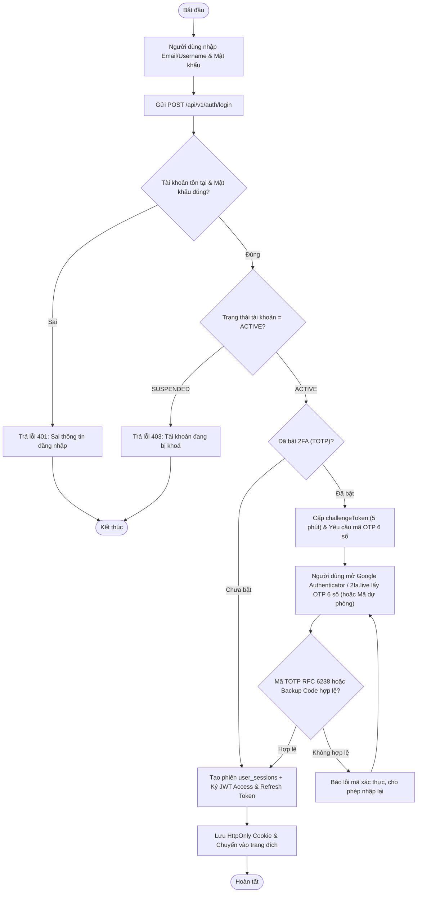
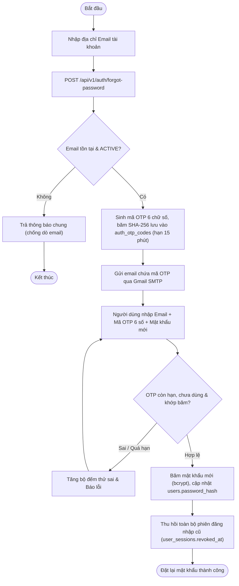
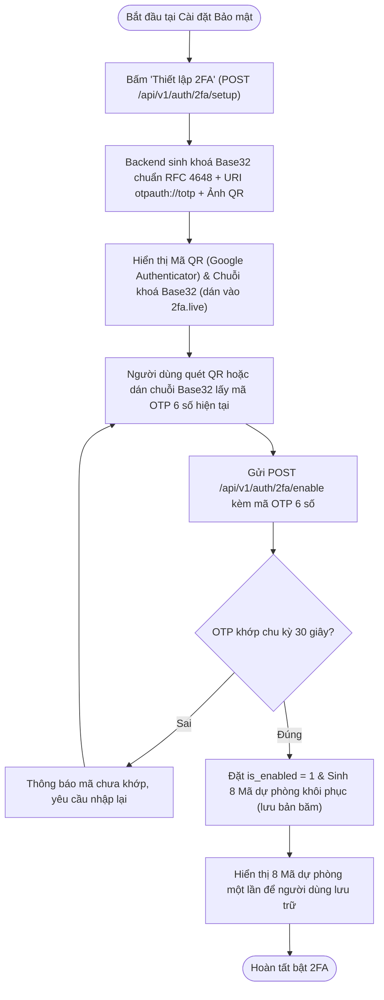
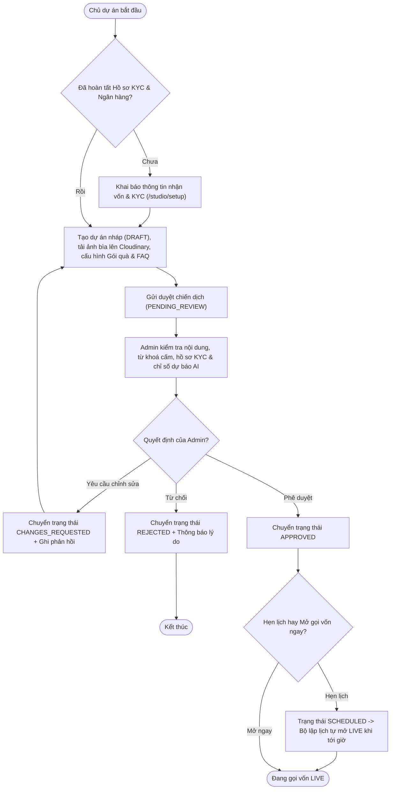
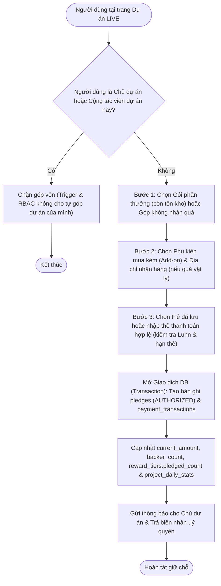
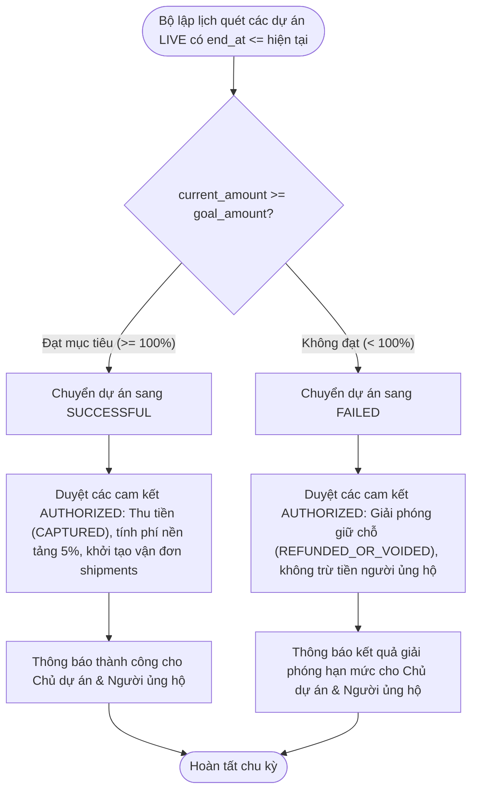
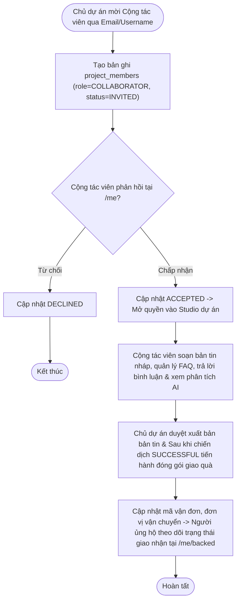

# Sơ đồ Hoạt động (Activity Diagrams — AD) — FundViet

Tài liệu đặc tả luồng hoạt động (Activity Diagrams) cho 7 quy trình nghiệp vụ cốt lõi của hệ thống FundViet.

---

## AD01 — Đăng nhập JWT kết hợp Xác thực 2 lớp (2FA TOTP Google Authenticator / 2fa.live)

---

## AD02 — Quên mật khẩu & Đặt lại mật khẩu qua Email OTP (Gmail SMTP)

---

## AD03 — Thiết lập Xác thực 2 lớp (2FA TOTP)

---

## AD04 — Khởi tạo Chiến dịch, Gửi duyệt & Phê duyệt của Quản trị viên

---

## AD05 — Góp vốn giữ chỗ All-or-Nothing (Pledge Authorization)

---

## AD06 — Tự động Chốt chiến dịch khi hết hạn (All-or-Nothing Settlement)

---

## AD07 — Cộng tác viên (Collaborator) & Thực hiện Giao quà (Fulfillment)

